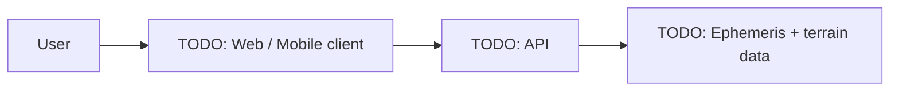

<div align="center">

# Lunar Landing Site Navigator

**Compare Moon landing sites and dates at a glance: where the Sun and Earth sit above the horizon, how long the power and direct-to-Earth communication windows last.**

[](LICENSE)
[](https://github.com/ahmetkrkyn0/NasaSpaceApp_FEZA/actions/workflows/pr-checks.yml)


[Overview](#overview) · [Getting Started](#getting-started) · [Usage](#usage) · [Architecture](#architecture) · [Contributing](#contributing)

</div>

---

> [!NOTE]
> Parts of this README are still placeholders. Replace every `TODO` once the stack and scope are fixed.

## Table of Contents

- [Overview](#overview)
- [Features](#features)
- [Tech Stack](#tech-stack)
- [Getting Started](#getting-started)
  - [Prerequisites](#prerequisites)
  - [Installation](#installation)
  - [Configuration](#configuration)
  - [Running Locally](#running-locally)
- [Usage](#usage)
- [Testing](#testing)
- [Architecture](#architecture)
- [Project Structure](#project-structure)
- [Roadmap](#roadmap)
- [Contributing](#contributing)
- [Team](#team)
- [License](#license)
- [Acknowledgements](#acknowledgements)

## Overview

Planning a landing near the lunar south pole means juggling extreme lighting and communication conditions. Small changes in location or date can decide whether solar panels get enough sunlight and whether the lander can talk to Earth directly. Existing tools (Quickmap, Moon Trek, JPL Horizons) are built for detailed analysis and are hard to use for quick what-if comparisons.

This project turns ephemeris and terrain data into a simple tool for mission planners, educators, and the public: pick sites and dates, see Sun and Earth positions relative to the horizon, and compare power and communication windows side by side.

Built by team **FEZA** for the [NASA Space Apps Challenge](https://www.spaceappschallenge.org/) 2026. The challenge text is in [docs/challenge/lunar-landing-site-navigator.md](docs/challenge/lunar-landing-site-navigator.md), data sources in [docs/challenge/resources.md](docs/challenge/resources.md).

<!-- Screenshot or demo GIF:  -->

## Features

- [ ] Choose a site from a curated list (Apollo, CLPS targets, other programs) or enter custom coordinates
- [ ] Pick landing date and time, step through lunar days
- [ ] Show Sun and Earth position relative to the local horizon
- [ ] Solar elevation, sunlight duration, time to sunset / Earthset
- [ ] Side-by-side comparison of several site-date scenarios
- [ ] TODO: 2D / 3D terrain view, timeline animation

## Tech Stack

| Layer          | Technology |
| -------------- | ---------- |
| Frontend       | React, TypeScript, Vite ([ADR-0001](docs/adr/0001-uygulama-mimarisi-ve-stack.md)) |
| Backend        | Python 3.11+, FastAPI, Uvicorn ([`backend/`](backend/README.md)) |
| Data / Ephemeris | NASA SPICE via SpiceyPy (DE440 kernels, `MOON_ME` frame), NumPy, rasterio for DEMs; JPL Horizons only for validation |
| 3D view        | Unreal Engine, developed separately ([ADR-0001](docs/adr/0001-uygulama-mimarisi-ve-stack.md), item 2) |
| Infrastructure | Local only for now; hosting is an open decision |

## Getting Started

### Prerequisites

- Python 3.11 or newer, with `pip`
- Node.js and npm (frontend)
- Git

### Installation

```bash
git clone https://github.com/ahmetkrkyn0/NasaSpaceApp_FEZA.git
cd NasaSpaceApp_FEZA
python -m pip install -e "backend[dev]"
python backend/scripts/download_kernels.py   # five SPICE kernels (~46 MB) into data/raw/kernels/
```

### Configuration

No configuration is needed for local use. Optional environment variables for the backend:

| Variable          | Description | Required | Default |
| ----------------- | ----------- | -------- | ------- |
| `FEZA_DATA_DIR`   | Folder with `sites.json`, `panel_profiles.json`, `reference_missions.json` | No | `data/` |
| `FEZA_KERNEL_DIR` | Folder with the SPICE kernels | No | `data/raw/kernels/` |

> [!WARNING]
> Never commit `.env` or any secret. It is ignored by `.gitignore`.

### Running Locally

```bash
python -m uvicorn app.main:app --app-dir backend --port 8000 --reload
# API under http://localhost:8000/api, e.g. /api/health
```

## Usage

TODO: Show the main use cases with screenshots.

## Testing

```bash
python -m pytest backend
```

The ephemeris tests need the SPICE kernels; run `python backend/scripts/download_kernels.py` first.

## Architecture

TODO: High-level description of components and how they interact. Design notes and decisions live in [`docs/`](docs/).



## Project Structure

```text
.
├── .github/          # CI workflow, PR/issue templates, CODEOWNERS
├── docs/             # Design notes, decisions (ADR), assets
│   ├── challenge/    # Challenge statement, resources, judging and submission guides
│   └── research/     # Background research notes
├── TODO              # source code folders
├── AGENTS.md         # Rules for AI coding agents
├── CHANGELOG.md
├── CLAUDE.md
├── CONTRIBUTING.md
├── LICENSE
├── NOTICE
└── README.md
```

## Roadmap

| Milestone | Goal | Status |
| --------- | ---- | ------ |
| M1 | Data pipeline: Sun/Earth position for one site and date | Planned |
| M2 | UI: site + date picker, horizon view, key metrics | Planned |
| M3 | Comparison, timeline, polish, demo video | Planned |

## Contributing

All changes reach `main` through a pull request that is squash merged.

- Branches: `<type>/<short-name>` (e.g. `feat/sun-elevation`)
- PR titles: [Conventional Commits](https://www.conventionalcommits.org/) (e.g. `feat(api): add sun position endpoint`)

Read [CONTRIBUTING.md](CONTRIBUTING.md) before opening a PR.

## Team

| Name | Role | GitHub |
| ---- | ---- | ------ |
| TODO | TODO | [@ahmetkrkyn0](https://github.com/ahmetkrkyn0) |
| TODO | TODO | [@tunadeniz1304](https://github.com/tunadeniz1304) |
| TODO | TODO | [@goktugtabak](https://github.com/goktugtabak) |
| TODO | TODO | [@OgzhnTarhn](https://github.com/OgzhnTarhn) |
| TODO | TODO | TODO |

## License

Distributed under the Apache License 2.0. See [LICENSE](LICENSE) and [NOTICE](NOTICE).

## Acknowledgements

- NASA Space Apps Challenge and the data providers listed in [docs/challenge/resources.md](docs/challenge/resources.md)
- TODO: libraries, resources, or people to credit
