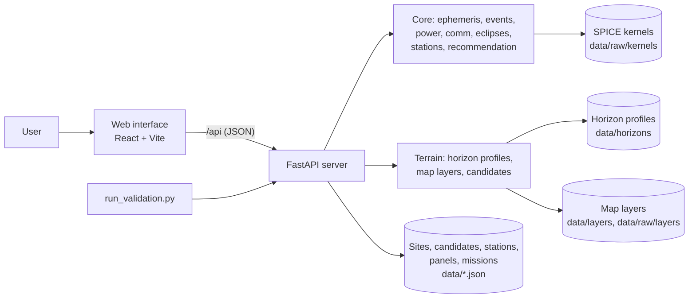

<div align="center">

# Lunar Landing Site Navigator

**Compare Moon landing sites and dates at a glance: where the Sun and Earth sit above the horizon, how long the power and direct-to-Earth communication windows last.**

[](LICENSE)
[](https://github.com/ahmetkrkyn0/NasaSpaceApp_FEZA/actions/workflows/pr-checks.yml)


[Overview](#overview) · [Getting Started](#getting-started) · [Usage](#usage) · [Validation](#validation) · [Data Sources](#data-sources-and-licences) · [Use of AI Tools](#use-of-ai-tools)

</div>

---

## Table of Contents

- [Overview](#overview)
- [Features](#features)
- [Tech Stack](#tech-stack)
- [Getting Started](#getting-started)
  - [Prerequisites](#prerequisites)
  - [Installation](#installation)
  - [Configuration](#configuration)
  - [Running Locally](#running-locally)
- [Usage](#usage)
- [Testing](#testing)
- [Validation](#validation)
- [Known Limits](#known-limits)
- [Architecture](#architecture)
- [Project Structure](#project-structure)
- [Data Sources and Licences](#data-sources-and-licences)
- [Use of AI Tools](#use-of-ai-tools)
- [Contributing](#contributing)
- [Team](#team)
- [License](#license)
- [Acknowledgements](#acknowledgements)

## Overview

Planning a landing near the lunar south pole means juggling extreme lighting and communication conditions. Small changes in location or date can decide whether solar panels get enough sunlight and whether the lander can talk to Earth directly. Existing tools (Quickmap, Moon Trek, JPL Horizons) are built for detailed analysis and are hard to use for quick what-if comparisons.

This project turns ephemeris and terrain data into a simple tool for mission planners, educators and the public: pick sites and dates, see the Sun and Earth relative to the horizon, and compare power and communication windows side by side.

Built by team **FEZA** for the [NASA Space Apps Challenge](https://www.spaceappschallenge.org/) 2026. The challenge text is in [docs/challenge/lunar-landing-site-navigator.md](docs/challenge/lunar-landing-site-navigator.md). The project page text is in [docs/submission/project-description.md](docs/submission/project-description.md).

## Features

- Ten catalogue sites (past landings and the IM-2 target on Mons Mouton), twelve candidate regions on Mons Mouton, or any custom latitude and longitude
- Any date in the ephemeris range, with a timeline to step through the lunar day
- Sun and Earth as disks on a horizon strip, against a terrain horizon at the south polar sites
- Sunrise, sunset, earthrise and earthset to the second, each with a one-arcminute sensitivity range
- Countdown to the next sunset or Earthset
- Hourly solar panel power for four panel set-ups, with energy, sunlit share and longest dark period
- Direct-to-Earth communication windows and a "relay required" label where Earth never rises
- Earth link view: when each Deep Space Network complex (Goldstone, Madrid, Canberra) sees the Moon, and which periods have a direct link, no station in view, or need a relay because Earth is below the site's horizon
- Eclipses (Earth covering the Sun) and the power drop they cause
- Side-by-side comparison of two to four scenarios, with "why" cards that change one input at a time
- Map layers around the south pole: hillshade, elevation, slope, permanently shadowed regions
- Candidate regions picked from the 20 m slope and permanent shadow maps of Mons Mouton, each with a terrain horizon
- Site recommendation: choose weights, a slope limit and a permanent shadow preference, and the candidate regions and catalogue sites of the region are ranked, every score shown with its components; the score ranks sites, it does not certify a landing site
- Three entry points on one engine: Plan (engineers), Explore (public), Classroom (educators)
- A validity label on every result; assumed values (flat horizon, panel profiles) are marked as such
- Dark theme by default and an optional light theme from the top bar, with contrast checked by tests
- Pre-rendered Unreal Engine illustrations of the three kinds of landing terrain and the Deep Space Network ground stations, always labelled "Illustration" ([credits](frontend/public/media/CREDITS.md))

## Tech Stack

| Layer | Technology |
| ----- | ---------- |
| Web interface | React, TypeScript, Vite ([ADR-0001](docs/adr/0001-uygulama-mimarisi-ve-stack.md)) |
| Server | Python 3.11+, FastAPI, Uvicorn ([`backend/`](backend/README.md)) |
| Ephemeris | NASA NAIF SPICE through SpiceyPy (DE440, `MOON_ME` frame); JPL Horizons only for validation |
| Terrain | LOLA height maps (PGDA product 90) read with rasterio; NumPy for ray casting |
| 3D model | Blender script for the IM-2 Athena lander ([`shipmodel/`](shipmodel/README.md)) |
| Illustrations | Unreal Engine 5.8, offline renders only; it does not run in the product ([ADR-0001](docs/adr/0001-uygulama-mimarisi-ve-stack.md)) |

## Getting Started

### Prerequisites

- Python 3.11 or newer, with `pip`
- Node.js 20.19 or newer (or 22.12 or newer), with npm
- Git
- Internet access for the first set-up (SPICE kernels, about 46 MB)

> [!IMPORTANT]
> Clone into a folder whose full path has only ASCII characters (for example `C:\projects\NasaSpaceApp_FEZA`, not under a user folder such as `C:\Users\Oğuzhan\...`). The SPICE library cannot open kernel files on a path with non-ASCII characters: the kernels download, but `/api/health` reports `kernels_loaded: false` and the ephemeris tests fail.

### Installation

From a fresh clone, in the repository root:

```bash
git clone https://github.com/ahmetkrkyn0/NasaSpaceApp_FEZA.git
cd NasaSpaceApp_FEZA
```

```bash
python -m pip install -e "backend[dev]"
```

```bash
python backend/scripts/download_kernels.py
```

```bash
npm ci --prefix frontend
```

`npm ci` installs the exact versions from `frontend/package-lock.json`. The kernel script downloads five SPICE files into `data/raw/kernels/` and skips files that are already there (`--force` downloads them again). A virtual environment (`python -m venv .venv`) is recommended but not required.

Map layers ship with the repository: `data/layers/` holds the four Mons Mouton layers at 40 m (2 × 2 blocks of the 20 m maps, 4 MB in total), so the map works on a clean checkout. Optional, for full resolution: `python backend/scripts/make_layers.py` reads the 20 m windows from the PGDA 90 maps over the network into `data/raw/layers/`; the server uses them when present. `python backend/scripts/make_layers.py --bundle` rebuilds `data/layers/` from them.

### Configuration

No configuration is needed for local use. Optional settings:

| Variable | Where | Description | Default |
| -------- | ----- | ----------- | ------- |
| `FEZA_DATA_DIR` | server | Folder with `sites.json`, `panel_profiles.json`, `reference_missions.json` | `data/` |
| `FEZA_KERNEL_DIR` | server | Folder with the SPICE kernels | `data/raw/kernels/` |
| `VITE_DATA_MODE` | interface | `live` reads the server; anything else reads the example files in `data/examples/` | example files |

> [!WARNING]
> Never commit `.env` or any secret. It is ignored by `.gitignore`.

### Running Locally

Start the server, then the interface, each in its own terminal:

```bash
python -m uvicorn app.main:app --app-dir backend --port 8000 --reload
```

```bash
npm --prefix frontend run dev
```

Open <http://127.0.0.1:5173/?data=live>. The development server forwards `/api` to port 8000. Without `?data=live` (or `VITE_DATA_MODE=live`) the interface shows the example payloads from `data/examples/`, which is useful when the server is not running.

The API answers under <http://127.0.0.1:8000/api>, for example `/api/health` and `/api/sites`. FastAPI's interactive documentation is at <http://127.0.0.1:8000/docs>.

## Usage

1. Pick a site from the list, or enter a latitude and longitude.
2. Pick a date and time. The horizon strip shows where the Sun and Earth are; the timeline shows sunlit, dark, Earth-visible and Earth-hidden windows.
3. Choose a panel set-up and a mast height to see hourly power and the energy over the range.
4. Add scenarios (another site, another date) and open the comparison to see them side by side, with the best value per metric and a "why" card for each difference.
5. In the Plan door, open **Site recommendation**, set the weights and limits and rank the Mons Mouton sites for the active period and mast; use a ranked site as the scenario or add the top three to the comparison.
6. Open the **Comms** tab (the **Earth link** panel in Plan, **Talking to Earth** in Explore and Classroom) to see the link windows over the period, which ground stations see the Moon at the selected moment, and when a relay would be needed.
7. Switch between Plan, Explore and Classroom for the same scenario at a different level of detail.

Main endpoints ([ADR-0004](docs/adr/0004-api-uc-noktalari.md)):

| Endpoint | Returns |
| -------- | ------- |
| `/api/sky-series` | Sun and Earth azimuth, elevation, distance and apparent radius over time |
| `/api/body-series` | Sub-solar and sub-Earth points on the Moon (`MOON_ME`) and the Earth distance over time |
| `/api/events` | Rise and set events, windows, summary metrics, eclipses and the relay label |
| `/api/now`, `/api/comm-window` | State at an instant and time to the next change |
| `/api/power` | Hourly panel power and summary |
| `/api/compare` | Two to four scenarios with per-metric differences |
| `/api/horizon`, `/api/layers/{name}` | Horizon profile of a site; map layers |
| `/api/candidates` | Candidate regions of a region and the catalogue sites inside it; candidate ids work as `site_id` everywhere |
| `/api/recommend` | Weighted score and ranking of the candidate regions (and catalogue sites), with components and eliminated sites |
| `/api/ground-stations`, `/api/earth-link` | Deep Space Network stations with coordinate sources; station view and link windows (`direct`, `no_station`, `relay_needed`) |
| `/api/eclipses` | Earth covering the Sun |
| `/api/validation` | The validation report |

## Testing

```bash
python -m pytest backend
```

```bash
npm --prefix frontend run typecheck
```

```bash
npm --prefix frontend run test
```

```bash
npm --prefix frontend run build
```

The server tests need the SPICE kernels; run `python backend/scripts/download_kernels.py` first.

`python backend/scripts/smoke_api.py --in-process` calls every endpoint for every catalogue site and candidate region and exits with an error if any answer is not 200; without `--in-process` it calls a server on port 8000.

## Validation

`python backend/scripts/run_validation.py --in-process` runs the reference tests of [docs/PLAN.md, 4.2](docs/PLAN.md) against the endpoints without a separate server and writes [`data/validation_report.json`](data/validation_report.json) and [`docs/validation-report.md`](docs/validation-report.md). Without `--in-process` it calls a server on port 8000. The first run also reads one NASA map window over the network for the approximate comparison T6; `--no-t6` skips it.

Every expected value in the report comes from a row marked verified in [`docs/research/dogrulama/`](docs/research/dogrulama/), and thresholds are never relaxed. The current run ([`docs/validation-report.md`](docs/validation-report.md)) has 69 passing checks, no failures and one approximate comparison (T6); T8 checks the sub-solar and sub-Earth points against JPL Horizons and T9 the limits of the candidate regions. The project page text summarises the tests: [docs/submission/project-description.md](docs/submission/project-description.md).

## Known Limits

- **Terrain horizon only at four sites and the candidate regions.** Precomputed terrain horizons exist only for the catalogue sites inside the south polar height maps (Mons Mouton, IM-2 Athena, IM-1 Odysseus, Chandrayaan-3) and the twelve candidate regions on Mons Mouton, at 2 m and 10 m masts. All other sites, custom coordinates and mast heights use a flat horizon, labelled `SYNTHETIC` and shown as "Assumed, terrain not included".
- **Panel profiles are assumptions.** Area, efficiency and mounting are generic values, labelled `SYNTHETIC`.
- **Accident causes are not computed.** Past missions show the measured environment; causes are quoted only from official sources with an evidence label.
- **Relay satellites are not modelled.** The relay label and the link view's "relay needed" only say that Earth is not in line of sight; the relay drawn in the link schematic is labelled "Illustration".
- **Station view is simplified.** Ground station visibility is computed for the Moon's centre, not for the site, with Earth's rotation from the `IAU_EARTH` model (no nutation, no UT1 correction); the 10° minimum station elevation is an assumption.
- **The score is not a landing safety guarantee.** It ranks sites for the weights the user chose. The 12° slope limit is the Apollo lunar module's landing limit (SP-2013-605, [verified in gorev-araclari.md, row 89](docs/research/dogrulama/gorev-araclari.md)); the other thresholds are assumptions and are marked as such.
- **No rocks or small craters.** Candidate regions and their scores come from 20 m maps; boulders and craters smaller than a cell are not in the data.
- **Eclipses** treat Earth as a sharp disk and the Sun as uniformly bright.
- **Terrain horizon accuracy** is compared with NASA's illumination map only approximately (T6).
- **Illustrations are not the product's calculation.** The images were rendered in Unreal Engine for one recorded moment per scene, with the Sun and Earth directions of that moment from JPL DE421; they are not computed for the chosen site and moment, and the terrain is procedural. An image shows a kind of terrain, not the ground at the chosen site. There is no live 3D view.

## Architecture



All computation happens on the server; the interface only formats the server's numbers. Contracts: [ADR-0002](docs/adr/0002-koordinat-sistemi-ve-zaman.md) (frames, time, angles), [ADR-0003](docs/adr/0003-veri-sozlesmesi.md) (data shapes), [ADR-0004](docs/adr/0004-api-uc-noktalari.md) (endpoints). Design notes are in [docs/design/](docs/design/).

## Project Structure

```text
.
├── backend/              # FastAPI server: app/ (api, core, models, terrain), scripts/, tests/
├── frontend/             # React + TypeScript + Vite web interface
├── frontend-migrate/     # Reference interface design export (layout, tokens)
├── data/
│   ├── sites.json        # Site catalogue with coordinate sources
│   ├── panel_profiles.json
│   ├── reference_missions.json
│   ├── candidates.json   # Candidate regions on Mons Mouton
│   ├── ground_stations.json  # Deep Space Network stations with coordinate sources
│   ├── horizons/         # Precomputed terrain horizon profiles
│   ├── layers/           # Map layers at 40 m, used when data/raw/layers is absent
│   ├── examples/         # One example payload per endpoint, test vectors
│   ├── validation_report.json
│   └── raw/              # Downloaded kernels and layers (not committed)
├── docs/                 # Plan, ADRs, design notes, research, submission text
├── shipmodel/            # IM-2 Athena lander model and its Blender build script
├── public/assets/        # Images used in the docs
├── AGENTS.md             # Rules for AI coding agents
├── CHANGELOG.md
├── CONTRIBUTING.md
├── LICENSE
└── NOTICE
```

## Data Sources and Licences

Data the code actually uses:

| Data | Used for | Source |
| ---- | -------- | ------ |
| SPICE kernels: `de440s.bsp`, `moon_pa_de440_200625.bpc`, `moon_de440_250416.tf`, `pck00011.tpc`, `naif0012.tls` | Sun and Earth positions and sizes; Earth's rotation for the ground stations | NASA NAIF generic kernels, <https://naif.jpl.nasa.gov/pub/naif/generic_kernels/> |
| LOLA height maps `LDEM_80S_20MPP_ADJ` (20 m) and `LDEM_60S_60MPP_ADJ` (60 m) | Terrain horizon profiles of the south polar sites and candidate regions, elevation layer | NASA GSFC PGDA product 90, <https://pgda.gsfc.nasa.gov/products/90> |
| `LDEM_80S_20MPP_ADJ_HILL`, `LDSM_80S_20MPP_ADJ`, `LPSR_80S_20MPP_ADJ` | Hillshade, slope and permanent shadow layers; candidate regions and their slope and shadow values | NASA GSFC PGDA product 90 |
| `AVGVISIB_75S_120M_201608` | Approximate comparison T6 (validation only) | NASA GSFC PGDA product 69, <https://pgda.gsfc.nasa.gov/products/69> |
| Deep Space Network station coordinates (DSS 14, DSS 63, DSS 43) | Ground station view in the Earth link | NASA/JPL DSN Telecommunications Link Design Handbook 810-005, module 301, Rev. P, <https://deepspace.jpl.nasa.gov/dsndocs/810-005/301/301P.pdf> |
| Site coordinates | Site catalogue | NASA NSSDC lunar artifact table; LROC site releases; each site's source is in `data/sites.json` |
| JPL Horizons | Reference values for tests only; never called at run time | <https://ssd.jpl.nasa.gov/horizons/> |

The kernels and full resolution layers are downloaded by scripts and never committed; only the downsampled layers in `data/layers/` are. NASA data is used under NASA's media and data guidelines; no NASA logo or insignia is used anywhere in the project.

Main open source dependencies and their licences, read from the installed package metadata (this closes the open point in [ADR-0001](docs/adr/0001-uygulama-mimarisi-ve-stack.md)):

| Package | Licence |
| ------- | ------- |
| SpiceyPy | MIT |
| FastAPI | MIT |
| Pydantic | MIT |
| Uvicorn | BSD-3-Clause |
| Starlette | BSD-3-Clause |
| NumPy | BSD-3-Clause (bundled parts: 0BSD, MIT, Zlib, CC0-1.0) |
| rasterio | BSD |
| React, Vite, Vitest | MIT |
| TypeScript | Apache-2.0 |

All are compatible with this project's Apache 2.0 licence.

### Illustration media

The images and short loops in [`frontend/public/media/`](frontend/public/media/) are offline Unreal Engine renders, shown in the interface as labelled illustrations, not as the product's calculation. They cover Moon surface scenes, the three Deep Space Network ground stations and an Earth globe. The lander in the surface scenes is the team's own Athena model ([`shipmodel/`](shipmodel/README.md), no third-party parts).

Who prepared each image group, the other tools used, and the source and licence of every texture and model are kept in one place, [`frontend/public/media/CREDITS.md`](frontend/public/media/CREDITS.md); that credit information is being completed.

## Use of AI Tools

The NASA Space Apps rules ask teams to say where and how AI tools were used.

- **Code and documents:** most source code, tests and documentation were written with AI coding assistants: Claude (Anthropic) through Claude Code, one session per team member. Each task was defined in a GitHub issue with its scope and acceptance criteria. A separate Claude session coordinated the tasks and reviewed the pull requests (a few after they were merged); OpenAI Codex was used for code review on most code changes. Team members merged the pull requests by hand. The rules the agents follow are in [AGENTS.md](AGENTS.md).
- **Research:** the notes in [docs/research/](docs/research/) were drafted with AI assistance. Each claim the product relies on was checked against its source and labelled in [docs/research/dogrulama/](docs/research/dogrulama/); only verified values are used.
- **Images:** three AI-generated (Grok) rover concept images, `public/assets/grok-*.jpg`, appear in one research note. They are not part of the product or the demo.
- **Illustration media:** the images in `frontend/public/media/` were rendered in Unreal Engine 5.8. Who prepared them and any other tools used in making them, AI tools included, are recorded in [`frontend/public/media/CREDITS.md`](frontend/public/media/CREDITS.md); that credit information is being completed.
- **Data:** no data is AI-generated. Positions come from SPICE, terrain from LOLA, reference values from JPL Horizons and published sources.

## Contributing

All changes reach `main` through a pull request that is squash merged.

- Branches: `<type>/<short-name>` (e.g. `feat/sun-elevation`)
- PR titles: [Conventional Commits](https://www.conventionalcommits.org/) (e.g. `feat(api): add sun position endpoint`)

Read [CONTRIBUTING.md](CONTRIBUTING.md) before opening a PR.

## Team

| Name | Work in this project | GitHub |
| ---- | -------------------- | ------ |
| Oğuzhan Tarhan | Server core: Sun and Earth positions, events, power, communication, comparison, eclipses | [@OgzhnTarhn](https://github.com/OgzhnTarhn) |
| Tuna Deniz | Data and terrain: site catalogue, horizon profiles, map layers, validation run | [@tunadeniz1304](https://github.com/tunadeniz1304) |
| Göktuğ Tabak | Interface shell and views: layout, horizon strip, timeline, map; task coordination | [@goktugtabak](https://github.com/goktugtabak) |
| Ahmet Karakoyun | Interface data, panels and content: scenario state, set-up, power, comms, comparison | [@ahmetkrkyn0](https://github.com/ahmetkrkyn0) |

## License

Distributed under the Apache License 2.0. See [LICENSE](LICENSE) and [NOTICE](NOTICE).

## Acknowledgements

- NASA Space Apps Challenge and the data providers listed in [docs/challenge/resources.md](docs/challenge/resources.md)
- NASA NAIF for the SPICE toolkit and kernels, and the LOLA team at NASA GSFC for the polar height maps
- The Canadian Space Agency for the public pages behind the CSA information cards
