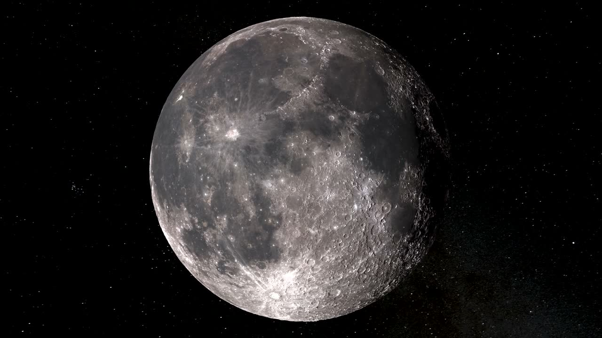
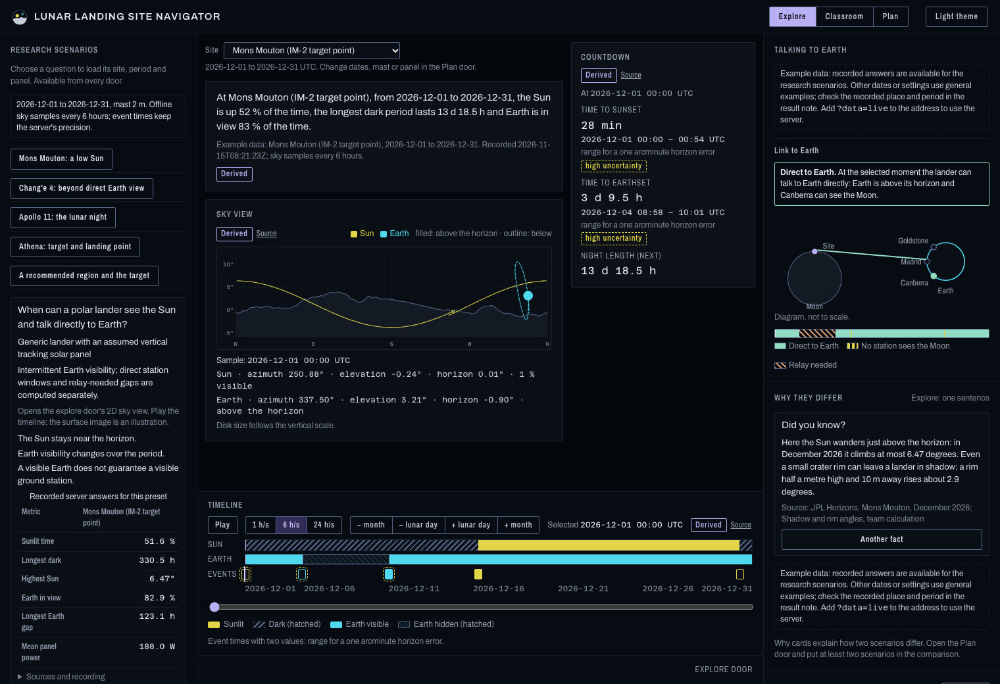
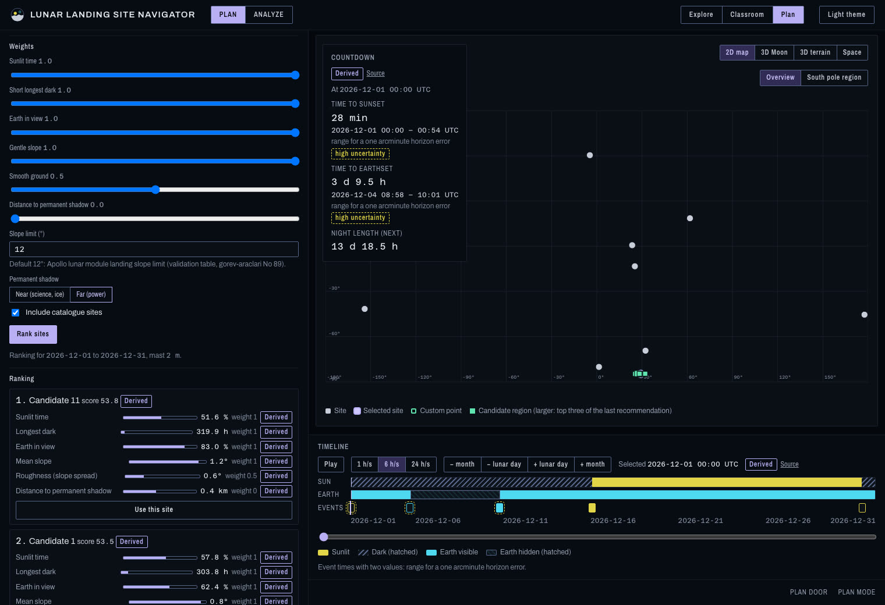

<div align="center">

[English](README.md) · **Türkçe**



<sub>İllüstrasyon: NASA Scientific Visualization Studio, "Lunar Near and Far Side Phases" (ID 14992); uygulamanın açılış ekranındaki animasyon.</sub>

# Lunar Landing Site Navigator

### İniş aracınız Güneş'i görecek mi, Dünya'yla konuşabilecek mi?

Ay'ın güney kutbunda Güneş hiç yükselmez. Aralık 2026'da Mons Mouton'da ufkun en fazla **6,47°** üzerine çıkar ve Dünya **bir seferde yaklaşık beş gün** görünmez olabilir. Bir saha ve tarih seçin; NASA verisiyle hesaplanan güç ve iletişim pencerelerini tarayıcınızda yan yana görün.

[](LICENSE)
[](https://github.com/ahmetkrkyn0/NasaSpaceApp_FEZA/actions/workflows/pr-checks.yml)


**[▶ Demo: sunum ve 30 saniyelik video](https://drive.google.com/drive/folders/1YRAIZKT6ozyZFqt9GNfwpi4g6wL1GMvq?usp=sharing)**

[Genel bakış](#genel-bakış) · [Kurulum](#kurulum) · [Kullanım](#kullanım) · [Doğrulama](#doğrulama) · [Veri kaynakları](#veri-kaynakları-ve-lisanslar) · [Yapay zekâ kullanımı](#yapay-zekâ-araçlarının-kullanımı)

</div>

> Bu sayfa İngilizce [README.md](README.md) dosyasının Türkçe sürümüdür. Ürünün arayüzü, proje sayfası metni ve sunum İngilizcedir. Uç nokta listesi, mimari şema, dizin yapısı ve lisans tabloları gibi teknik ayrıntılar İngilizce sürümdedir.

## Bir bakışta

| | |
| --- | --- |
| **Sahalar** | 10 katalog inişi (Apollo 11, CLPS, Chang'e, Chandrayaan-3, SLIM, Hakuto-R) + Mons Mouton'da 12 aday bölge + istenen her enlem ve boylam |
| **Fizik** | NASA NAIF SPICE (DE440, `MOON_ME`), 150 km'ye uzanan 720 ışınla LOLA arazi ufku, saniye hassasiyetinde olaylar |
| **Yanıtlar** | Ufukta Güneş ve Dünya, güneşli ve karanlık pencereler, panel gücü, Deep Space Network bağlantısı, tutulmalar, sıralı saha önerisi |
| **Görünümler** | 2B harita · dokulu 3B Ay · 3B arazi · Dünya–Ay sahnesi |
| **Kitleler** | Plan (mühendisler) · Explore (halk) · Classroom (eğitimciler), tek ortak motor |
| **Güven** | JPL Horizons ve yayımlanmış değerlere karşı 113 referans denetimi geçiyor; her sonuç ölçülmüş, türetilmiş ya da varsayılmış olduğunu söylüyor |

<table>
<tr>
<td width="50%"></td>
<td width="50%"></td>
</tr>
<tr>
<td><sub><b>Explore:</b> Mons Mouton ufkunda Güneş ve Dünya, geri sayım, bir aylık güneşli ve Dünya görünür pencereler ve şu an Dünya ile kimin konuşabildiği.</sub></td>
<td><sub><b>Plan:</b> sizin ağırlıklarınızla sıralanan aday bölgeler; puanın her parçası güvenilirlik etiketiyle.</sub></td>
</tr>
</table>

<sub>Çalışan uygulamanın örnek kipteki ekran görüntüleri (sunucunun kayıtlı yanıtları, Aralık 2026).</sub>

---

## Genel bakış

Ay'ın güney kutbuna iniş planlamak, aşırı ışık ve iletişim koşullarıyla uğraşmak demektir. Konumda ya da tarihte küçük bir değişiklik, güneş panellerinin yeterli ışık alıp almayacağını ve iniş aracının Dünya ile doğrudan konuşup konuşamayacağını belirleyebilir. Mevcut araçlar (Quickmap, Moon Trek, JPL Horizons) ayrıntılı analiz için tasarlanmıştır ve hızlı "ya şöyle olursa" karşılaştırmaları için kullanışlı değildir.

Bu proje, efemeris ve arazi verisini görev planlayıcıları, eğitimciler ve halk için basit bir araca dönüştürür: saha ve tarih seçin, Güneş ile Dünya'nın ufka göre konumunu görün, güç ve iletişim pencerelerini yan yana karşılaştırın.

**FEZA** takımı tarafından [NASA Space Apps Challenge](https://www.spaceappschallenge.org/) 2026 için geliştirildi. Challenge metni: [docs/challenge/lunar-landing-site-navigator.md](docs/challenge/lunar-landing-site-navigator.md).

## Özellikler

- On katalog sahası (geçmiş inişler ve Mons Mouton'daki IM-2 hedefi), Mons Mouton'da on iki aday bölge ya da istenen her enlem ve boylam
- Efemerisin kapsadığı her tarih; ay gününü adım adım izleyen bir zaman çubuğu
- Ufuk şeridinde disk olarak Güneş ve Dünya; güney kutbu sahalarında gerçek arazi ufkuna karşı
- Saniye hassasiyetinde gün doğumu, gün batımı, Dünya doğuşu ve batışı; her birinde bir yay dakikalık duyarlılık aralığı
- Bir sonraki gün batımına ya da Dünya batışına geri sayım
- Dört panel düzeni için saatlik güneş paneli gücü; enerji, güneşli pay ve en uzun karanlık süre
- Dünya ile doğrudan iletişim pencereleri; Dünya'nın hiç doğmadığı yerlerde "relay required" etiketi
- Dünya bağlantı görünümü: her Deep Space Network istasyonunun (Goldstone, Madrid, Canberra) Ay'ı ne zaman gördüğü; doğrudan bağlantı, görünür istasyon olmaması ya da Dünya ufkun altındayken röle gereken dönemler
- Tutulmalar (Dünya'nın Güneş'i örtmesi) ve yol açtıkları güç düşüşü
- İki ile dört senaryonun yan yana karşılaştırması; her seferinde tek bir girdiyi değiştiren "why" kartları
- Güney kutbu çevresinde harita katmanları: gölgeli kabartma, yükseklik, eğim, kalıcı gölge bölgeleri
- 3B Ay: NASA CGI Moon Kit renk haritasıyla kaplı, seçili an için sunucunun hesapladığı Güneş yönünden aydınlatılan, Dünya'nın tam tepede olduğu noktası işaretli bir küre; "Even light" seçeneği hesaplanan aydınlatma olmadığını belirterek tüm yüzü gösterir
- 3B arazi: Mons Mouton bölgesi yükseklik katmanından kurulan bir yüzey olarak (yükseklikler üç kat abartılı ve katsayı ekranda); kabartma, eğim ya da kalıcı gölgeyle renklendirilir, seçili sahadaki Güneş yönünden aydınlatılır
- Dünya–Ay sahnesi: üç Deep Space Network istasyonu, sahada ekibin Athena modeli, bağlantı doğrudanken Ay'ı gören istasyonlara bir çizgi, Dünya ufkun altındayken "Illustration" etiketli röle yolu; Dünya'nın yönü ve dönüşü sunucudan, uzaklıklar ve boyutlar ölçeksiz
- Beş hazır araştırma sorusu (alçak kutup Güneşi, Ay'ın arka yüzü, ay gecesi, Athena'nın hedefi ve iniş noktası, önerilen bölgeye karşı hedef); tek tıkla saha, dönem ve kapı yüklenir
- Mons Mouton'un 20 m eğim ve kalıcı gölge haritalarından seçilen aday bölgeler, her biri arazi ufkuyla
- Saha önerisi: ağırlıkları, eğim sınırını ve kalıcı gölge tercihini seçin; aday bölgeler ve bölgedeki katalog sahaları sıralanır, her puan bileşenleriyle gösterilir. Puan sıralar, iniş sahasını onaylamaz
- Tek motor üzerinde üç giriş: Plan (mühendisler), Explore (halk), Classroom (eğitimciler); Explore'da iniş penceresi oyunu, Classroom'da yönlendirmeli görevler
- Kendi adreslerinde rol sayfaları: `#/start` üç rolü kart olarak sunar; `#/public`, `#/educator` ve `#/engineer` ilgili kapıyı açan tek sayfalık birer özettir
- Her sonuçta bir güvenilirlik etiketi; varsayılan değerler (düz ufuk, panel profilleri) öyle işaretlenir
- Varsayılan koyu tema ve üst çubuktan açık tema; kontrast testlerle denetlenir
- Sunucusuz örnek kip: Aralık 2026 için her katalog sahası ve aday bölgede canlı sunucunun kayıtlı yanıtları; başka seçimlerde eşleşmediğini söyleyen genel örnek
- Üç iniş arazisi türünün ve Deep Space Network istasyonlarının önceden hazırlanmış Unreal Engine illüstrasyonları, her zaman "Illustration" etiketiyle ([künye](frontend/public/media/CREDITS.md))
- Açılış ekranı: ürün adının arkasında NASA'nın Ay'ın yakın ve uzak yüz evreleri animasyonu (NASA SVS 14992), "Illustration" etiketiyle; hareket azaltma tercihinde yalnızca durağan bir kare

## Teknoloji

| Katman | Teknoloji |
| ----- | ---------- |
| Web arayüzü | React, TypeScript, Vite; 3B görünümler için three.js (yalnızca bir 3B görünüm açılınca yüklenir) |
| Sunucu | Python 3.11+, FastAPI, Uvicorn ([`backend/`](backend/README.md)) |
| Efemeris | SpiceyPy üzerinden NASA NAIF SPICE (DE440, `MOON_ME`); JPL Horizons yalnızca doğrulamada |
| Arazi | rasterio ile okunan LOLA yükseklik haritaları (PGDA ürün 90); ışın izleme için NumPy |
| 3B model | IM-2 Athena iniş aracı için Blender betiği ([`shipmodel/`](shipmodel/README.md)) |
| İllüstrasyonlar | Yalnızca çevrimdışı Unreal Engine 5.8 görüntüleri; üründe çalışmaz |

## Kurulum

Gerekenler: Python 3.11 ya da üstü, Node.js 20.19 ya da üstü (veya 22.12+), Git ve ilk kurulum için internet (SPICE çekirdekleri, yaklaşık 46 MB).

> [!IMPORTANT]
> Depoyu yolunda yalnızca ASCII karakter olan bir klasöre klonlayın (ör. `C:\projects\NasaSpaceApp_FEZA`; `C:\Users\Oğuzhan\...` gibi değil). SPICE kütüphanesi ASCII dışı karakterli yollardan çekirdek dosyalarını açamaz.

```bash
git clone https://github.com/ahmetkrkyn0/NasaSpaceApp_FEZA.git
cd NasaSpaceApp_FEZA
python -m pip install -e "backend[dev]"
python backend/scripts/download_kernels.py
npm ci --prefix frontend
```

Sunucuyu ve arayüzü ayrı terminallerde başlatın:

```bash
python -m uvicorn app.main:app --app-dir backend --port 8000 --reload
```

```bash
npm --prefix frontend run dev
```

<http://127.0.0.1:5173/?data=live> adresini açın. `?data=live` olmadan arayüz sunucunun kayıtlı yanıtlarını (`data/examples/recorded/`) gösterir; sunucu çalışmıyorsa işe yarar. Örnek kip hesap yapmaz.

## Kullanım

1. Listeden bir saha seçin ya da enlem ve boylam girin.
2. Tarih ve saat seçin. Ufuk şeridi Güneş ile Dünya'nın yerini, zaman çubuğu güneşli, karanlık, Dünya görünür ve Dünya gizli pencereleri gösterir.
3. Saatlik gücü ve dönem boyunca enerjiyi görmek için panel düzenini ve direk yüksekliğini seçin.
4. Senaryo ekleyin (başka saha, başka tarih) ve karşılaştırmayı açın; her ölçüde en iyi değer ve her fark için bir "why" kartı görünür.
5. Plan kapısında **Site recommendation** panelini açın, ağırlıkları ve sınırları ayarlayıp Mons Mouton sahalarını sıralayın.
6. Dönem boyunca bağlantı pencerelerini ve seçili anda Ay'ı gören yer istasyonlarını görmek için **Comms** sekmesini açın.
7. Haritayı **3D Moon**, **3D terrain** ya da **Space** görünümüne geçirin; Space görünümünde **Moon**, **Earth** ve **Link** düğmeleri kamerayı taşır.
8. Hazır bir soruyu sahası, dönemi ve kaynaklarıyla yüklemek için herhangi bir kapıdan bir **research scenario** açın.
9. Aynı senaryoyu farklı ayrıntı düzeyinde görmek için Plan, Explore ve Classroom arasında geçin.

## Testler

```bash
python -m pytest backend
npm --prefix frontend run typecheck
npm --prefix frontend run test
npm --prefix frontend run build
```

Sunucu testleri SPICE çekirdeklerine ihtiyaç duyar; önce `python backend/scripts/download_kernels.py` çalıştırın.

## Doğrulama

`python backend/scripts/run_validation.py --in-process`, referans testlerini ayrı bir sunucu olmadan uç noktalara karşı çalıştırır ve [`data/validation_report.json`](data/validation_report.json) ile [`docs/validation-report.md`](docs/validation-report.md) dosyalarını yazar.

Rapordaki her beklenen değer, [`docs/research/dogrulama/`](docs/research/dogrulama/) tablolarında doğrulanmış olarak işaretli bir satırdan gelir ve eşikler hiçbir zaman gevşetilmez. 15 Kasım 2026 tarihli son koşu: **113 denetim geçti, hata yok**, bir yaklaşık karşılaştırma (T6). Öne çıkanlar:

- Altı geçmiş inişte Güneş ve Dünya'nın azimut ve yüksekliği JPL Horizons'a karşı: 15'i de 0,01° içinde, en büyük fark 0,0049°.
- Ay üzerindeki Güneş altı ve Dünya altı noktaları dört anda JPL Horizons'a karşı: en büyük fark 0,0056° (sınır 0,01°).
- Üç Deep Space Network istasyonunda Ay'ın yüksekliği 19 anda JPL Horizons'a karşı: en büyük fark 0,071° (sınır 0,1°).
- Aynı bir yay dakikalık ufuk değişikliği gün doğumunu Mons Mouton'da 23,1 dakika, Apollo 11'de 1,98 dakika kaydırır: kutupta küçük değişikliklerin neden büyük sonuç doğurduğunu gösterir.

## Bilinen sınırlar

- **Arazi ufku yalnızca dört sahada ve aday bölgelerde.** Diğer sahalar ve özel koordinatlar düz ufuk kullanır ve "Assumed, terrain not included" olarak etiketlenir.
- **Panel profilleri varsayımdır.** Alan, verim ve montaj genel değerlerdir.
- **Kaza nedenleri hesaplanmaz.** Geçmiş görevler için ortam ölçülür; nedenler yalnızca resmî kaynaklardan kanıt etiketiyle aktarılır.
- **Röle uyduları modellenmez.** "Relay needed" yalnızca Dünya'nın görüş hattında olmadığını söyler; şemadaki röle "Illustration" etiketli bir çizimdir.
- **İstasyon görünümü basitleştirilmiştir.** Görünürlük sahaya değil Ay'ın merkezine göre hesaplanır; en az 10° istasyon yüksekliği bir varsayımdır.
- **Puan bir iniş güvenliği garantisi değildir.** Kullanıcının seçtiği ağırlıklara göre sıralar. 12° eğim sınırı Apollo ay modülünün iniş sınırıdır; diğer eşikler varsayımdır ve öyle işaretlenir.
- **Kaya ve küçük kraterler yoktur.** Aday bölgeler 20 m haritalardan gelir; bir hücreden küçük kaya ve kraterler veride yoktur.
- **3B görünümler çizer, hesaplamaz.** 3B Ay'ın yüzey görüntüsü yön bulmak içindir; gölge düşürülmez. 3B arazi yükseklikleri üç kat abartır. Dünya–Ay sahnesinde uzaklıklar ve boyutlar sıkıştırılmıştır, yıldızlar süs amaçlıdır.
- **Örnek kip canlı hesap değildir.** Sunucu olmadan Aralık 2026 için kayıtlı yanıtlar gösterilir.
- **İllüstrasyonlar ürünün hesabı değildir.** Görüntüler her sahnenin kendi kayıtlı anı için Unreal Engine'de üretilmiştir; seçilen saha ve an için hesaplanmamıştır.

## Veri kaynakları ve lisanslar

| Veri | Kullanım | Kaynak |
| ---- | -------- | ------ |
| SPICE çekirdekleri (DE440, Ay yönelimi, artık saniyeler) | Güneş ve Dünya konumları; yer istasyonları için Dünya'nın dönüşü | NASA NAIF, <https://naif.jpl.nasa.gov/pub/naif/generic_kernels/> |
| LOLA yükseklik, eğim, kabartma ve kalıcı gölge haritaları | Arazi ufukları, harita katmanları, 3B arazi, aday bölgeler | NASA GSFC PGDA ürün 90, <https://pgda.gsfc.nasa.gov/products/90> |
| LOLA ortalama görünürlük haritası | Yaklaşık karşılaştırma T6 (yalnızca doğrulama) | NASA GSFC PGDA ürün 69, <https://pgda.gsfc.nasa.gov/products/69> |
| Deep Space Network istasyon koordinatları | Dünya bağlantı görünümü | NASA/JPL DSN 810-005, <https://deepspace.jpl.nasa.gov/dsndocs/810-005/301/301P.pdf> |
| NASA SVS 4720 CGI Moon Kit, Blue Marble, SVS 14992 | 3B Ay, Dünya ve açılış ekranı görselleri; hesapta kullanılmaz | <https://svs.gsfc.nasa.gov/4720>, <https://science.nasa.gov/earth/earth-observatory/blue-marble-next-generation/base-topography-bathymetry/>, <https://svs.gsfc.nasa.gov/14992/> |
| JPL Horizons | Yalnızca test referans değerleri; çalışma sırasında çağrılmaz | <https://ssd.jpl.nasa.gov/horizons/> |

Tüm kaynakların, açık kaynak paketlerin ve lisanslarının tam listesi İngilizce [README.md](README.md#data-sources-and-licences) ve [görsel künyesi](frontend/public/media/CREDITS.md) içindedir. Projede NASA logosu ya da amblemi kullanılmaz.

## Yapay zekâ araçlarının kullanımı

- **Kod ve belgeler:** kaynak kodun, testlerin ve belgelerin çoğu yapay zekâ kodlama yardımcılarıyla yazıldı: Claude Code üzerinden Claude (Anthropic), her geliştirici için bir oturum. Her iş kapsamı ve kabul ölçütleriyle bir GitHub issue'sunda tanımlandı ve bir pull request'te incelendi; çoğu kod değişikliği ayrıca OpenAI Codex ile gözden geçirildi.
- **Araştırma:** [docs/research/](docs/research/) altındaki notların taslakları yapay zekâ yardımıyla yazıldı; ürünün kullandığı her iddia kaynağına karşı denetlendi.
- **Görseller:** araştırma sırasında Grok ile üretilen üç kavram görseli filigran taşımadığı için depodan kaldırıldı. Üründe ve demoda yapay zekâ ile üretilmiş görsel yoktur.
- **Veri:** hiçbir veri yapay zekâ ile üretilmedi. Konumlar SPICE'tan, arazi LOLA'dan, referans değerler JPL Horizons ve yayımlanmış kaynaklardan gelir.

## Takım

| Ad | Projedeki işi | GitHub |
| ---- | -------------------- | ------ |
| Oğuzhan Tarhan | Sunucu çekirdeği: Güneş ve Dünya konumları, olaylar, güç, iletişim, karşılaştırma, tutulmalar | [@OgzhnTarhn](https://github.com/OgzhnTarhn) |
| Tuna Deniz | Veri ve arazi: saha kataloğu, ufuk profilleri, harita katmanları, doğrulama koşusu | [@tunadeniz1304](https://github.com/tunadeniz1304) |
| Göktuğ Tabak | Arayüz kabuğu ve görünümler: yerleşim, ufuk şeridi, zaman çubuğu, harita; iş koordinasyonu | [@goktugtabak](https://github.com/goktugtabak) |
| Ahmet Karakoyun | Arayüz verisi, paneller ve içerik: senaryo durumu, kurulum, güç, iletişim, karşılaştırma | [@ahmetkrkyn0](https://github.com/ahmetkrkyn0) |
| Berke Kuş | İllüstrasyon ve tasarım: yüzey ve istasyon sahnelerinin Unreal Engine görüntüleri, uygulamanın tasarım değişkenlerinin geldiği LunaPath arayüz tasarımı | — |

## Lisans

Apache License 2.0 ile dağıtılır. Bkz. [LICENSE](LICENSE) ve [NOTICE](NOTICE).
