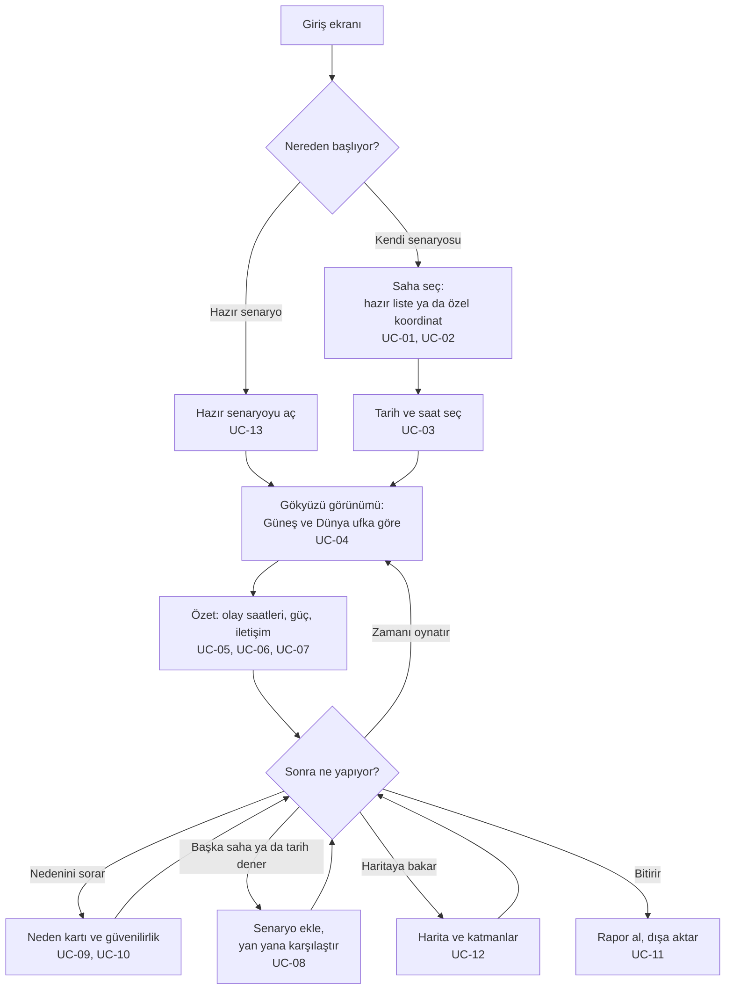
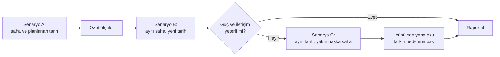
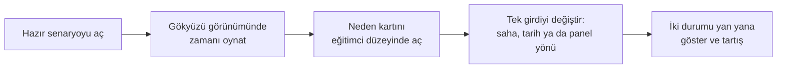
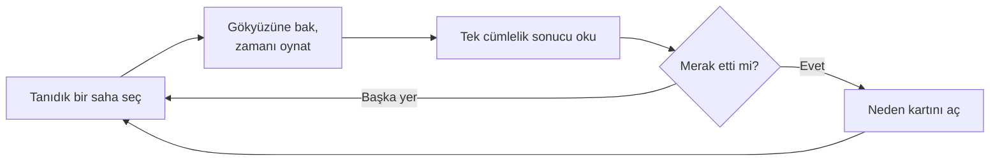

# Kullanıcı Planı: Akış, Use Case'ler ve Senaryolar

- **Tarih:** 14 Kasım 2026
- **Durum:** Taslak. Ekip gözden geçirecek; değişiklikler PR ile yapılır.
- **Kapsam:** Ürünü kimin, hangi soruyla, hangi adımlarla kullanacağı. Hesap yöntemi ve ekran tasarımı bu belgenin konusu değil.

Bu belge, [araştırma analiz özetinin](../research/ANALIZ-OZETI.md) 9. bölümünde eksik diye yazılan iki maddeyi karşılar: "kullanıcı türlerine göre içerik planı yok" ve (kısmen) "ekran tasarımı yok". Kimlikler (`K`, `UC`, `S`) sabittir; düzenlerken numara değiştirmeyin, yeni madde için sıradaki numarayı kullanın.

## İçindekiler

1. [Dayandığı belgeler](#1-dayandığı-belgeler)
2. [Kapsam sınırı](#2-kapsam-sınırı)
3. [Kullanıcılar](#3-kullanıcılar)
4. [Genel akış](#4-genel-akış)
5. [Use case'ler](#5-use-caseler)
6. [Kullanıcıya göre akışlar](#6-kullanıcıya-göre-akışlar)
7. [Senaryolar](#7-senaryolar)
8. [İzlenebilirlik](#8-izlenebilirlik)
9. [Demo için notlar](#9-demo-için-notlar)
10. [Açık kararlar](#10-açık-kararlar)
11. [Kitle stratejisi belgesiyle farklar](#11-kitle-stratejisi-belgesiyle-farklar)

## 1. Dayandığı belgeler

| Belge | Bu plana ne verdi |
| --- | --- |
| [Challenge metni](../challenge/lunar-landing-site-navigator.md) | Üç kullanıcı türü ve yedi hedef (bölüm 8'de `O1`–`O7`) |
| [Araştırma analiz özeti](../research/ANALIZ-OZETI.md) | Onaylı kapsam (bölüm 7 ve 10), doğrulanmış sayılar (bölüm 5), belgeler arası çelişkiler (bölüm 8) |
| [Açıklanabilirlik raporu](../research/explainability-mission-differences/) | Üç düzeyde anlatım, karşılaştırma yöntemi, "neden" kartları, vaka senaryoları |
| [Arayüz tasarım belgesi](../../frontend-migrate/DESIGN.md) | Ekranlar ve panel yerleşimi (Plan ve Analyze modları) |
| [Zamanla değişen veri notu](../research/zamanda-degisen-veri-hazirlama.md), [ufuk hesabı notu](../research/lunar-horizon/README.md) | Olaylar, pencereler, ufuk ve gösterim önerisi |
| [Güneş paneli notu](../research/solar-panel-model/README.md), [efemeris ve yer istasyonları](../research/ephemeris-rotation-ground-stations/README.md) | Güç ve iletişim use case'lerinin girdileri |
| [Veri kaynakları kataloğu](../research/data-sources/README.md), [CSA notu](../research/csa-moon-exploration.md) | Saha listesi, katmanlar, ekstra özelliklerin kaynağı |
| Jüri ve teslim kılavuzları (`docs/challenge/*.pdf`) | Demo sınırları ve beş puanlama ölçütü |

Senaryolardaki sayıların hepsi analiz özetinde "doğrulandı" etiketi taşıyanlardan seçildi. Öyle olmayan yerde yanında not var.

## 2. Kapsam sınırı

Sınıflar analiz özetinin 7. bölümünden aynen alındı.

| Sınıf | Bu plandaki karşılığı |
| --- | --- |
| **Zorunlu** | Güneş ve Dünya konumu, ufuk, ufka göre gösterim, olay saatleri ve süreler, güç değerlendirmesi, iletişim penceresi, saha listesi ve özel koordinat, yan yana karşılaştırma (`UC-01`–`UC-08`) |
| **Destekleyici** | Üç düzeyde açıklama ve "neden" kartları, hata payı ve kaynak gösterimi, panel tipi ve direk yüksekliği, yer istasyonları, kalıcı gölge katmanı (`UC-09`–`UC-12` ve zorunlu use case'lerin içindeki seçenekler) |
| **Ekstra** | Geçmiş görev vakaları, Athena demosu, "röle gerekli" etiketi, tutulmalar, CSA bilgi kartları, saha puanı, yaklaşma profili ve gölge uyarısı, zemin sıcaklığı, araç modelleri (`UC-13`–`UC-16` ve ilgili seçenekler) |
| **Kapsam dışı** | Rover ile ilgili her şey (rota, enerji, konumlama, dijital ikiz), batarya ve geceyi atlatma modeli, karmaşık katkı paylaştırma (Shapley), ajans merkezleri haritası, araçların devrilme hesabı |

Kapsam dışı maddeler için bu planda use case ya da senaryo yok. Gece uzunluğu ve "gün batımına kalan süre" kapsamda; bunlar olay saatlerinin parçası.

## 3. Kullanıcılar

Challenge üç kullanıcı türü sayıyor. Açıklanabilirlik raporu (bölüm 7, "kademeli açıklama") her birine ayrı bir anlatım düzeyi öneriyor. Üçü de aynı hesabı görür; değişen yalnızca ayrıntı düzeyidir.

| Kimlik | Kullanıcı | Kim | Asıl sorusu | Ne görür | İşini bitirdiğini nasıl anlar |
| --- | --- | --- | --- | --- | --- |
| `K1` | Görev planlamacı | Bilim ve mühendislik ekiplerinde saha ve tarih seçen kişi | "Tarih ya da saha değişirse güç ve iletişim nasıl etkilenir?" | Sayılar, saat aralıkları (hata payıyla), fark tablosu, dışa aktarma | İki ya da daha çok senaryoyu aynı ölçülerle kıyaslayıp birini seçebildi |
| `K2` | Eğitimci | Öğretmen, atölye yürütücüsü, bilim iletişimcisi | "Kutupta iniş neden bu kadar zor, bunu nasıl gösteririm?" | Gökyüzü görünümü, fiziksel neden ve basit formül | Bir kavramı tek bir girdiyi değiştirerek gösterebildi |
| `K3` | Halk | Meraklı ziyaretçi, öğrenci | "Ay'da bu noktada durmak nasıl bir şey?" | Tek cümlelik sonuç ve simge | Bir sahada Güneş'in ve Dünya'nın ne yaptığını kendi cümlesiyle anlatabildi |

Jüri bir kullanıcı türü değildir ama demoyu izler; ona dair notlar bölüm 9'da.

## 4. Genel akış

Her kullanıcı aynı omurgadan geçer: bir saha ve bir tarih seçer, gökyüzünü görür, özet ölçüleri okur, sonra ya zamanı oynatır ya nedenini sorar ya da ikinci bir senaryo ekleyip kıyaslar.

Anlatım düzeyi (`K1`, `K2`, `K3`) bu akışın bir adımı değil, her adımda geçerli bir ayardır. Düzeyin nerede ve nasıl seçileceği açık karar (bölüm 10, madde 1).

### Akışın arayüz tasarımındaki karşılığı

Aşağıdaki eşleme bir öneridir. Kesin hali, analiz özetinin 10.2 bölümünde planlanan `docs/design/gosterim-ve-arayuz.md` belgesinde yazılacak. Tasarım belgesi rover rota planlama için yazıldığından bazı ekranların içeriği değişmek zorunda.

| Akış adımı | Tasarım belgesindeki karşılığı | Not |
| --- | --- | --- |
| Giriş | Açılış ekranı ve tanıtım sayfası (bölüm 2.1, S0 ve S1) | Metinler rover yerine saha karşılaştırmayı anlatmalı |
| Hazır senaryo ya da saha seçimi | Hangar ekranı (S3) | Bu ekran rover seçimi içindi; yerine ne geleceği açık karar (bölüm 10, madde 2) |
| Saha, tarih ve panel kurulumu | Çalışma ekranı, Plan modu, sol panel (`mission-setup`) | Başlangıç ve hedef noktası yerine saha ve tarih |
| Gökyüzü görünümü | Karşılığı yok | Yeni görünüm; orta sahnede 2B harita ve 3B arazinin yanında üçüncü seçenek olabilir |
| Zamanı oynatma | Alt bölümdeki zaman ekseni (`time-axis`) ve oynatma çubuğu (`playback`) | Doğrudan kullanılabilir |
| Özet ölçüler | Analyze modu, sağ paneldeki sekmeler | Sekme adları (Route, Safety, Analysis, Compare) yeniden adlandırılmalı |
| Karşılaştırma | Sağ panelde `Compare` sekmesi | İçerik yeniden yazılacak |
| Harita ve katmanlar | Katman seçici (`layer-picker`), analiz katmanları (`analysis-layers`: PSR mask, Earth visibility) | Rover'a özgü katmanlar (Cost, Traverse) çıkar |
| Dünya görünürlüğü | `earth-visibility` paneli | Mevcut panel konuya uygun |
| Kaynak ve güvenilirlik | `layer-provenance`, `psr-validation` panelleri | Mevcut paneller konuya uygun |
| Rapor ve dışa aktarma | Görev raporu (`mission-report`; İngilizce ve Türkçe, CSV) | İçerik rota yerine senaryo karşılaştırması |

## 5. Use case'ler

### 5.1 Özet tablo

"Kim" sütununda ilk yazılan asıl kullanıcıdır. "Yazılacak belge" sütunu analiz özetinin 10.2 ve 10.3 bölümlerindeki dosya adlarıdır (`docs/design/` altında).

| Kimlik | Use case | Kim | Sınıf | Challenge hedefi | Yazılacak belge |
| --- | --- | --- | --- | --- | --- |
| `UC-01` | Hazır listeden saha seçmek | Hepsi | Zorunlu | O1 | `saha-katalogu.md` |
| `UC-02` | Özel koordinat girmek | K1 | Zorunlu | O1 | `saha-katalogu.md`, `ufuk-hesabi.md` |
| `UC-03` | Tarih ve saat seçmek, zamanı oynatmak | Hepsi | Zorunlu | O2, O6 | `gosterim-ve-arayuz.md` |
| `UC-04` | Güneş ve Dünya'yı ufka göre görmek | Hepsi | Zorunlu | O3, O5 | `gunes-dunya-konumu.md`, `ufuk-hesabi.md`, `gosterim-ve-arayuz.md` |
| `UC-05` | Olay saatlerini ve kalan süreyi görmek | K1, K3 | Zorunlu | O3, O6 | `olaylar-ve-sureler.md` |
| `UC-06` | Güç durumunu değerlendirmek | K1, K2 | Zorunlu | O4 | `guc-degerlendirmesi.md` |
| `UC-07` | İletişim penceresini değerlendirmek | K1, K2 | Zorunlu | O4 | `iletisim-penceresi.md` |
| `UC-08` | Senaryoları yan yana karşılaştırmak | K1, K2 | Zorunlu | O1, O2 | `karsilastirma-ve-aciklama.md` |
| `UC-09` | "Neden" açıklamasını okumak | K3, K2, K1 | Destekleyici | O7 | `karsilastirma-ve-aciklama.md` |
| `UC-10` | Sonucun güvenilirliğini görmek | K1 | Destekleyici | – | `olaylar-ve-sureler.md`, `dogrulama-plani.md` |
| `UC-11` | Rapor almak ve dışa aktarmak | K1 | Destekleyici (öneri) | – | `gosterim-ve-arayuz.md` |
| `UC-12` | Haritada sahayı ve katmanları görmek | Hepsi | Destekleyici | O5 | `kalici-golge-katmani.md`, `gosterim-ve-arayuz.md` |
| `UC-13` | Hazır senaryoyu (geçmiş görev vakası) açmak | K2, K3 | Ekstra | O7 | `gecmis-gorev-vakalari.md`, `athena-demosu.md` |
| `UC-14` | Sahaları puanla sıralamak | K1 | Ekstra | O1 | `saha-puani.md` |
| `UC-15` | Yaklaşma profilini ve gölge uyarısını görmek | K1 | Ekstra | – | `yaklasma-profili-ve-golge-uyarisi.md` |
| `UC-16` | Zemin sıcaklığını görmek | K1, K2 | Ekstra | – | `zemin-sicakligi.md` |

`UC-11` analiz özetinde ayrı bir konu olarak sınıflandırılmadı. Dışa aktarma açıklanabilirlik raporunda, rapor ekranı tasarım belgesinde geçtiği için buraya "öneri" olarak alındı.

### 5.2 Kim hangisini kullanır

● asıl kullanıcı, ○ ara sıra kullanır, boş: beklenmez.

| Use case | K1 Planlamacı | K2 Eğitimci | K3 Halk |
| --- | :---: | :---: | :---: |
| `UC-01` Hazır saha | ● | ● | ● |
| `UC-02` Özel koordinat | ● | ○ | |
| `UC-03` Tarih ve zaman | ● | ● | ● |
| `UC-04` Gökyüzü görünümü | ● | ● | ● |
| `UC-05` Olay saatleri | ● | ○ | ● |
| `UC-06` Güç | ● | ● | ○ |
| `UC-07` İletişim | ● | ● | ○ |
| `UC-08` Karşılaştırma | ● | ● | ○ |
| `UC-09` Neden kartı | ○ | ● | ● |
| `UC-10` Güvenilirlik | ● | ○ | |
| `UC-11` Rapor | ● | ○ | |
| `UC-12` Harita ve katmanlar | ● | ● | ● |
| `UC-13` Hazır senaryo | ○ | ● | ● |
| `UC-14` Saha puanı | ● | | |
| `UC-15` Yaklaşma profili | ● | | |
| `UC-16` Zemin sıcaklığı | ● | ○ | |

### 5.3 Zorunlu use case'ler

#### UC-01 Hazır listeden saha seçmek

- **Amaç:** Koordinat bilmeden tanınmış bir sahayla başlamak.
- **Akış:**
  1. Kullanıcı saha listesini açar. Liste gruplara ayrılmıştır: geçmiş inişler, gelecekteki hedefler, aday bölgeler.
  2. Bir saha seçer. Saha haritada işaretlenir ve kısa bir bilgi kartı açılır (görev, tarih, koordinat, kaynak).
  3. Seçilen saha etkin senaryonun sahası olur.
- **Seçenekler:**
  - Geçmiş bir iniş seçildiğinde tarih de o inişin anına ayarlanabilir (`UC-13`'e geçiş).
  - Kanada katkısı olan sahalarda CSA bilgi kartı görünür (ekstra).
- **Dikkat:**
  - Artemis aday bölgeleri eski plana ait; katman adı "2024 Artemis III aday çalışması" olmalı ve tarihiyle gösterilmeli.
  - IM-2 hedef noktası ile Athena'nın gerçekten indiği yer iki ayrı kayıt.
- **Dayanak:** Veri kaynakları kataloğu (bölüm 2), analiz özeti (7.1 ve 8), CSA notu (6.1).

#### UC-02 Özel koordinat girmek

- **Amaç:** Listede olmayan bir noktayı değerlendirmek.
- **Akış:**
  1. Kullanıcı enlem ve boylam yazar ya da haritada bir noktaya tıklar.
  2. Sistem girdiyi doğrular ve noktayı haritada gösterir.
  3. Nokta etkin senaryonun sahası olur.
- **Seçenekler:**
  - Geçersiz girdi (aralık dışı, eksik) alan yanında açıklanır; senaryo değişmez.
  - O nokta için arazi ufku hesaplanamıyorsa sistem düz (arazisiz) ufka düşer ve sonucu "arazi hesaba katılmadı" diye etiketler (bölüm 10, madde 5).
- **Dikkat:** Koordinat sistemi tek olmalı. İki Ay koordinat sistemi karışırsa saha 660 ile 875 m arası kayar.
- **Dayanak:** Ufuk hesabı notu (bölüm 10, madde 3), analiz özeti (7.2).

#### UC-03 Tarih ve saat seçmek, zamanı oynatmak

- **Amaç:** Koşulların zaman içinde nasıl değiştiğini görmek.
- **Akış:**
  1. Kullanıcı bir tarih ve saat seçer. Saatler UTC olarak gösterilir.
  2. Zaman çubuğunu sürükler ya da oynatır; gökyüzü görünümü ve özet ölçüler birlikte güncellenir.
  3. İsterse bir Ay günü ya da birkaç ay ileri geri atlar.
- **Seçenekler:** Hazır veri aralığının dışındaki bir tarih seçilirse sistem aralığı söyler ve en yakın geçerli tarihi önerir.
- **Dikkat:** Sayılar döneme göre değişir (örneğin Mons Mouton'da Güneş'in en yüksek açısı dönemine göre 6,5 ile 6,8 derece arası). Her değer tarihiyle birlikte gösterilmeli.
- **Dayanak:** Challenge metni ("Date and time flexibility", "Temporal dynamics"), analiz özeti (bölüm 8).

#### UC-04 Güneş ve Dünya'yı ufka göre görmek

- **Amaç:** Challenge'ın "yapın" diye yazdığı tek hedef: seçilen saha ve anda Güneş ile Dünya ufka göre nerede.
- **Akış:**
  1. Sistem, sahanın ufuk çizgisini bir siluet olarak çizer.
  2. Güneş'in ve Dünya'nın o andaki yeri ve seçili dönemdeki yolu siluetin üzerine çizilir.
  3. Kullanıcı Güneş'in ya da Dünya'nın üzerine geldiğinde yön ve yükseklik açısını okur.
- **Seçenekler:** Güneş ufukla kısmen örtülüyse görünen oranı gösterilir (Güneş nokta değil, yaklaşık yarım derecelik bir disk).
- **Dikkat:** Atmosfer yok; kırılma düzeltmesi ve alacakaranlık yok. Ufku arazi ve Ay'ın eğriliği belirler.
- **Dayanak:** Ufuk hesabı notu (bölüm 5 ve 10), açıklanabilirlik raporu (bölüm 7, "sky plot" ve ufuk profili).

#### UC-05 Olay saatlerini ve kalan süreyi görmek

- **Amaç:** "Ne zaman kararır, ne zaman Dünya batar?" sorusuna tek bakışta cevap.
- **Akış:**
  1. Sistem seçili an için şunları gösterir: gün batımına kalan süre, Dünya'nın batışına kalan süre, bir sonraki gün doğumu, gecenin uzunluğu.
  2. Zaman çizelgesinde üç bant görünür: Güneş görünür, Dünya görünür, ikisi birlikte.
  3. Kullanıcı bir olaya tıklayınca zaman o ana gider.
- **Seçenekler:**
  - Güneş ya da Dünya o dönemde hiç batmıyorsa ya da hiç doğmuyorsa geri sayım yerine bu durum yazılır.
  - Dünya'nın Güneş'i örttüğü olaylar (tutulma) listede ayrı bir işaretle görünür (ekstra).
- **Dikkat:** Kutupta küçük bir ufuk hatası olay saatini 20 dakikadan fazla kaydırır. Tek saat yerine saat aralığı gösterilmeli (`UC-10`).
- **Dayanak:** Zamanla değişen veri notu (bölüm 6), analiz özeti (7.1).

#### UC-06 Güç durumunu değerlendirmek

- **Amaç:** Bu saha ve tarihte Güneş'ten ne kadar yararlanılabilir.
- **Akış:**
  1. Sistem Güneş'in yükseklik açısını, seçili dönemdeki güneşli süreyi ve en uzun karanlık süreyi gösterir.
  2. Kullanıcı isterse panel tipini (yere yatık, dik sabit, dik dönen, iki eksenli) ve direk yüksekliğini seçer.
  3. Sistem dönem boyunca güç eğrisini ve ortalama gücü gösterir.
- **Seçenekler:** Dik sabit panelde kullanıcı panelin baktığı yönü de girer.
- **Dikkat:**
  - Ufuktaki 1 derecelik fark enerji sonucunu yüzde 11 ile 16 arası oynatır; arazi ufku yoksa sonuç kabadır ve öyle etiketlenmeli.
  - Uygulama bataryayı ve gece dayanımını modellemez; yalnızca gün batımına kalan süreyi ve gece uzunluğunu gösterir.
- **Dayanak:** Güneş paneli notu (bölüm 4 ve 12, "Kullanım 1"), analiz özeti (7.1, 7.2, 7.5).

#### UC-07 İletişim penceresini değerlendirmek

- **Amaç:** Araç bu saha ve tarihte Dünya ile röle olmadan konuşabilir mi.
- **Akış:**
  1. Sistem Dünya'nın yükseklik açısını ve seçili dönemde Dünya'nın görünür olduğu pencereleri gösterir.
  2. Kullanıcı isterse yer istasyonu katmanını açar: yalnızca Dünya'nın görünmesi yetmez, bir istasyonun da Ay'ı görmesi gerekir.
- **Seçenekler:** Dünya dönem boyunca hiç görünmüyorsa "röle gerekli" etiketi çıkar (ekstra). Röle uydusunun kendisi modellenmez.
- **Dikkat:** "Dünya görünüyor" ölçütü (merkezi mi, kenarı mı, tamamı mı) seçilmedi; seçim pencereyi 19 ile 38 saat arası oynatıyor (bölüm 10, madde 3).
- **Dayanak:** Efemeris raporu, zamanla değişen veri notu (bölüm 9), analiz özeti (5.2, 7.1, 7.3).

#### UC-08 Senaryoları yan yana karşılaştırmak

- **Amaç:** Challenge'ın özü: saha ve tarih seçeneklerini hızlı kıyaslamak.
- **Akış:**
  1. Kullanıcı etkin senaryoyu (saha ve tarih) karşılaştırmaya ekler.
  2. Tek bir girdiyi değiştirerek ikinci senaryoyu oluşturur. İki hazır kalıp vardır: "aynı saha, başka tarih" ve "aynı tarih, başka saha".
  3. Sistem senaryoları aynı ölçülerle yan yana gösterir: Güneş'in en yüksek açısı, güneşli süre, en uzun karanlık, Dünya'nın görünür olduğu süre, ikisinin birlikte olduğu süre.
  4. Kullanıcı bir senaryoyu referans seçer; diğerleri ona göre fark olarak da okunur.
- **Seçenekler:**
  - İkiden fazla senaryo eklenebilir.
  - Farkın nedeni sorulursa `UC-09` açılır.
- **Dikkat:** Karşılaştırma ekranının nasıl görüneceği hiçbir belgede çizilmedi; orta riskli.
- **Dayanak:** Açıklanabilirlik raporu (bölüm 7, karşı-olgusal karşılaştırma; bölüm 8.3), analiz özeti (7.1).

### 5.4 Destekleyici use case'ler

#### UC-09 "Neden" açıklamasını okumak

- **Amaç:** Küçük bir değişikliğin neden büyük fark yarattığını anlamak.
- **Akış:**
  1. Kullanıcı bir sonucun ya da bir farkın yanındaki "neden" bağlantısına basar.
  2. Sistem bir kart açar. Kartın düzeyi kullanıcıya göre değişir:
     - Halk: tek cümle ve simge ("Burada Güneş ufkun hemen üstünde gezinir").
     - Eğitimci: gökyüzü görünümü, fiziksel neden ve basit formül.
     - Planlamacı: sayılar, hangi girdinin farkı yarattığı, saat aralıkları.
  3. Kullanıcı kartı açarak bir alt düzeydeki ayrıntıya inebilir.
- **Dikkat:**
  - Her kartta kanıt düzeyi etiketi olmalı. Geçmiş kazaların nedenlerinin çoğu "ön bulgu".
  - Araç kaynaklı neden, ortam kaynaklı neden gibi sunulmamalı.
- **Dayanak:** Açıklanabilirlik raporu (bölüm 7 ve 9; hazır İngilizce ve Türkçe metinler bölüm 9'da), analiz özeti (7.2).

#### UC-10 Sonucun güvenilirliğini görmek

- **Amaç:** Bir sayının ne kadar güvenilir olduğunu ve nereden geldiğini bilmek.
- **Akış:**
  1. Olay saatleri tek saat yerine aralık olarak gösterilir ("14:05–14:52 UTC" gibi).
  2. Kullanıcı bir değerin kaynağını açar: hangi veri, hangi çözünürlük, hangi varsayım.
  3. Doğrulama bölümünde sonuçlarımızın NASA araçlarıyla ve hazır NASA haritalarıyla karşılaştırması görünür.
- **Seçenekler:** Kutup sahalarında aralık genişse "yüksek belirsizlik" uyarısı çıkar.
- **Dikkat:** Yükseklik haritasındaki hata sonucu iyimser gösterir; sonuçlar küçük bir güvenlik payıyla sunulmalı.
- **Dayanak:** Açıklanabilirlik raporu (bölüm 7, belirsizlik), ufuk hesabı notu, analiz özeti (5.3, 7.2).

#### UC-11 Rapor almak ve dışa aktarmak

- **Amaç:** Karşılaştırmayı ekip arkadaşına ya da ders notuna taşımak.
- **Akış:**
  1. Kullanıcı rapor düğmesine basar.
  2. Sistem karşılaştırılan senaryoları, ölçüleri ve kaynakları tek sayfada toplar.
  3. Kullanıcı tabloyu CSV olarak indirir.
- **Dikkat:** Senaryonun bağlantı olarak paylaşılması açık karar (bölüm 10, madde 8).
- **Dayanak:** Açıklanabilirlik raporu (bölüm 7, planlamacı düzeyi), tasarım belgesi (bölüm 5.4).

#### UC-12 Haritada sahayı ve katmanları görmek

- **Amaç:** Sahanın çevresini görmek ve mekânsal ilişkiyi kurmak.
- **Akış:**
  1. Kullanıcı sahayı 2B haritada görür; isterse 3B arazi görünümüne geçer.
  2. Katman seçiciden bir katman açar: yükseklik, eğim, kalıcı gölge.
  3. Haritada başka bir noktaya tıklayarak onu yeni senaryo sahası yapabilir (`UC-02`).
- **Seçenekler:** 3B görünümde sahaya lisansı doğrulanmış bir araç modeli konabilir (ekstra).
- **Dikkat:** Kalıcı gölge katmanı buzun varlığını göstermez; buz için "belirsiz" etiketi kullanılmalı.
- **Dayanak:** Veri kaynakları kataloğu (bölüm 4 ve 5), tasarım belgesi (bölüm 3 ve 4), analiz özeti (7.2, 7.3).

### 5.5 Ekstra use case'ler

Bunlar analiz özetinin 7.3 bölümündeki sırayla, yani yapılabilirliğe göre dizildi. Zorunlu use case'ler bitmeden başlanmamalı.

#### UC-13 Hazır senaryoyu (geçmiş görev vakası) açmak

- **Amaç:** Gerçek bir iniş üzerinden ürünü ve bir kavramı tek adımda göstermek.
- **Akış:**
  1. Kullanıcı vaka listesinden birini seçer (örneğin Athena, Blue Ghost, SLIM, Chang'e-4).
  2. Sistem o inişin sahasını ve anını yükler, gökyüzünü gösterir ve vakaya özgü mesajı açar.
  3. Kullanıcı tek bir girdiyi değiştirerek "öyle olmasaydı" sorusunu dener (`UC-08`).
- **Dikkat:** Uygulama bir görevin neden başarısız olduğunu hesaplamaz. Ortamı ölçer; araç kaynaklı nedeni yalnızca resmi kaynağa atıfla ve kanıt etiketiyle gösterir.
- **Dayanak:** Açıklanabilirlik raporu (bölüm 8.1), analiz özeti (5.6, 7.3). Altı inişin Güneş ve Dünya açıları yeniden hesaplandı ve tuttu.

#### UC-14 Sahaları puanla sıralamak

- **Amaç:** Birkaç ölçütü tek sayıda toplayıp adayları sıralamak.
- **Akış:** Kullanıcı ölçütlerin ağırlığını seçer (güneşli süre, Dünya görünürlüğü, eğim); sistem sahaları puanlar ve sıralar.
- **Dikkat:** Ağırlıklar keyfi kalabilir; puanın yanında her ölçütün kendi değeri de görünmeli.
- **Dayanak:** CSA notu (bölüm 8.2), [Chandrayaan-3 saha seçimi notu](../research/chandrayaan3-landing-site-selection/README.md) (bölüm 7).

#### UC-15 Yaklaşma profilini ve gölge uyarısını görmek

- **Amaç:** İniş yönündeki araziyi ve alçak Güneş'in yarattığı uzun gölgeyi fark etmek.
- **Akış:** Kullanıcı bir yaklaşma yönü seçer; sistem o yöndeki arazi kesitini çizer ve Güneş alçaksa gölge uzunluğu uyarısı verir.
- **Dayanak:** CSA notu (bölüm 8.2), analiz özeti (7.3).

#### UC-16 Zemin sıcaklığını görmek

- **Amaç:** Seçilen sahada zemin sıcaklığının zaman içindeki seyrini görmek.
- **Akış:** Sistem seçili dönem için sıcaklık eğrisini gösterir.
- **Dikkat:** Yüksek riskli. Hazır araçta üç kurulum sorunu çıktı ve model sonuçları yeniden hesaplanmadı.
- **Dayanak:** Zamanla değişen veri notu (bölüm 8), analiz özeti (5.3, 7.3).

## 6. Kullanıcıya göre akışlar

### 6.1 Planlamacı: "Plan değişti, hâlâ uygun mu?"

Kullandığı use case'ler: `UC-01` ya da `UC-02`, `UC-03`, `UC-05`, `UC-06`, `UC-07`, `UC-08`, `UC-10`, `UC-11`.

### 6.2 Eğitimci: "Bunu derste nasıl gösteririm?"

Kullandığı use case'ler: `UC-13`, `UC-03`, `UC-04`, `UC-09`, `UC-08`.

### 6.3 Halk: "Ay'da bu noktada durmak nasıl bir şey?"

Kullandığı use case'ler: `UC-01`, `UC-03`, `UC-04`, `UC-05`, `UC-09`, `UC-12`.

## 7. Senaryolar

Senaryo, bir kullanıcının belirli bir saha ve tarihle baştan sona yaptığı iştir. Demo, test ve içerik yazımı için ortak örneklerdir.

**Sayılar hakkında:** Aşağıdaki açılar NASA'nın Horizons aracıyla hesaplanıp doğrulanmış değerlerdir ve araziyi hesaba katmaz. Arazi ufku eklendiğinde ürünün göstereceği saatler ve süreler değişir. Koordinatlar `saha-katalogu.md` yazıldığında oradan alınmalı.

### 7.1 Özet tablo

| Kimlik | Senaryo | Kim | Saha | Sınıf | Asıl use case'ler |
| --- | --- | --- | --- | --- | --- |
| `S-01` | Plan değişti: aynı saha, başka tarih | K1 | Mons Mouton test sahası | Zorunlu | `UC-03`, `UC-07`, `UC-08` |
| `S-02` | Aynı tarih, başka saha | K1 | Mons Mouton ve IM-1 sahası | Zorunlu | `UC-01`, `UC-06`, `UC-08` |
| `S-03` | Güneş ufukta sürünüyor | K3 | Mons Mouton | Zorunlu | `UC-04`, `UC-05`, `UC-09` |
| `S-04` | Küçük hata, büyük fark | K1 | Mons Mouton | Destekleyici | `UC-05`, `UC-10` |
| `S-05` | Paneli yükseltmek | K1 | Mons Mouton | Destekleyici | `UC-06`, `UC-08` |
| `S-06` | Alçak Güneş tek başına başarısızlık değildir | K2 | Blue Ghost ve Athena sahaları | Ekstra | `UC-13`, `UC-08`, `UC-09` |
| `S-07` | Panelin baktığı yön | K2 | SLIM sahası | Ekstra | `UC-13`, `UC-06` |
| `S-08` | Dünya hiç görünmüyor | K2, K1 | Chang'e-4 sahası | Ekstra | `UC-13`, `UC-07` |
| `S-09` | Ay'dan Güneş tutulması | K3, K2 | Apollo 11 sahası | Ekstra | `UC-05` |
| `S-10` | Athena demosu | Hepsi | Athena'nın indiği yer | Ekstra | `UC-13`, `UC-04`, `UC-08` |

### 7.2 Zorunlu ve destekleyici senaryolar

#### S-01 Plan değişti: aynı saha, başka tarih

- **Durum:** Planlamacı Mons Mouton test sahasında (84,78° G, 29,13° D) Aralık 2026 için bir iniş planlıyor. Donanım gecikmesi tarihi kaydırıyor.
- **Adımlar:**
  1. Sahayı ve ilk tarihi seçer, özet ölçüleri okur.
  2. Senaryoyu karşılaştırmaya ekler; "aynı saha, başka tarih" ile tarihi 3–11 Aralık aralığına kaydırır.
  3. İki senaryoyu yan yana okur.
- **Beklenen sonuç:** İkinci senaryoda Dünya ufkun altında; doğrudan iletişim penceresi yok. Sistem bir sonraki Dünya doğuşunu gösterir.
- **Kanıt:** Aralık 2026'da bu sahada Dünya ufkun 2,1 derece altı ile 10,6 derece üstü arasında geziyor ve 3–11 Aralık arasında ufkun altında (ayın yaklaşık yüzde 26'sı). Güneş en fazla 6,5 derece yükseliyor. Doğrulandı (analiz özeti 5.2).

#### S-02 Aynı tarih, başka saha

- **Durum:** `S-01`'in devamı. Tarih değiştirilemiyorsa planlamacı aynı bölgede başka bir sahaya bakıyor.
- **Adımlar:**
  1. "Aynı tarih, başka saha" ile listeden daha kuzeydeki IM-1 sahasını (yaklaşık 80,1° G) ekler.
  2. Güneş'in en yüksek açısını, güneşli süreyi ve Dünya'nın görünür olduğu süreyi kıyaslar.
  3. Farkın nedenini açar.
- **Beklenen sonuç:** Kuzeydeki sahada Güneş daha yükseğe çıkıyor. Neden kartı farkı enleme bağlıyor.
- **Kanıt:** Güneş'in yıllık üst sınırı yaklaşık 90° − enlem + 1,54° ile bulunur: Mons Mouton'da yaklaşık 6,8, IM-1 sahasında yaklaşık 11,4 derece (açıklanabilirlik raporu, bölüm 5.3 ve 8.3). IM-1 koordinatı ve saati yaklaşık.

#### S-03 Güneş ufukta sürünüyor

- **Durum:** Bir ziyaretçi Ay'ın güney kutbunun neden farklı olduğunu merak ediyor.
- **Adımlar:**
  1. Listeden Mons Mouton'u seçer.
  2. Gökyüzü görünümünde zamanı bir Ay günü boyunca oynatır.
  3. Tek cümlelik sonucu okur; isterse neden kartını açar.
- **Beklenen sonuç:** Güneş yükselip batmak yerine ufkun hemen üstünde dolanıyor. Kart metni: "Burada Güneş ufkun hemen üstünde gezinir. Küçük bir krater kenarı bile aracı gölgede bırakabilir."
- **Kanıt:** Aralık 2026'da Güneş en fazla 6,47 derece yükseliyor. Güneş 2,47 derecedeyken 1 m'lik bir nesne yaklaşık 23 m gölge yapar. İkisi de doğrulandı (analiz özeti 5.4, 5.6). Kart metni açıklanabilirlik raporunun 9. bölümünden.

#### S-04 Küçük hata, büyük fark

- **Durum:** Planlamacı kutup sahasındaki bir gün doğumu saatine ne kadar güvenebileceğini bilmek istiyor.
- **Adımlar:**
  1. Mons Mouton'da bir gün doğumu olayını seçer.
  2. Olayın saat aralığını ve "yüksek belirsizlik" uyarısını görür.
  3. Kaynağı açar: hangi yükseklik haritası, hangi çözünürlük.
- **Beklenen sonuç:** Tek saat yerine bir aralık. Aynı olay ekvatora yakın bir sahada çok daha dar bir aralıkla görünür.
- **Kanıt:** Kutupta küçük bir ufuk hatası olay saatini 20 dakikadan fazla, Dünya için 70 dakika kadar kaydırıyor. Doğrulandı (analiz özeti 5.6).

#### S-05 Paneli yükseltmek

- **Durum:** Planlamacı aynı sahada paneli bir direğe koymanın ne kazandırdığını soruyor.
- **Adımlar:**
  1. Mons Mouton'da panel tipini "dik, dönen" seçer.
  2. Direk yüksekliğini değiştirerek ikinci bir senaryo oluşturur.
  3. Güneşli süreyi ve en uzun karanlığı kıyaslar.
- **Beklenen sonuç:** Yüksek direkte güneşli süre artıyor, en uzun karanlık kısalıyor. Sayıları ürünün kendi hesabı verir.
- **Kanıt:** NASA çalışmasındaki bir sahada aydınlanma 1 m'de yüzde 67–71, 5 m'de yüzde 83–89. Doğrulandı (analiz özeti 5.3). Bu sayı Mons Mouton için değil, gerekçe olarak verildi.

### 7.3 Ekstra senaryolar

Bunların hepsi `UC-13`'e, yani geçmiş görev vakalarına dayanır. Kaza nedenleri "ön bulgu" etiketiyle gösterilmeli.

#### S-06 Alçak Güneş tek başına başarısızlık değildir

- **Durum:** Eğitimci "Güneş alçaksa iniş başarısız olur" yanılgısını düzeltmek istiyor.
- **Adımlar:** Blue Ghost ve Athena inişlerini açar, iki inişi yan yana koyar, sonra zamanı ileri oynatır.
- **Beklenen sonuç:** İniş anında iki sahada da Güneş alçak. Fark sonrasında: Blue Ghost'un sahasında Güneş gün içinde çok yükseliyor, Mons Mouton'da hep alçak kalıyor.
- **Kanıt:** İniş anında Güneş Blue Ghost'ta 3,43, Athena'da 2,47 derece yüksekteydi. Doğrulandı (analiz özeti 5.6).

#### S-07 Panelin baktığı yön

- **Durum:** Eğitimci panel yönünün Güneş'in yüksekliği kadar önemli olduğunu göstermek istiyor.
- **Adımlar:** SLIM vakasını açar, panel tipini "dik, sabit" ve yönünü batı seçer, zamanı oynatır; sonra yönü doğuya çevirip kıyaslar.
- **Beklenen sonuç:** Batıya bakan panel, Güneş doğudayken güç üretmiyor; Güneş batıya geçince üretmeye başlıyor.
- **Kanıt:** İniş anında Güneş doğudaydı (yön 81,7, yükseklik 37,2 derece). SLIM'in panellerinin batıya baktığı Japon uzay ajansının 25 Ocak 2024 tarihli belgesinde geçiyor. Saat ve koordinat yaklaşık.

#### S-08 Dünya hiç görünmüyor

- **Durum:** Kullanıcı Ay'ın uzak yüzünde iletişimin neden farklı olduğunu görmek istiyor.
- **Adımlar:** Chang'e-4 vakasını açar, gökyüzü görünümünde Dünya'nın yoluna bakar, zamanı bir yıl boyunca oynatır.
- **Beklenen sonuç:** Dünya'nın yolu hep ufkun altında. Sistem "röle gerekli" etiketini gösteriyor.
- **Kanıt:** İniş anında Dünya ufkun 39 derece altındaydı ve bütün yıl ufkun altında. Doğrulandı (analiz özeti 5.6).
- **Dikkat:** Space Apps kılavuzunda Çin ile ilgili bir uygunluk incelemesi var. Kamuya açık görev bilgisini kullanmanın bu kapsama girip girmediğine NASA karar veriyor (analiz özeti 5.7). Bu vakayı demoya koymadan önce ekipçe karar verilmeli.

#### S-09 Ay'dan Güneş tutulması

- **Durum:** Kullanıcı Ay'dan bakıldığında Dünya'nın Güneş'i örttüğü bir anı görmek istiyor.
- **Adımlar:** Apollo 11 sahasını seçer, olay listesinden 20–21 Şubat 2027 tutulmasına gider, zamanı oynatır.
- **Beklenen sonuç:** Dünya, Güneş diskinin bir kısmını örtüyor; güç eğrisinde kısa bir düşüş görünüyor.
- **Kanıt:** 22:09–00:36 UTC arasında, 2 saat 27 dakika boyunca, en fazla yüzde 34 örtülme. İki araçla doğrulandı (analiz özeti 5.1).

#### S-10 Athena demosu

- **Durum:** Tek bir gerçek iniş üzerinden bütün ürünü anlatmak.
- **Adımlar:** Athena'nın indiği yeri ve anını açar; aynı konum ve saat için iki duruşu yan yana görür; sonra duruşu sabit tutup sahayı ya da tarihi değiştirir.
- **Beklenen sonuç:** Güneş görünse bile küçük bir kenarın onu kesebildiği görülüyor.
- **Kanıt:** İniş anında Güneş 2,47, Dünya 11,19 derece yüksekteydi. Doğrulandı.
- **Dikkat:** Orta ile yüksek arası riskli: krater kenarı için çok ince yükseklik haritası gerekiyor ve aracın gerçek duruş açıları bilinmiyor. Gösterim "senaryo" diye etiketlenmeli (açıklanabilirlik raporu 8.2).

## 8. İzlenebilirlik

### 8.1 Challenge hedeflerinden use case'lere

Hedefler challenge metnindeki "Objectives" listesinin sırasıyla numaralandı.

| Kimlik | Challenge hedefi | Use case'ler | Senaryolar |
| --- | --- | --- | --- |
| O1 | Saha seçimi ve karşılaştırma | `UC-01`, `UC-02`, `UC-08`, `UC-14` | `S-01`, `S-02` |
| O2 | Tarih ve saat esnekliği | `UC-03`, `UC-08` | `S-01` |
| O3 | Güneş ve Dünya konumunun gösterimi, batışa kalan süre | `UC-04`, `UC-05` | `S-03`, `S-08` |
| O4 | Güç ve iletişim değerlendirmesi | `UC-06`, `UC-07` | `S-01`, `S-05`, `S-07` |
| O5 | Birden çok gösterim (2B, 3B, başka) | `UC-04`, `UC-12` | `S-03` |
| O6 | Zaman içindeki değişim | `UC-03`, `UC-05` | `S-03`, `S-09` |
| O7 | Farklı beceri düzeyleri | `UC-09`, `UC-13` | `S-03`, `S-06`, `S-07` |

### 8.2 Jüri ölçütlerine katkı

| Ölçüt | En çok katkı veren | Neden |
| --- | --- | --- |
| Impact | `K1`, `K2`, `K3` için ayrı düzey | Aynı araç üç kitleye ulaşıyor |
| Creativity | `UC-08`, `UC-09` | Tek girdi değiştirerek karşılaştırma ve nedeni gösterme |
| Validity | `UC-10`, `S-04` | Hata payı ve NASA araçlarıyla doğrulama |
| Relevance | `UC-04`–`UC-07` | Challenge'ın ana cümlesinin doğrudan karşılığı; NASA verisi hesabın temeli |
| Presentation | `S-01`, `S-03` | Challenge'ın kendi hikâyesi (plan değişikliği) ve tek bakışta anlaşılan görüntü |

## 9. Demo için notlar

Bu bölüm tam bir sunum planı değildir; yalnızca senaryoların demoya nasıl bağlanacağını söyler.

- **Sınır:** Teslimde 7 slayt (başlık ve giriş dahil) ya da en fazla 30 saniyelik video istenir. Sınırı aşan proje küresel değerlendirmeye giremez.
- **Dil:** Teslim sayfası, bağlantılı malzemeler ve slaytlar İngilizce olmalı. Videoda başka dil konuşulursa İngilizce altyazı şart.
- **Önerilen ana senaryo:** `S-01`. Challenge metnindeki plan değişikliği hikâyesinin birebir karşılığı ve sayıları doğrulanmış.
- **Önerilen açılış görüntüsü:** `S-03`. Güneş'in ufukta dolandığı gökyüzü görünümü.
- **Canlı sunum olursa:** Açıklanabilirlik raporunun yönetici özetindeki 3–4 dakikalık akış kullanılabilir (Athena, SLIM, Chang'e-4; yani `S-10`, `S-07`, `S-08`).
- **Kurallar:** NASA logosu kullanılamaz. Kullanılan her veri, kod ve yapay zekâ aracı teslimde belirtilmeli; yapay zekâ ile üretilen görsel ve videoda görünür filigran olmalı.

## 10. Açık kararlar

Bu plan aşağıdaki kararlar verilmeden kesinleşmez. İlk beşi use case'lerin akışını doğrudan değiştirir.

| No | Karar | Etkilediği yer | Not |
| --- | --- | --- | --- |
| 1 | Anlatım düzeyi nasıl seçilecek: girişte üç ayrı kapı mı, çalışma ekranında bir düzey anahtarı mı? | Bütün akış, `UC-09` | Kitle stratejisi belgesi "üç kapı" önermişti |
| 2 | Hangar ekranının (rover seçimi) yerine ne gelecek: saha ve hazır senaryo seçimi mi, yoksa ekran kaldırılacak mı? | Genel akış, `UC-01`, `UC-13` | Rover kapsam dışı |
| 3 | "Dünya görünüyor" ölçütü: merkezi mi, kenarı mı, tamamı mı ufkun üstünde? | `UC-07`, `S-01` | Seçim pencereyi 19 ile 38 saat arası oynatıyor |
| 4 | Yer istasyonu için alım sınırı mı (6 derece), gönderim sınırı mı (10,1 derece)? | `UC-07` | Etkisi günde dakikalar düzeyinde |
| 5 | Özel koordinatta arazi ufku nasıl hesaplanacak: sunucuda anında mı, yalnızca hazır sahalarda mı? | `UC-02` | Ufuk hesabı notu sunucu öneriyor |
| 6 | Ortak veri sözleşmesi (dosya biçimi) | Bütün use case'ler | Dört belge dört ayrı biçim öneriyor; `docs/adr/` boş |
| 7 | Hazır saha ve hazır senaryo listesi | `UC-01`, `UC-13` | Chang'e-4 koordinatı iki belgede farklı: resmi tablo 45,4561° G, 177,5885° D; açıklanabilirlik raporu 45,4446° G, 177,5991° D |
| 8 | Senaryonun bağlantı olarak paylaşılması | `UC-11` | Araştırma belgelerinde yok |
| 9 | Tasarım belgesindeki asistan (sohbet) kapsamda mı? | `UC-09` | Analiz özetinde geçmiyor |
| 10 | Arayüz dili: yalnızca İngilizce mi, Türkçe de mi? | Bütün metinler | Teslim İngilizce istiyor; açıklanabilirlik raporunda iki dilde hazır metin var |

## 11. Kitle stratejisi belgesiyle farklar

[Kitle stratejisi](audience-strategy.md) belgesi kapsam kararlarından önce yazıldı. Ana fikri (tek motor, üç kitle) bu planla aynı. Üç yerde fark var ve bu plan geçerli:

| Kitle stratejisinde | Bu planda | Neden |
| --- | --- | --- |
| "Lander'ın hayatta kalır mı?" batarya oyunu | Yok | Batarya ve geceyi atlatma kapsamdan çıkarıldı (analiz özeti 7.5). Yerine gün batımına kalan süre ve gece uzunluğu (`UC-05`) |
| Yaklaşık 3 dakikalık demo hikâyesi | 7 slayt ya da 30 saniyelik video | Teslim kılavuzunun sınırı |
| Paylaşılabilir iniş kartı, tarih × saha ısı haritası, eğitim görevleri | Use case olarak yok | Onaylı kapsam listesinde yoklar. Eğitim görevlerinin yerini hazır senaryolar (`UC-13`) tutuyor; diğer ikisi ekip isterse sonradan eklenebilir |
