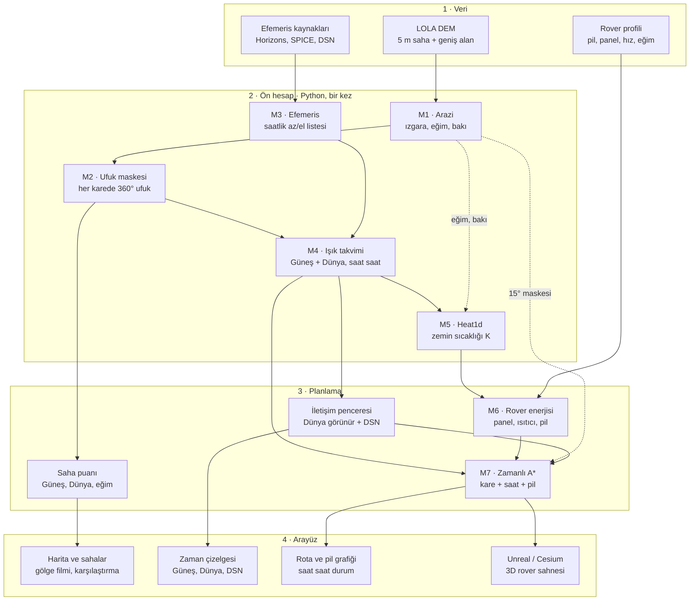

# Işık ve Isı Katmanı: Rover için Gölge, Pil ve Sıcaklık

"Thermal modelde daha iyi bir çözüm (Heat1d dışında)" araştırma başlığı (madde 5) kapsamında hazırlanan mimari önerisi. Heat1d'yi düz zemin varsayımıyla değil, arazinin gerçek gölgesiyle besleyip rover'ın yol bulmasına bağlar. Hangi modülün ne aldığını, ne verdiğini, hangi açık kaynak araçla yapılacağını ve ürünün diğer özelliklerine nasıl bağlandığını anlatır.

- **Tarih:** 14 Kasım 2026
- **Durum:** Öneri. Henüz kod yok; kod örnekleri çalıştırılmadı.
- **Kapsadığı maddeler:** 5, 8, 9, 12, 13
- **Test sahası:** Mons Mouton (−84,78°, 29,13° D), [ephemeris-rotation-ground-stations](../ephemeris-rotation-ground-stations/README.md) ile aynı

## İçindekiler

1. [Kısa özet](#1-kısa-özet)
2. [Neden bu yaklaşım](#2-neden-bu-yaklaşım)
3. [Mimari](#3-mimari)
4. [Modüller](#4-modüller)
5. [Ön hesap ile arayüz arasındaki dosyalar](#5-ön-hesap-ile-arayüz-arasındaki-dosyalar)
6. [Ürünün diğer özellikleriyle bağlantısı](#6-ürünün-diğer-özellikleriyle-bağlantısı)
7. [Açık kaynak araçlar ve veri](#7-açık-kaynak-araçlar-ve-veri)
8. [Teslime kadar plan](#8-teslime-kadar-plan)
9. [Riskler ve açık sorular](#9-riskler-ve-açık-sorular)
10. [Kaynaklar](#10-kaynaklar)

---

## 1. Kısa özet

1. Rover için sıcaklık sorunu aslında bir **enerji** sorunu. Rover soğukta ısıtıcıyla yaşar, ısıtıcı pili, pil güneşi kullanır. Bu yüzden rota için asıl ölçü: **gölgede kaç saat kalıyorum ve zemin ne kadar soğuk?**
2. Heat1d tek başına düz zemin varsayar. Biz ona her karede kendi hesapladığımız ufuk maskesinden çıkan güneş verisini veriyoruz. Heat1d'nin güncel sürümü (v0.4.1) bunu kodu değiştirmeden kabul ediyor: `Model(flux_series=..., flux_dt=...)`.
3. Aynı ufuk maskesinden üç şey çıkıyor: güneş takvimi (gölge süresi, kalıcı gölge), Dünya takvimi (iletişim) ve Heat1d sıcaklığı. Hepsi zamana bağlı A* rota bulucuya giriyor.
4. Ağır hesaplar bir kez, önceden Python ile yapılır. Arayüz yalnızca hazır dosyaları okur.
5. Teslime kalan süre için öncelik: **ufuk maskesi → ışık takvimi → pil kurallı A\***. Heat1d sıcaklığı zaman kalırsa eklenir; mimari buna hazır.

---

## 2. Neden bu yaklaşım

NASA'nın VIPER rover ekibi aynı problemi aynı yerde, Mons Mouton'da çözmüştü. Sunumlarındaki ana gözlem: **kutupta gölgeler rover'ın ortalama hızıyla aynı hızda kayıyor.** Bu yüzden rota yalnızca "nereden" değil, "ne zaman" sorusunun da cevabı. VIPER'ın sayıları varsayılan rover profilimizin başlangıcı olabilir.

| VIPER parametresi | Değer | Bizde nereye girer |
|---|---|---|
| Gölgede dayanma (matkap çalışırken) | ~9,5 saat | M6 pil modeli, M7 kuralı |
| En düşük güç modunda dayanma | 50 saat | "Güvenli liman" tanımı |
| Ortalama hız (bekleme dahil) | 1 cm/s ≈ 36 m/saat | M7 hamle süresi |
| Eğim sınırı | 15° | M1 yasak kare maskesi |
| Güvenli liman | karanlık ≤ 50 saat | M4 + M7 (Dünya ufkun altındayken beklenecek yer) |

VIPER üç boyutlu bir termal model kullandı (2–20 m'lik üçgen ağ, 6 saatlik adım), ancak bu modelin kodu ve çıktıları açık değil. Bizim yolumuz aynı fikrin hafif sürümü: her kare için 1 boyutlu Heat1d, ama güneşi arazinin gölgesine göre kesilmiş olarak.

---

## 3. Mimari

Dört katman var: üstte ham veri, altında bir kez çalışan ön hesap, sonra planlama, en altta kullanıcının gördüğü arayüz.



Kesikli oklar: M1'in eğim ve bakı haritası M5'e (Heat1d eğimli yüzey) ve M7'ye (yasak kareler) de girer.

---

## 4. Modüller

Boyut tahminleri tek bir örnek bölge için: **4 km × 4 km, 20 m kare (200 × 200 = 40.000 kare), bir Ay günü boyunca saatlik adım (≈ 709 adım).** Gerçek değerler bölge ve adım seçimine göre değişir.

### M1 · Arazi hazırlama

Yükseklik verisini ortak bir ızgaraya çevirir, her karenin eğimini ve hangi yöne baktığını (bakı) hesaplar. Eğimi rover sınırını aşan kareleri işaretler.

| Girdi | Çıktı | Açık kaynak |
|---|---|---|
| PGDA 5 m LOLA saha DEM'i (listedeki "Site20, Leibnitz beta plateau", Mons Mouton'un eski adı)<br/>Uzak ufuk için daha geniş, kaba bir LOLA DEM (20–60 m) | `elev[ny,nx]` m, `slope[ny,nx]`, `aspect[ny,nx]` derece<br/>`no_go[ny,nx]` (eğim > 15°)<br/>Izgara bilgisi: güney kutup stereografik, metre | rasterio / GDAL (GeoTIFF okuma)<br/>NumPy (eğim, bakı)<br/>PGDA zaten eğim GeoTIFF'i de veriyor |

### M2 · Ufuk maskesi (madde 12)

Her karenin ortasında durup 360° etrafa bakmak gibi: her yön için "arazi gözümden kaç derece yukarıda" listesi. Dağlar yer değiştirmediği için **bir kez** hesaplanır. Ay'da hava olmadığı için ışık kırılması düzeltmesi gerekmez, ama Ay küresinin eğriliği hesaba katılmalı.

```python
# her kare (i, j) ve her yön az için:
for d in mesafeler:                                   # ışın boyunca yürü
    dz = z(p) - z0 - h_gozlemci - d * d / (2 * R_ay)  # R_ay = 1737,4 km
    aci = atan2(dz, d)
    ufuk[i, j, az] = max(ufuk[i, j, az], aci)
```

| Girdi | Çıktı | Açık kaynak |
|---|---|---|
| M1 DEM'leri (yakın 5 m, uzak kaba)<br/>Gözlemci yüksekliği: zemin için 0 m, panel için direk yüksekliği | `horizon[ny,nx,n_az]` derece, float16<br/>360 yön için ≈ 29 MB (yalnızca ön hesapta tutulur) | Kendi NumPy kodumuz (yukarıdaki döngü), ya da HORAYZON (Python)<br/>Referans: Schörghofer Planetary-Code-Collection |

> **Uzak arazi önemli:** Mons Mouton'un plato kenarı yaklaşık 50 km uzakta ve ufku yaklaşık 1° değiştirebiliyor ([ephemeris raporu](../ephemeris-rotation-ground-stations/README.md)). Bu yüzden iki çözünürlüklü DEM gerekiyor.

### M3 · Efemeris (madde 2)

Seçilen tarih aralığında Güneş ve Dünya'nın saat saat yönünü (azimut), yüksekliğini ve uzaklığını verir. Bu işin büyük kısmı [ephemeris-rotation-ground-stations](../ephemeris-rotation-ground-stations/README.md) çalışmasında zaten hazır ve üç yöntemle çapraz doğrulanmış.

| Girdi | Çıktı | Açık kaynak |
|---|---|---|
| Bölge merkezi enlem/boylam, tarih aralığı, adım (ör. 1 saat) | Tablo: `t, sun_az, sun_el, sun_r_au, earth_az, earth_el`<br/>709 satır × 6 sütun, birkaç yüz KB | Ekibin kodu: `site_azel_spice.py` (SpiceyPy), `lunarAzEl.mjs` (astronomy-engine)<br/>astroquery.jplhorizons (Ay yüzeyi gözlemcisi destekli)<br/>heat1d içindeki `heat1d.horizons` |

> **Basitleştirme:** Birkaç km'lik bölgede tek bir liste kullanılabilir. 4 km'de yerel dikey yaklaşık 0,13° döner. Kutupta Güneş çok alçak olduğu için bu fark sınır durumlarda önemli olabilir; gerekirse liste kare bazında düzeltilir.

### M4 · Işık ve Dünya takvimi (madde 9)

Mimarinin kalbi. Her kare ve her saat için tek bir karşılaştırma: **Güneş, o yöndeki ufuktan yüksek mi?** Güneş bir nokta değil, yarıçapı yaklaşık 0,27° olan bir disk; bu yüzden 0 ile 1 arasında "diskin görünen kesri" tutulur. Aynısı Dünya için yapılır.

```python
fark     = sun_el[t] - horizon[i, j, sun_az[t]]
sun_vis  = clip(fark / (2 * 0.27) + 0.5, 0, 1)     # 0 = gölge, 1 = tam güneş
earth_ok = earth_el[t] > horizon[i, j, earth_az[t]]
```

| Girdi | Çıktı | Açık kaynak |
|---|---|---|
| M2 ufuk maskesi<br/>M3 Güneş ve Dünya tablosu | `sun_vis[t,ny,nx]` uint8 (0–255) ≈ 28 MB<br/>`earth_vis[t,ny,nx]` bit ≈ 3,5 MB<br/>Türetilenler: `shadow_left_h[t,ny,nx]` (gölgenin kaç saat süreceği), `psr_mask` (hiç güneş görmeyen kare), ortalama güneşlenme % | NumPy (vektörel karşılaştırma)<br/>Doğrulama: PGDA ortalama aydınlanma ve Dünya görünürlüğü haritaları, QuickMap Terrain Shadows |

### M5 · Heat1d ile zemin sıcaklığı (madde 5)

Her kare için güneş akısını Heat1d'nin kendi fizik fonksiyonuyla hesaplayıp M4'teki görünürlükle çarpar, sonra Heat1d'yi bu dış akıyla çalıştırır. Sonuç, karenin saat saat yüzey (ve istenirse derinlik) sıcaklığıdır.

```python
import numpy as np, planets
from heat1d.model import Model
from heat1d.horizons import horizons_to_flux

flux = horizons_to_flux(sun_el, sun_r_au, planets.Moon,
                        azimuth_deg=sun_az, slope=slope_rad, slope_az=aspect_rad)
flux = flux * sun_vis[:, i, j] / 255          # arazi gölgesini uygula

m = Model(planet=planets.Moon, lat=np.deg2rad(lat), lon=np.deg2rad(lon),
          flux_series=flux, flux_dt=3600.0,
          slope=slope_rad, slope_az=aspect_rad)
m.run()
T_yuzey = m.T[:, 0]                           # K, zaman boyunca
```

| Girdi | Çıktı | Açık kaynak |
|---|---|---|
| M3 Güneş yüksekliği, azimutu, uzaklığı<br/>M4 `sun_vis`<br/>M1 eğim ve bakı | `T_surf[t,ny,nx]` K<br/>6 saatlik adımda float16 ≈ 9 MB, ya da yalnızca rota koridoru | heat1d v0.4.1, MIT lisansı (Python + hızlı C sürümü)<br/>Kaynak kodda doğrulanan: `flux_series`, `flux_dt`, `slope`, `slope_az`, `psr_d_D`, `horizons_to_flux` |

> **Dikkat:** Yukarıdaki kod denenmedi; imzalar heat1d kaynak kodundan okundu. Heat1d'de `flux[0]` yerel öğlene karşılık geliyor; takvimi öğlene hizalamak ya da `flux_noon_idx` vermek gerekebilir. Hız ölçülmedi. 40.000 kare yavaş kalırsa aynı ışık deseni, eğim ve bakı aralığına düşen kareler gruplanıp her grup bir kez hesaplanabilir.

### M6 · Rover enerji modeli (madde 13)

Rover profiline göre her saat ne kadar enerji kazanıldığını ve harcandığını hesaplayan basit fonksiyonlar. Panel gücü, panelin gerçekten Güneş'e baktığı açıya ve **panel yüksekliğindeki** ufuk maskesine bağlıdır. Isıtıcı gücü zemin sıcaklığına bağlıdır.

```text
P_panel  = verim × alan × 1361 × (1 / r_au)² × max(0, güneş_yönü · panel_normali) × sun_vis_direk
P_ısıtıcı = max(0, G × (T_hedef − T_çevre))          # T_çevre: M5 zemin sıcaklığından
pil     += (P_panel − P_sürüş − P_elektronik − P_ısıtıcı) × dt
```

| Girdi | Çıktı | Açık kaynak |
|---|---|---|
| Rover profili: pil (Wh), panel alanı ve yönü, güç tüketimleri, hız, eğim sınırı<br/>M4 (direk yüksekliğinde), M5 | `sarj(t, kare)`, `harcama(t, kare, eylem)` fonksiyonları | Yalnızca NumPy; formüller basit<br/>Rover tablosu, [rover modelleme notundaki](../rover-modelleme-ve-unreal-gecis.md) "rover tablosu" ile aynı olabilir |

> Heat1d hazır değilken ısıtıcı için sabit bir "gölgede saatlik harcama" kullanılır. M5 gelince bu değer zemin sıcaklığına göre değişir.

### M7 · Zamana bağlı A* (madde 8)

Normal A* yalnızca "hangi kareye" diye sorar. Bu sürüm **"oraya saat kaçta varırım ve pilim yüzde kaç olur"** diye de sorar. "Burada bekle" de bir hamledir: gölge geçene kadar güneşte beklemek çoğu zaman en iyi seçenektir.

| Girdi | Çıktı | Açık kaynak |
|---|---|---|
| Başlangıç karesi ve saati, hedef kare<br/>M1 `no_go`, M4 takvimleri, M6 fonksiyonları<br/>Kurallar: pil ≥ güvenli seviye, isteğe bağlı "yalnızca Dünya görünürken sür" | Rota: `[{t, x, y, pil, T, gunes, dunya}, ...]` JSON<br/>Neden bekledi, neden döndü açıklamaları | Python `heapq` ile kendi A*'ımız (hazır kütüphaneler zamana bağlı maliyeti desteklemiyor)<br/>Sezgisel: düz çizgi mesafesi / en yüksek hız |

> **Uygulanabilirlik:** Durum sayısı kare × saat kadar (40.000 × 709 ≈ 28 milyon). Bunu küçültmek için pil durumun parçası değil etiket olarak tutulur (her kare-saat için en iyi pil saklanır), arama hedefe yakın bir zaman penceresiyle sınırlanır ve gerekirse rota kaba ızgarada bulunup ince ızgarada düzeltilir.

---

## 5. Ön hesap ile arayüz arasındaki dosyalar

Ağır işler bir kez Python ile yapılır ve sonuçlar dosya olarak kaydedilir. Arayüz bu dosyaları okur; kullanıcı başına hesap ya da Horizons çağrısı yapmaz. Bu, ephemeris raporundaki "kullanıcı başına çağrı yapılmaz" kararıyla aynı.

| Dosya | Şekil | Tip | Örnek boyut | Kim üretir → kim okur |
|---|---|---|---|---|
| `terrain.npz` | ny × nx | float32 | ≈ 0,5 MB | M1 → M2, M5, M7, arayüz |
| `ephemeris.csv` | t × 6 | metin | < 1 MB | M3 → M4, M5, zaman çizelgesi |
| `sun_vis.bin` | t × ny × nx | uint8 | ≈ 28 MB | M4 → M5, M6, harita (gölge filmi) |
| `earth_vis.bin` | t × ny × nx | bit | ≈ 3,5 MB | M4 → iletişim penceresi, M7 |
| `t_surf.bin` | t/6 × ny × nx | float16 | ≈ 9 MB | M5 → M6, harita |
| `route.json` | adım listesi | JSON | < 100 KB | M7 → rota grafiği, Unreal |

Boyutlar 200 × 200 kare ve 709 saatlik adım için tahmindir. Büyük veri dosyaları repoya konmaz (bkz. [AGENTS.md](../../../AGENTS.md)); bir indirme/üretim betiğiyle oluşturulur. Tarayıcıya gönderilecek dosyalar küçültülebilir: gölge filmi için zaman adımı seyreltilir ya da yalnızca seçilen bölge gönderilir.

---

## 6. Ürünün diğer özellikleriyle bağlantısı

Aynı takvim ve sıcaklık verisi, proje dosyalarında önerilen hemen her özelliği besliyor. Yani bu katman yalnızca rover için değil, ana ürün için de temel.

| Özellik | Nereden geliyor | Kullandığı modül |
|---|---|---|
| Saha + tarih karşılaştırma (ana ürün) | README yol haritası M1–M3 | M3, M4 (saha noktasında güneşlenme %, Dünya %, en uzun gece) |
| Güneş ve Dünya'nın ufka göre görünümü | README özellikleri | M2 (bir noktanın ufuk profili) + M3 |
| Gün batımına kalan süre, gece sayacı | Challenge metni, [CSA notu](../csa-moon-exploration.md) (MVP) | M4 `shadow_left_h` |
| Panel yönüne ve yüksekliğine göre güç eğrisi | Madde 13, CSA notu (SLIM dersi) | M2 (direk yüksekliğinde) + M6 |
| Doğrudan Dünya iletişimi ve DSN boşlukları | Ephemeris raporu: `dsn_coverage.py` | M4 `earth_vis` VE istasyon görünürlüğü |
| Kalıcı gölge katmanı | CSA notu (Danuri dersi) | M4 `psr_mask` |
| Çok kriterli saha puanı | CSA notu (Chandrayaan-3 dersi) | M1 eğim + M4 + M5 |
| Rover konumlama: beklenen gölge haritası | [Rover konumlama](../rover-localization/README.md), bölüm 10–11 | M4 `sun_vis` o anki gölge haritasını doğrudan verir; census eşleştirmesi buna karşı yapılabilir |
| Rover dijital ikizi, Unreal sahnesi | Madde 1, 3, 7, 10; [rover modelleme notu](../rover-modelleme-ve-unreal-gecis.md) | M7 `route.json` ve sıcaklık profili sahneye aktarılır; ileride Bekker kayması kare başına hızı belirleyip M7 maliyetine girer |
| Açıklanabilirlik | Madde 14 | M7 açıklamaları: "3 saat bekledi, çünkü önündeki kare 2 saat sonra güneşe çıkıyor" |
| Üç kullanıcı türü | Madde 6, 17 | Planlayıcı: rota ve pil grafiği · Eğitimci: gölge filmi animasyonu · Halk: "rover burada donar mı?" kartı |

---

## 7. Açık kaynak araçlar ve veri

Projenin lisansı Apache 2.0. MIT ve BSD lisanslı araçlar bununla uyumlu. Lisansı bu araştırmada okunmayanlar ayrıca işaretlendi. Yeni bir bağımlılık eklemeden önce ekip onayı gerekir (bkz. [docs/adr/](../../adr/README.md)).

| Araç / veri | Ne için | Lisans | Durum |
|---|---|---|---|
| heat1d (Hayne vd.) | M5 sıcaklık; ayrıca Horizons'tan güneş akısı | MIT | Kaynak kod okundu |
| HORAYZON (Steger vd. 2022) | M2 ufuk maskesi, eğim, bakı | Kontrol edilmeli | Makale okundu, denenmedi |
| Schörghofer Planetary-Code-Collection | M2 için referans algoritma | Kontrol edilmeli | Denenmedi |
| astroquery.jplhorizons | M3, Ay yüzeyinden Horizons sorgusu | BSD-3 | Belge okundu |
| SpiceyPy, astronomy-engine | M3 (ekibin kodu) | Kontrol edilmeli | Ekipte kullanıldı |
| rasterio / GDAL, NumPy | M1 ve tüm ön hesap | Açık kaynak | Standart |
| PGDA 5 m LOLA saha DEM'leri | M1 yükseklik ve eğim | NASA verisi | Sayfa okundu |
| PGDA kutup aydınlanma haritaları | M4 doğrulaması | NASA verisi | Sayfa okundu |
| JPL Horizons, NAIF kernel'leri | M3 | NASA | Ekipte kullanıldı |

---

## 8. Teslime kadar plan

Teslim: **15 Kasım 2026, 23:59.** Her aşama bir öncekinin çıktısıyla çalışır, bu yüzden sıra önemli. İlk üç aşama (0–2) demo için şart, aşama 3 ekstra.

| Aşama | Zaman | İş | Şart mı? |
|---|---|---|---|
| 0 · Kararlar ve hazır parçalar | 14 Kasım akşam | Bölge, kare boyutu, tarih aralığı · M1: DEM'leri indir, eğim maskesi · M3: ekibin kodundan tablo | Şart |
| 1 · Gölge | 14 Kasım gece | M2 ufuk maskesi (küçük bölge) · M4 ışık ve Dünya takvimi · PGDA haritasıyla karşılaştır | Şart |
| 2 · Rota | 15 Kasım öğlen | M6 sabit ısıtıcılı pil modeli · M7 zamanlı A*, bekleme hamlesiyle · `route.json` → arayüz | Şart |
| 3 · Isı | Zaman kalırsa | M5 Heat1d, gruplanmış karelerde · Rota boyunca sıcaklık grafiği · Isıtıcı gücünü sıcaklığa bağla | Ekstra |

---

## 9. Riskler ve açık sorular

- **Uzak ufuk:** 5 m'lik saha DEM'i küçük bir alanı kapsıyor. Onlarca km ötedeki arazi için geniş ve kaba bir DEM gerekiyor; hangi ürünün kullanılacağı seçilmeli.
- **Hesap süresi ölçülmedi:** Hem M2 hem M5 için ilk iş küçük bir bölgede süre ölçmek.
- **Heat1d ve dış akı:** Dış akı ile denge (spin-up) davranışı ve öğlen hizalaması denenmeli.
- **Yansıyan ışık yok:** Bu yöntem komşu aydınlık yamaçlardan gelen ışığı ve ısıyı hesaba katmaz. Gölgedeki kareler gerçekte olduğundan biraz daha soğuk çıkar. Rover için bu güvenli yönde bir hata: pil tahmini fazla temkinli olur.
- **Dünya görünürlük ölçütü:** Merkez mi, ilk kenar mı, tam disk mi? Ephemeris raporundaki bekleyen kararlardan biri; M4'teki `earth_ok` buna göre yazılacak.
- **Rover parametreleri:** Gerçek bir rover seçilmedi. VIPER değerleri varsayılan olarak kullanılabilir; arayüzde varsayım olduğu belirtilmeli.
- **Stack kararı:** "Python ile ön hesap, arayüze hazır dosya" önerisi bir ADR olarak `docs/adr/` altına yazılmalı.

---

## 10. Kaynaklar

- heat1d: <https://github.com/phayne/heat1d> · Hayne vd. 2017, <https://arxiv.org/abs/1711.00977>
- VIPER görev planlama, Shirley ve Balaban 2022: <https://www.nasa.gov/wp-content/uploads/2022/05/overview_of_mission_planning_for_the_viper_rover.pdf>
- VIPER rota planlama, Ennico-Smith vd. 2023: <https://ntrs.nasa.gov/citations/20230004239>
- Mons Mouton termal ve buz modeli, Coyan, Siegler vd. 2025: <https://iopscience.iop.org/article/10.3847/PSJ/adbc6c>
- PGDA kutup aydınlanma haritaları: <https://pgda.gsfc.nasa.gov/products/69>
- PGDA 5 m saha DEM'leri: <https://pgda.gsfc.nasa.gov/products/78>
- HORAYZON, Steger vd. 2022, GMD: <https://gmd.copernicus.org/articles/15/6817/2022/>
- Schörghofer kod koleksiyonu: <https://github.com/nschorgh/Planetary-Code-Collection>
- astroquery Horizons: <https://astroquery.readthedocs.io/en/stable/jplhorizons/jplhorizons.html>
- NASA arazi termal modeli eğitimi (Horizons + LOLA): <https://ntrs.nasa.gov/citations/20260007830>
- Proje içi: [ephemeris-rotation-ground-stations](../ephemeris-rotation-ground-stations/README.md), [csa-moon-exploration.md](../csa-moon-exploration.md), [rover-modelleme-ve-unreal-gecis.md](../rover-modelleme-ve-unreal-gecis.md), [rover-localization](../rover-localization/README.md)
