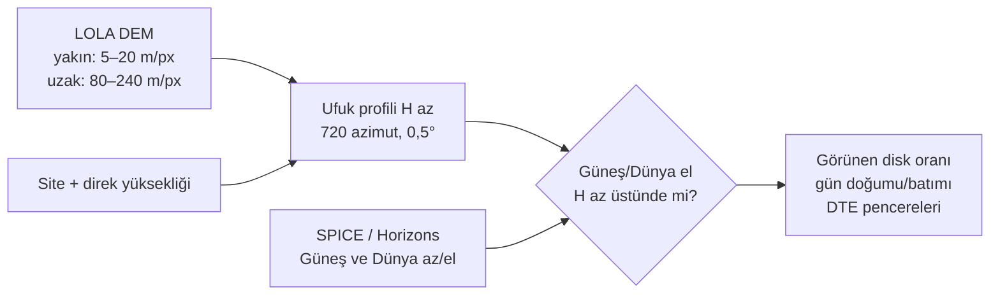

# Atmosfersiz Ay'da Ufuk Hesabı

Araştırma notu: Ay'da atmosfer yokken ufuk nasıl hesaplanır, Güneş ve Dünya'nın görünürlüğü bu ufka göre nasıl belirlenir, literatürde hangi parametreler kullanılıyor ve projemizde nasıl uygulayabiliriz.

> **Temel fikir.** Atmosfer olmadığı için ışık düz bir çizgide gider; ufuk hesabı tamamen geometriktir. Her azimut doğrultusu için "araziyi en yüksek hangi açıda görüyorum?" sorusu sorulur. Bu sorunun cevabı Ay'ın eğriliği hesaba katılarak bulunur. Güneş ya da Dünya bu açının üstündeyse görünür.
>
> Ufku iki şey belirler:
>
> 1. **Küre kenarı:** Düz arazide ufuk birkaç km ötededir ve yataydan çok az aşağıdadır.
> 2. **Arazi:** Güney kutbunda belirleyicidir. 50–200 km ötedeki dağlar ufku yükseltir.

## İçindekiler

1. [Atmosferin olmaması neyi değiştirir?](#1-atmosferin-olmaması-neyi-değiştirir)
2. [Küre kenarı: düz arazide ufuk](#2-küre-kenarı-düz-arazide-ufuk)
3. [Eğrilik neden kritik?](#3-eğrilik-neden-kritik)
4. [Standart yöntem: ufuk profili](#4-standart-yöntem-ufuk-profili)
5. [Güneş diskinin kısmi görünürlüğü](#5-güneş-diskinin-kısmi-görünürlüğü)
6. [Dünya görünürlüğü (doğrudan haberleşme)](#6-dünya-görünürlüğü-doğrudan-haberleşme)
7. [Literatürdeki parametreler](#7-literatürdeki-parametreler)
8. [Gözlemci yüksekliğinin etkisi](#8-gözlemci-yüksekliğinin-etkisi)
9. [Tuzaklar](#9-tuzaklar)
10. [Projemiz için öneri](#10-projemiz-için-öneri)
11. [Örnek kod taslağı](#11-örnek-kod-taslağı)
12. [Kaynaklar](#12-kaynaklar)

---

## 1. Atmosferin olmaması neyi değiştirir?

| | Dünya | Ay |
|---|---|---|
| Kırılma (refraction) | Ufukta yaklaşık 0,57°. Güneş geometrik olarak 0,83° aşağıdayken "doğmuş" sayılır. | **Yok.** Işık düz gider; Güneş gerçekte nerede ise orada görünür. |
| Alacakaranlık, gök parlaklığı | Var. Güneş battıktan sonra da ortam aydınlıktır. | **Yok.** Işık ya gelir ya gelmez. Geçişi yalnızca Güneş diskinin ne kadarının göründüğü belirler. |
| Eğrilik düzeltmesi | Kırılma ışığı büktüğü için "etkin yarıçap" katsayısı kullanılır (optikte k ≈ 7/6, radyoda 4/3). | k = 1. Saf geometri. |

Problem metni de aynı şeyi söylüyor: kırılma olmadığı için ufku yerel arazi ve Ay küresinin kenarı belirler ([lunar-landing-site-navigator.md](../../challenge/lunar-landing-site-navigator.md), "Technical approach" bölümü).

> **Eğitim notu (genel kitle için).** Hava olmadığı için uzaktaki dağlar da yakındakiler kadar keskin görünür. Astronotlar bu yüzden Ay'da mesafe tahmininde zorlandı. Gölgeler de çok karanlıktır, çünkü ışığı dağıtacak hava yoktur. Gölgeye yalnızca çevredeki araziden yansıyan ışık ulaşır.

---

## 2. Küre kenarı: düz arazide ufuk

Ay küçük olduğu için ufuk Dünya'dakinin yaklaşık yarısı kadar yakındır. Hesaplarda LOLA referans küresi R = 1737,4 km kullanıldı.

| Gözlemci yüksekliği | Ay'da ufuk uzaklığı | Ufuk alçalması (dip) | Dünya'da ufuk uzaklığı |
|---|---|---|---|
| 1 m | 1,86 km | 0,061° | 3,57 km |
| 1,7 m (astronot gözü) | 2,43 km | 0,080° | 4,65 km |
| 2 m | 2,64 km | 0,087° | 5,05 km |
| 5 m | 4,17 km | 0,137° | 7,98 km |
| 10 m | 5,89 km | 0,194° | 11,29 km |

Formüller:

- Ufuk uzaklığı: `d = √(2Rh + h²)`
- Ufuk alçalması: `δ = arccos(R / (R + h)) ≈ √(2h / R)`

Apollo bölgeleri gibi düz mare alanlarında ufuk pratikte yaklaşık 0°'dir. Orada Güneş'in doğup batması hemen hemen geometrik yükseklik 0° anına denk gelir.

---

## 3. Eğrilik neden kritik?

Uzaktaki bir nokta, eğrilik yüzünden olduğundan daha aşağıda görünür:

- Yükseklik düşüşü: `d² / (2R)`
- Görünen açıdaki düşüş: yaklaşık `d / (2R)` radyan

| Uzaklık | Eğrilik düşüşü | Açıya etkisi (Ay) | Açıya etkisi (Dünya) |
|---|---|---|---|
| 1 km | 0,3 m | 0,016° | 0,004° |
| 10 km | 29 m | 0,165° | 0,045° |
| 25 km | 180 m | 0,412° | 0,112° |
| 50 km | 720 m | 0,824° | 0,225° |
| 100 km | 2,9 km | **1,649°** | 0,450° |
| 150 km | 6,5 km | 2,473° | 0,674° |
| 200 km | 11,5 km | 3,298° | 0,899° |

Uzaktaki bir noktanın görünen yükseklik açısı yaklaşık şöyledir:

```
e ≈ atan( (z_hedef − z_gözlemci) / d  −  d / (2R) )
```

**Örnekler** (gözlemci 2 m yükseklikte, düz arazide, tepe 100 km uzakta):

| Tepe yüksekliği | Eğrilikle (doğru) | Düz varsayımla (yanlış) |
|---|---|---|
| 1500 m | −0,79°. Gözlemcinin kendi ufkunun (−0,087°) altında kalır, yani **hiç görünmez**. | +0,86°. Güneş'i engelliyor sanılır. |
| 5000 m | +1,21° | +2,86° |

Fark yaklaşık 1,65°. Bu, Güneş'in kutuptaki bütün yükseklik aralığından (±1,54°) büyük. Yani kutupta eğrilik atlanırsa sonuç tamamen yanlış çıkar. Bu değerler örnek kodla (Bölüm 11) yapay arazide sınandı.

---

## 4. Standart yöntem: ufuk profili

Literatürde "horizon method" olarak geçer. Mazarico vd. (2011), ESA'nın ICAT aracı (De Rosa vd. 2012) ve Barker vd. aynı yolu izler.



**Adımlar:**

1. **Gözlemci noktası.** `P₀ = (R + h_DEM + h_direk) · n̂`
   - Ay merkezli Kartezyen koordinatta tanımlanır, DEM ile aynı çerçevede (LOLA için MOON_ME).
   - Yerel yukarı yön: `û = P₀ / |P₀|`
2. **Işınlar.** 720 azimut doğrultusu açılır (0,5° aralık). ESA bu aralığı şöyle gerekçelendiriyor: Güneş yaklaşık 1 saatte kendi çapı kadar (~0,53°) yer değiştiriyor.
3. **Örnekleme.** Her ışın boyunca DEM'den yükseklik okunur. Yakında sık, uzakta seyrek örnek alınır.
   - ESA ICAT: 3 km'ye kadar her 20 m'de bir, 75 km'den ötesi her 2 km'de bir, arada doğrusal artış, en fazla 150 km'ye kadar.
   - Barker vd.: iç içe ızgara kullanır. 5 km'ye kadar 5 m/px, 5–100 km arası 80 m/px, daha ötesi 240 m/px.
4. **Her örnek noktanın açısı.**

   ```
   e = asin( (Pₜ − P₀) · û  /  |Pₜ − P₀| )
   ```

   Hesap Kartezyen koordinatta yapıldığı için eğrilik kendiliğinden dahil olur; ayrıca bir düzeltme gerekmez.
5. **Ufuk profili.** `H(az) = o ışın boyunca en büyük e`
   - Profil siteye özgüdür ve zamana bağlı değildir. Bir kez hesaplanıp saklanır.
   - En pahalı adım budur; DEM'e erişim süreyi belirler.
6. **Her zaman adımı.**
   - Güneş'in (veya Dünya'nın) azimut ve yüksekliği SPICE ile alınır.
   - Ufuk değeri `H(az_☉)`, iki komşu azimut arasında doğrusal enterpolasyonla bulunur.
   - Görünürlük koşulu: `e_☉ > H(az_☉)`

ESA'nın en uzak mesafe gerekçesi de öğretici: 150 km, bölgedeki en yüksek noktanın bile en düşük Güneş yüksekliğinin altında kaldığı mesafe olarak seçilmiş (−85° enlemde yaklaşık −6,5°). Daha ötedeki arazi eğrilik yüzünden zaten Güneş'i kapatamıyor.

---

## 5. Güneş diskinin kısmi görünürlüğü

Güneş, Ay'dan bakınca nokta değil bir disktir:

- Açısal çapı 0,524°–0,542° arasında değişir (Dünya–Güneş uzaklığına bağlı), ortalama 0,533°.
- Kutupta Güneş çoğunlukla ufka paralel, yatay olarak kayar. Tırtıklı ufuk boyunca uzun süre kısmen görünebilir. Bu yüzden disk hesabı önemlidir.

**Görünen disk oranı** (ufuk, disk boyunca yatay bir çizgi kabul edilir):

```
x = (e_☉ − H(az_☉)) / r_☉          (r_☉ ≈ 0,2665°, x ∈ [−1, 1] aralığına kırpılır)
f = 1 − ( acos(x) − x·√(1 − x²) ) / π
```

| x | −1 | −0,5 | 0 | 0,5 | 1 |
|---|---|---|---|---|---|
| Görünen oran f | %0 | %19,6 | %50 | %80,4 | %100 |

Kaynaklarda kullanılan farklı yaklaşımlar:

| Kaynak | Yaklaşım |
|---|---|
| Barker vd. | Diski ufkun yüksekliğinden yatay olarak bölüyor. Ayrıca 550 nm'de kenar kararmasını (limb darkening) hesaba katıyor. |
| ESA ICAT | 0,533°'lik diskin yalnızca dikey oranını alıyor; daha basit, doğrusal bir yaklaşım. |
| ESA'nın STK tabanlı aracı | Güneş'i nokta kaynak sayıyor. Bu, %50 eşiğine denk geliyor. |
| DLR (HPG 2025) | "Sabit ufuk yüksekliği" yaklaşımının düşük maliyetle iyi sonuç verdiğini raporluyor. |

---

## 6. Dünya görünürlüğü (doğrudan haberleşme)

Dünya için de aynı ufuk profili kullanılır; yalnızca hedef değişir.

- **Açısal çap:** Dünya'nın Ay'dan görünen çapı 1,80°–2,05° (Ay–Dünya uzaklığına göre). Haberleşme için genellikle merkezin ufkun belli bir pay kadar üstünde olması aranır.
- **Kutupta Dünya'nın hareketi:** Dünya gökyüzünde neredeyse sabittir, ama librasyon (salınım) yüzünden küçük bir alanda gezinir. ESA'ya göre güney kutbunda Dünya'nın merkezi her ay yükseklikte yaklaşık ±6,5°, azimutta yaklaşık ±8° salınıyor.
- **Sonuç:** Kutup bölgelerinde Dünya'nın görünür olduğu pencereler yaklaşık 14 gün sürüyor.
- **Paralaks:** ESA, Ay merkezli efemerisi gözlemci konumuna göre düzeltiyor. Dünya için bu fark önemlidir: Ay yarıçapı, Dünya uzaklığının yaklaşık %0,45'i kadar, yani yaklaşık 0,26°.

---

## 7. Literatürdeki parametreler

| Çalışma | DEM | Azimut | Mesafe | Güneş modeli | Zaman |
|---|---|---|---|---|---|
| Mazarico vd. 2011 (Icarus) | LOLA 240 m/px, 75° enleme kadar | Çok yönlü ufuk profilleri | — | — | 1 saat adım, 18,6 yıllık nütasyon döngüsü |
| De Rosa vd. 2012, ESA ICAT | LOLA | 720 (0,5°) | En fazla 150 km, değişken adım | 0,533° disk, dikey oran | 12 sinodik ay |
| Gläser vd. 2014 (Icarus) | LOLA 20 m/px | — | — | — | 19 yıl; yüzeyde, 2 m ve 10 m |
| Barker vd. (Planet. Space Sci.) | 5 / 80 / 240 m/px iç içe | 720 (0,5°) | Yakın alan ~100 m, uzak alan 50–200 km | Kenar kararmalı disk | 1 saat adım, 2024–2026 |
| Fritsch vd., HPG 2025 (DLR) | Gezegen ölçeğinde yükseklik haritası | 360 → 16 Fourier katsayısı | — | Yumuşak gölge yaklaşımları | Gerçek zamanlı; RTX 4090'da 0,1–0,25 ms ek yük |

Tablodaki "—" o bilginin okuduğum kaynakta bulunmadığını gösterir. Gläser vd. 2014'ün tam metnine ulaşılamadı; o satır makalenin özetinden ve öne çıkan bulgularından derlendi.

ESA'nın sonuçları Mazarico vd. (2011) ufuklarıyla ve LROC görüntü birikimiyle (Speyerer ve Robinson) iyi uyuşmuş. Bu, yöntemin doğrulanabilir olduğunu gösteriyor.

---

## 8. Gözlemci yüksekliğinin etkisi

Birkaç metre yükseklik, yakındaki engellerin üstünden bakmayı sağlar ve sonucu çok değiştirir:

| Kaynak | Yer | Alçakta | Yüksekte |
|---|---|---|---|
| Barker vd. | Site 1, ortalama aydınlanmanın en kötü %1'lik durumu | 1 m: %67–71 | 5 m: %83–89 |
| Gläser vd. 2014 | Connecting Ridge, güneşli zaman oranı | 2 m: %92,3 | 10 m: %95,7 |

Kaynaklar bu yüzden güneş panellerinin olabildiğince yükseğe konmasını öneriyor. Arayüzümüzde **"panel/direk yüksekliği"** bir giriş parametresi olmalı.

---

## 9. Tuzaklar

- **Projeksiyon:** Polar stereografik DEM üzerinde piksel mesafesini doğrudan kullanma. Pikseli enlem/boylama, oradan Kartezyen koordinata çevir.
- **Çerçeve:** DEM ile efemeris aynı çerçevede olmalı. LOLA ürünleri MOON_ME kullanır. Ay'ın yönelimi DE4xx PA kernel'ından gelir; MOON_ME'ye NAIF'in çerçeve kernel'ıyla geçilir.
- **Referans yüzey:** LOLA yükseklikleri 1737,4 km'lik küreye göredir. Ufuk için yerel dikey, bu kürenin normalidir. Zemin eğimi ufku değil, panel yönelimini ve güç hesabını etkiler.
- **DEM hatası iyimser sonuç verir:** Barker vd.'nin bulgusu şu: DEM'deki tek bir pozitif yükseklik hatası ufku yükseltmeye yeter; ufku alçaltmak ise birçok hatanın aynı anda küçük olmasını gerektirir. Gerçek aydınlanma büyük olasılıkla hesaplanandan biraz kötüdür; sonuçları küçük bir güvenlik payıyla sunmak doğru olur.
- **Azimut sarması:** 359,5° ile 0° arasında enterpolasyon yaparken açı sarmasını unutma (`np.interp(..., period=360)`).
- **Tam kutup:** Enlem ±90°'de "doğu" yönü tanımsızdır. Orada azimut referansı ayrıca seçilmelidir.
- **Zaman adımı:** Güneş saatte yaklaşık 0,5° hareket eder (360° / 29,53 gün). 1 saatlik adım literatür standardıdır. Doğuş/batış anı gerekiyorsa iki adım arasında kök bulma (bisection) yapılır.

---

## 10. Projemiz için öneri

Bu not, [ışık ve ısı katmanı](../light-heat-layer/README.md) notundaki **M2 · Ufuk maskesi** modülünün yöntem ayrıntısıdır. Oradaki döngü, Bölüm 3'teki eğrilik terimli formülü (`d² / 2R`) kullanıyor ve 360 yön öngörüyor. Literatürdeki standart 720 yön (0,5°); bellek kısıtı varsa 360 yön de kullanılabilir, ama Güneş'in saatlik hareketinden daha kaba bir çözünürlük olur.

1. **Hazır siteler için önceden hesaplanmış profiller.** Her site için 720 değerlik `H(az)` profilini çevrimdışı hesaplayıp JSON olarak sakla. Site ve direk yüksekliği başına yaklaşık 3 KB tutar.
2. **Arayüzde basit karşılaştırma.** Tarayıcı yalnızca `e_☉ > H(az_☉)` karşılaştırmasını ve disk oranı formülünü çalıştırır. Mevcut az/el kodumuza (`lunarAzEl.mjs`, `site_azel_spice.py`, bkz. [ephemeris-rotation-ground-stations](../ephemeris-rotation-ground-stations/README.md)) doğrudan bağlanır.
3. **Özel koordinatlar için arka uç.** Kullanıcının girdiği koordinatta aynı ışın yürütme işlemi yapılır: 720 ışın × birkaç yüz örnek. Bölüm 11'deki taslak bunun mantığını gösterir.
4. **Görselleştirme.** Ufuk profili, panorama şeridinde bir siluet çizgisi olarak çizilir. Güneş ve Dünya'nın yolları bu siluetin üzerine eklenir. Bu, problem metnindeki "Sun and Earth positions relative to the horizon" isteğini doğrudan karşılar.
5. **Doğrulama.** Sonuçları Mazarico vd.'nin PGDA'daki kutup aydınlanma haritalarıyla ve Quickmap'teki aydınlanma katmanlarıyla karşılaştır.
6. **İleri seviye.** 3B görünümde gerçek zamanlı gölge istenirse DLR'nin Fourier'le sıkıştırılmış ufuk haritaları veya Stewart (1998) algoritması değerlendirilebilir.

> Not: NumPy, rasterio ve SpiceyPy henüz ekip stack'ine alınmadı. Yeni bir bağımlılık eklemeden önce ekip kararı gerekir (bkz. `docs/adr/`).

---

## 11. Örnek kod taslağı

Aşağıdaki taslak yalnızca yöntemi göstermek içindir. Yapay arazide (düz küre ve tek bir tepe) sınandı:

- **Düz arazi, 2 m direk:** −0,0869° verdi; beklenen değer −0,087°.
- **5000 m'lik tepe, 100 km uzakta:** 1,15° verdi; formül 1,21° veriyor. Aradaki küçük fark, o mesafedeki ~1,4 km'lik örnekleme adımından geliyor.

`dem_height(lat, lon)` fonksiyonu, LOLA DEM'den metre cinsinden yükseklik döndüren bir yer tutucudur.

```python
import numpy as np

R = 1737.4e3  # LOLA referans küresi (m)

def unit(lat, lon):
    return np.array([np.cos(lat) * np.cos(lon), np.cos(lat) * np.sin(lon), np.sin(lat)])

def sample_ranges(max_km=150):
    # ESA ICAT: 3 km'ye kadar 20 m, 75 km'den sonra 2 km, arada doğrusal artış
    r, out = 20.0, []
    while r <= max_km * 1e3:
        out.append(r)
        if r < 3e3:
            step = 20.0
        elif r > 75e3:
            step = 2000.0
        else:
            step = 20.0 + (r - 3e3) / 72e3 * 1980.0
        r += step
    return np.array(out)

def horizon_profile(lat0, lon0, mast_h, dem_height, n_az=720, max_km=150):
    """Her azimut için ufuk yüksekliği (derece). Azimut kuzeyden doğuya ölçülür."""
    up = unit(lat0, lon0)
    p0 = (R + dem_height(lat0, lon0) + mast_h) * up
    east = np.cross([0.0, 0.0, 1.0], up)  # tam kutupta tanımsız, ayrıca ele alınmalı
    east /= np.linalg.norm(east)
    north = np.cross(up, east)
    ranges = sample_ranges(max_km)
    H = np.empty(n_az)
    for i in range(n_az):
        a = np.radians(i * 360.0 / n_az)
        d = np.cos(a) * north + np.sin(a) * east  # yerel yatay doğrultu
        best = -np.pi / 2
        for s in ranges:
            phi = s / R  # büyük çember üzerinde s metre ilerle
            q = np.cos(phi) * up + np.sin(phi) * d
            lat, lon = np.arcsin(q[2]), np.arctan2(q[1], q[0])
            v = (R + dem_height(lat, lon)) * q - p0
            best = max(best, np.arcsin(v @ up / np.linalg.norm(v)))
        H[i] = np.degrees(best)
    return H

def sun_fraction(sun_el, horizon_el, sun_radius=0.2665):
    """Güneş diskinin ufkun üstünde kalan oranı (0–1)."""
    x = np.clip((sun_el - horizon_el) / sun_radius, -1.0, 1.0)
    return 1 - (np.arccos(x) - x * np.sqrt(1 - x * x)) / np.pi

# Kullanım:
# az_grid = np.arange(720) * 0.5
# H = horizon_profile(np.radians(lat), np.radians(lon), 2.0, dem_height)
# h_sun = np.interp(sun_az, az_grid, H, period=360)
# f = sun_fraction(sun_el, h_sun)
```

Bu taslak her noktayı tek tek işlediği için yavaştır. Gerçek kullanımda ışınlar NumPy ile vektörleştirilmeli ve DEM bir kez belleğe okunmalıdır.

---

## 12. Kaynaklar

- Mazarico, E., Neumann, G. A., Smith, D. E., Zuber, M. T., Torrence, M. H. — *Illumination conditions of the lunar polar regions using LOLA topography*, Icarus 211, 1066–1081 (2011). <https://ntrs.nasa.gov/citations/20120010094>
- NASA PGDA, Lunar Polar Illumination (ürün 69). <https://pgda.gsfc.nasa.gov/products/69>
- Barker, M. K., Mazarico, E., Neumann, G. A., Smith, D. E., Zuber, M. T., Head, J. W. — *Improved LOLA elevation maps for south pole landing sites: Error estimates and their impact on illumination conditions*, Planetary and Space Science. <https://ntrs.nasa.gov/api/citations/20205009660/downloads/Mike%20Barker_%20Paper_%20Improved%20Lola.pdf>
- NASA PGDA, High-Resolution LOLA Topography for Lunar South Pole Sites (ürün 78). <https://pgda.gsfc.nasa.gov/products/78>
- De Rosa, D. vd. — *Characterisation of Potential Landing Sites for the European Space Agency's Lunar Lander Project*, Planetary and Space Science (2012). <https://arxiv.org/abs/1208.5587>
- Gläser, P. vd. — *Illumination conditions at the lunar south pole using high resolution Digital Terrain Models from LOLA*, Icarus 243, 78–90 (2014). Tam metne ulaşılamadı; sayılar özetten alındı. <https://ui.adsabs.harvard.edu/abs/2014Icar..243...78G>
- Stewart, A. J. — *Fast Horizon Computation at all Points of a Terrain with Visibility and Shading Applications*, IEEE TVCG 4(1), 82–93 (1998). <https://research.cs.queensu.ca/home/jstewart/papers/tvcg97.html>
- Fritsch, J., Schneegans, S., Friederichs, F., Flatken, M., Eisemann, M., Gerndt, A. — *Fast Planetary Shadows using Fourier-Compressed Horizon Maps*, HPG 2025 sunumu. <https://highperformancegraphics.org/untracked/2025/presentations/Pa5_2_Fast%20Planetary%20Shadows%20using%20Fourier-Compressed%20Horizon%20Maps.pdf>
- NAIF, SPICE DSK eğitimi (SINCPT, ILLUMF, GFOCLT ile arazi destekli görünürlük). <https://naif.jpl.nasa.gov/pub/naif/toolkit_docs/Tutorials/pdf/individual_docs/37_dsk.pdf>
- GRASS GIS `r.horizon` kılavuzu (Dünya için ufuk açısı hesabı, karşılaştırma için). <https://www.mankier.com/1/r.horizon.1grass>
