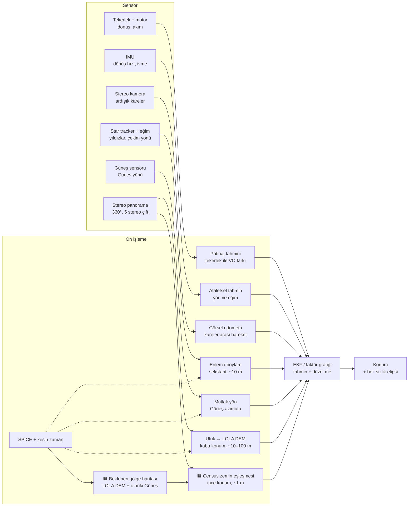

# Ay Rover'ı İçin Konumlama

Araştırma notları: yöntemler, NASA'nın uygulamaları ve önerilen mimari.
Aynı içeriğin sayfa düzenli PDF sürümü: [rover-konumlama-arastirmasi.pdf](rover-konumlama-arastirmasi.pdf).

> **Temel fikir.** Tek bir yöntem yeterli değil. NASA görevlerinde konum iki katmandan geliyor:
>
> 1. **Göreli konum:** tekerlek sayacı, IMU, görsel odometri. Sürekli ölçer ama hata zamanla birikir.
> 2. **Mutlak düzeltme:** Güneş veya yıldız ölçümü, ufku ya da zemini haritayla eşleştirme, Dünya'dan takip. Aralıklı ölçer ama birikmiş hatayı sıfırlar.
>
> İkisi bir filtrede birleştirilir: EKF (genişletilmiş Kalman filtresi) ya da faktör grafiği.

## İçindekiler

1. [İlk üç fikrin değerlendirmesi](#1-ilk-üç-fikrin-değerlendirmesi)
2. [Diğer konumlama yöntemleri](#2-diğer-konumlama-yöntemleri)
3. [Dünya'dan takip nasıl çalışır?](#3-dünyadan-takip-nasıl-çalışır)
4. [Yıldız izleyici ile konum: sekstant mantığı](#4-yıldız-izleyici-ile-konum-sekstant-mantığı)
5. [NASA görevlerinde konumlamanın evrimi](#5-nasa-görevlerinde-konumlamanın-evrimi)
6. [Lunokhod'un 9. tekerleği ve Apollo LRV](#6-lunokhodun-9-tekerleği-ve-apollo-lrv)
7. [Modern kayma (patinaj) tahmini](#7-modern-kayma-patinaj-tahmini)
8. [Mars Global Localization (Censible): nasıl çalışır?](#8-mars-global-localization-censible-nasıl-çalışır)
9. [Censible: sonuçlar ve çıkarımlar](#9-censible-sonuçlar-ve-çıkarımlar)
10. [Censible'ı Ay'a uyarlamak](#10-censiblei-aya-uyarlamak)
11. [Önerilen mimari](#11-önerilen-mimari)
12. [Hackathon demo planı](#12-hackathon-demo-planı)
13. [Kaynaklar](#13-kaynaklar)

---

## 1. İlk üç fikrin değerlendirmesi

### 1.1 Ufuk ve Güneş açısının zaman içindeki değişimi

- Literatürdeki karşılığı **ufuk / siluet eşleştirme** (skyline matching). JPL'in LunarNav projesi bunu LOLA yükseklik haritalarıyla (DEM) yapıyor.
- İki ölçüm arasındaki farka bakmak zayıf bir yöntem, çünkü uzak ufuk küçük hareketlerde neredeyse hiç değişmiyor. Daha iyisi, kameranın gördüğü ufku DEM'den hesaplanan ufukla **doğrudan karşılaştırmak**.
- Doğruluk literatürde tipik olarak ~100 m, en iyi durumda ~10 m. Bu yöntem kaba konum ve **yön** bulmak için uygun.

> **Not (önemli kural):** Güneş açısındaki değişimin çoğu rover'ın hareketinden değil, Ay'ın kendi dönüşünden gelir: 360° / 29,5 gün ≈ **0,5°/saat**. Bu pay SPICE efemerisi ve kesin zaman damgasıyla çıkarılmalı. Çıkarılmazsa duran bir rover bile hareket etmiş görünür. Ay ekvatorunda 0,5° yaklaşık 15 km konum hatasına denk gelir.

### 1.2 Yıldız haritasıyla konum

- Yıldız izleyici (star tracker) aracın uzaya göre yönünü verir. Buna yer çekimi yönü (eğim ölçer) ve kesin zaman eklenince enlem ve boylam bulunur.
- Ay küçük olduğu için yöntem hassastır: 1 yay saniyesi eğim hatası ≈ 8 m. Doğruluğu sınırlayan şey eğim ölçer.
- Atmosfer olmadığı için gündüz de çalışabilir. Şartlar: iyi bir gölgelik (baffle) olmalı ve kamera Güneş'e ya da aydınlık zemine bakmamalı.

### 1.3 Tekerlek dönüşüyle mesafe

- Regolitte patinaj ciddi bir sorun. Yokuşta kayma %10–20'yi rahatça geçer.
- Tarihteki çözümler: Lunokhod'un serbest dönen 9. tekerleği ve Apollo LRV'nin tekerlek seçim mantığı ([Bölüm 6](#6-lunokhodun-9-tekerleği-ve-apollo-lrv)).
- Modern çözüm: görsel odometriyle tekerlek sayacını karşılaştırıp kaymayı tahmin etmek ([Bölüm 7](#7-modern-kayma-patinaj-tahmini)).

---

## 2. Diğer konumlama yöntemleri

| Yöntem | Tür | Ne verir | Kim kullanıyor |
|---|---|---|---|
| **Görsel odometri (VO)**: stereo kamera, kareler arası özellik takibi | Göreli | Konum ve yön değişimi. Hata gidilen yolun ~%1–2'si. | Spirit/Opportunity, Curiosity, Perseverance, Yutu |
| **IMU**: jiroskop ve ivmeölçer | Göreli | Dönüş hızı ve eğim. Rover dururken jiroskop sapması sıfırlanır. | Hepsi |
| **Tekerlek sayacı** | Göreli | Mesafe. Patinaj yüzünden düzeltilmesi gerekir. | Hepsi |
| **Güneş sensörü / kamerayla Güneş'i bulma** | Mutlak | Yön (azimut) | Mars rover'ları, Apollo LRV |
| **Yıldız izleyici + eğim ölçer** | Mutlak | Yön; ayrıca enlem ve boylam | VIPER (yön için); CMU ve JPL konum çalışmaları |
| **Zemini yörünge haritasıyla eşleştirme** | Mutlak | Konum, metre altı doğruluk | Perseverance: Mars Global Localization (2026) |
| **Ufku DEM ile eşleştirme** | Mutlak | Kaba konum (~10–100 m) ve yön | JPL LunarNav (araştırma) |
| **Krater / kaya işaretleri** | Mutlak | Konum (belirgin işaretlerin olduğu arazide) | JPL araştırmaları |
| **Dünya'dan takip**: mesafe ölçümü, Doppler, VLBI | Mutlak | Konum | Chang'e; Lunokhod (lazer yansıtıcı) |
| **Ay seyrüsefer ağı** | Mutlak | Ay için GPS benzeri sistem | NASA LunaNet/LCRNS, ESA Moonlight. LuGRE 2025'te Ay'da GPS sinyali aldı. |
| **SLAM / faktör grafiği** | Birleştirici | Tüm ölçümleri birleştirir, geçmiş tahminleri de düzeltir | Güncel araştırmalar |

**Genel kural:** Göreli kaynaklar "nereye gittim" sorusunu sürekli cevaplar. Mutlak kaynaklar "şu an neredeyim" sorusunu aralıklarla cevaplar ve göreli hatayı sıfırlar.

---

## 3. Dünya'dan takip nasıl çalışır?

Rover'ın anteni etrafa yayın yapıp dairesel bir bölge oluşturmaz. Konum, Dünya'daki büyük antenlerle (örneğin DSN) yapılan hassas **zaman ve frekans ölçümlerinden** hesaplanır.

- **Mesafe ölçümü (ranging):** Dünya'dan sinyal gönderilir, rover'daki transponder sinyali hemen geri yollar. Gidiş-dönüş süresi × ışık hızı / 2 = mesafe. Tek bir ölçüm şunu söyler: "Rover bu antenden X km uzaklıktaki bir küresel kabuğun üzerinde."
- **Doppler:** Ay döndükçe rover Dünya'ya yaklaşır ve uzaklaşır, sinyal frekansı kayar. Kaymanın zamanla nasıl değiştiğinden rover'ın Ay üzerindeki konumu çıkarılır.
- **VLBI (çok uzun taban çizgili interferometri):** Kıtalarca uzaktaki iki anten aynı sinyali dinler. Varış zamanları arasındaki küçük fark, sinyalin geldiği açıyı verir. Sesin yönünü iki kulakla bulmanın radyo versiyonu gibi. Çin, Chang'e görevlerinde iniş aracının konumunu VLBI ile buldu. Yutu rover'ında doğrudan kullanılıp kullanılmadığı doğrulanmadı.
- **Lazer yansıtıcı:** Lunokhod'larda köşe aynalar var. Dünya'dan lazer atılır ve dönüş süresi ölçülür. Bilimsel ölçüm için kullanılır (Ay–Dünya mesafesi), gerçek zamanlı sürüş için değil.

**Özet:** Mesafe kabukları, Doppler çizgileri ve VLBI açıları üst üste bindirilir; kesişim noktası konumdur. Sınırları: Dünya görünür olmalı (Ay'ın uzak yüzünde çalışmaz), büyük yer antenlerinde zaman ayırmak gerekir ve doğruluk onlarca ile yüzlerce metre arasındadır.

---

## 4. Yıldız izleyici ile konum: sekstant mantığı

### Mantık, dört adımda

1. **Yıldız izleyici:** Gördüğü yıldızları bir katalogla eşleştirir ve kameranın uzaya göre yönünü (kuaterniyon) kesin olarak verir.
2. **Eğim ölçer:** Yer çekiminin yönünü, yani "aşağı"yı ölçer. Buradan pitch ve roll açıları çıkar.
3. **SPICE + kesin zaman:** O anda Ay'ın uzaydaki yönelimini verir.
4. **Birleştirme:** Rover'ın tam tepesindeki yön (zenit) uzayda bulunur ve Ay koordinatlarına çevrilir. Sonuç doğrudan enlem ve boylamdır.

### Gerçek kullanımlar

| Çalışma | Ne yapıldı |
|---|---|
| **Sigel ve Wettergreen (CMU, 2007)** | Ay rover'ı için geniş açılı yıldız izleyici + hassas eğim ölçerle konum tasarımı. Sonuç: en büyük hata kaynağı eğim ölçer. |
| **JPL küresel konumlama cihazı (2024)** | Eğim ölçer, yıldız izleyiciler, dönen platform ve eğim hizalama mekanizması. Hedef: GPS olmadan ~10 m konum doğruluğu. |
| **VIPER (NASA)** | Gezegen rover'ında uçacak ilk yıldız izleyici (Rocket Lab). Kutupta Güneş ufka çok yakın olduğu için yön ölçümünde yıldızlar kullanıldı. Amacı konum değil, esas olarak **yön**. |
| **Avrupa Seyrüsefer Konferansı (2025)** | Ataletsel sensörlerle birleştirilmiş gök seyrüseferi. Görev süresinden bağımsız ~100 m konum hedefi. |

### Pratik sınırlar

- 1 yay saniyesi eğim hatası ≈ 8 m (Ay yarıçapı 1737 km). İyi bir eğim ölçerle bile sonuç birkaç on metre düzeyinde kalır.
- Yerel yer çekimi anomalileri gerçek dikey yönü saptırır ve ek hata getirir.
- Sürüş titreşimi eğim ölçümünü bozar, bu yüzden ölçüm "dur, ölç, devam et" şeklinde yapılır.
- Metre altı doğruluk vermez, ~10–100 m verir. Yine de ufuk ve zemin eşleştirmesinden bağımsız bir kontrol olarak değerlidir.

---

## 5. NASA görevlerinde konumlamanın evrimi

| Görev | Göreli konum | Mutlak düzeltme |
|---|---|---|
| **Apollo LRV** (1971–72) | Yön jiroskobu + tekerlek sayaçları | Güneş gölgesi aletiyle başlangıç yönü. Konum ana araca göre gösterilir. |
| **Spirit / Opportunity** (2004) | Tekerlek + IMU. İşlemci yavaş olduğu için VO yalnızca riskli yerlerde kullanılır. | Kamerayla Güneş'i bularak yön. Yer ekibi yörünge görüntüleriyle elle düzeltir. |
| **Curiosity** (2012) | VO daha sık kullanılır | Yer ekibi rover görüntülerini HiRISE haritasıyla elle hizalar |
| **Perseverance** (2021) | Ayrı görüntü işlemcisiyle sürekli VO. Rekor: insan kontrolü olmadan 699,9 m. | Güneş'le yön. Konum yine elle düzeltildiği için sürüş mesafesi sınırlı. |
| **Perseverance + MGL** (Şubat 2026) | Aynı | **Araç üzerinde** panoramayı yörünge haritasıyla eşleştirme: ~2 dakika, ~25 cm |

**Güncel mimari:** Sürekli VO, IMU ve tekerlek ile göreli konum. Aralıklarla Güneş'le yön sabitleme ve panoramayı yörünge haritasıyla eşleştirerek mutlak düzeltme. Hepsi araç üzerinde.

**Neden önemli?**

- Konum belirsizliği büyüdükçe rover engel haritasındaki engelleri "şişirir": belirsizlik kadar güvenlik payı ekler. Dar geçitler kapanır ve sürüş erken biter. Makaledeki örnek Sol 385'teki dar koridor.
- Elle düzeltme, Dünya'ya veri gönderip insanı beklemek demektir.
- Araç üzerinde mutlak konum bulunabilirse sürüş mesafesindeki bu sınır pratikte kalkar.

VO hatası tipik olarak gidilen yolun %1–2'sidir. JPL'e göre uzun sürüşte konum 35 m'ye kadar sapabilir.

---

## 6. Lunokhod'un 9. tekerleği ve Apollo LRV

### Lunokhod: serbest dönen ölçüm tekerleği

- **"Serbest dönen" ne demek?** Bu tekerleğe motor bağlı değil. Rover'ın arkasında römork gibi çekilen dar bir tekerlek. Zemine değdiği için rover ilerledikçe sürtünmeyle döner.
- **Mantık:** Tahrik tekerlekleri kendi motorlarıyla döner, bu yüzden gevşek tozda patinaj yapınca rover yerinde sayarken bile dönmeye devam ederler. Motorsuz tekerleği çeviren tek kuvvet zeminin kendisidir. Bu nedenle ancak rover zemine göre **gerçekten ilerlediğinde** döner.
- **Benzetme:** Bisikletin arka tekerleği çamurda boşa dönebilir. Ama yanında yürüyen birinin ittiği ölçüm tekerleği (yol ölçüm cetveli) ancak gerçekten ilerlendiğinde döner.
- **Kayma ölçümü:** `kayma ≈ 1 − (ölçüm tekerleği yolu / tahrik tekerleği yolu)`
- **Sınırları:** Ölçüm tekerleği de kayabilir, zıplayabilir ya da batabilir. LRO görüntüleriyle sonradan yapılan haritalamada Lunokhod 1'in mesafesinin fazla, Lunokhod 2'ninkinin eksik hesaplandığı görüldü. Lunokhod 2 için ~42 km bulundu, eski değer ~37 km'ydi.

### Apollo LRV: jiroskop + tekerlek sayaçları + Güneş gölgesi

- **Yön jiroskobu:** Aracın baktığı yönü verir.
- **Artımlı sayaçlar:** Dört tekerleğin sinyallerinden mesafe ve hız hesaplanır.
- **Sinyal işlemci:** Yön ve mesafeyi birleştirir, panelde ana araca olan yönü ve uzaklığı gösterir.
- **Güneş gölgesi aleti:** Jiroskobun başlangıç yönünü ayarlamak için kullanılır. Araç Güneş'e sırtını dönecek şekilde park edilir, alet döndürülür ve iğnenin gölgesinin skalada düştüğü yer okunur. Güneş Ay gökyüzünde çok yavaş hareket ettiği için işe yarar.
- **Tekerlek seçim kuralı:** "Dört tekerleğin üçüncü en hızlısını kullan" kuralı aklımızda var: en hızlısı patinaj yapıyor, en yavaşı takılıyor olabilir. **Kaynaklarda doğrulanmadı.** Kesin cevap LRV Sistem El Kitabı'nda olmalı.

---

## 7. Modern kayma (patinaj) tahmini

Lunokhod'un ölçüm tekerleğinin yaptığı işi bugün kamera ve yazılım yapıyor.

> **Benzetme: koşu bandındaki koşucu.**
> - Adım sayar (pedometre) = **tekerlek sayacı**: "Çok adım attım."
> - Gözler = **görsel odometri**: "Duvar yerinden oynamadı."
> - Bacak yorgunluğu = **motor akımı**: "Çok zorlanıyorum."
> - İç kulak = **IMU**: "Yokuştayım."
>
> Bu duyular çeliştiğinde beyin "kayıyorum" sonucuna varır. Rover da aynısını yapar.

### Adım adım mantık

1. **Beklenen hareket:** Tekerlek dönüşü × yarıçap. Rover'ın "gitmem gereken" mesafe.
2. **Gerçek hareket:** VO kamera karelerinde zemindeki taşları takip eder ve "gerçekte gittiğim" mesafeyi verir.
3. **Kayma oranı:** `s = 1 − (gerçek / beklenen)`. Rover bunu her adımda hesaplar. Eşik aşılırsa (Mars'ta tipik olarak %40–60) durur ve batma riski bildirir.
4. **VO çalışmadığında tahmin:** VO pahalıdır, dokusuz zeminde ve gölgede başarısız olur. O zaman kayma dolaylı sinyallerden tahmin edilir:
   - **Eğim (IMU):** Yokuş yukarı kayma artar.
   - **Motor akımı:** Kayan tekerlek tozu kazırken daha çok akım çeker.
   - **Arazi sınıfı:** Kameradan kum veya kaya olarak sınıflandırılır.

   Bunlardan "bu yokuşta, bu akımda, bu zeminde kayma ≈ %25" diyen bir model öğrenilir. JPL bunu Mars'ta öğrenilmiş kayma modelleriyle denedi.
5. **Filtre:** Kayma tahmini EKF'ye düzeltme terimi olarak girer. Tekerlek sayacı ham mesafe olarak değil, kaymaya göre düzeltilmiş mesafe olarak kullanılır. VO her çalıştığında model yeniden kalibre edilir.

```text
beklenen = tekerlek_dönüşü × r          (tekerlek sayacı)
gerçek   = VO_yer_değiştirmesi            (kamera)
s        = 1 − gerçek / beklenen          (ölçülen kayma)
ŝ        = f(eğim, akım, arazi)           (VO yokken tahmin)
mesafe   = beklenen × (1 − ŝ)  →  EKF
```

---

## 8. Mars Global Localization (Censible): nasıl çalışır?

Kaynak: JPL, Nash, Verma ve ark., *Censible*, ICRA 2024. Perseverance'ta Şubat 2026'dan beri görevde kullanılıyor.

**Benzetme:** Elinde bir mahallenin uydu fotoğrafı var ve gözün bağlı bir sokakta uyandın. Etrafındaki zemine bakıp kuş bakışı bir taslak çizersin, sonra taslağı fotoğrafın üzerinde kaydırarak en iyi oturduğu yeri ararsın. Pusulan olduğu için taslağı döndürmen gerekmez, yalnızca kaydırırsın.

1. **Yönü sabitle:** Güneş, yıldızlar veya jiroskopla mutlak yön bulunur. Arama 3 boyuttan (x, y, dönüş) yalnızca x–y kaydırmaya iner.
2. **360° stereo panorama:** Genellikle 5 stereo çift çekilir. Kırmızı kanal kullanılır, çünkü HiRISE de kırmızı / yakın kızılötesi bantta.
3. **Işık düzeltmesi:** Lensin yarattığı kenar kararmaları (vignetting) ve pozlama farkları giderilir. Düzeltme birkaç katsayılı bir polinomla yapılır, böylece Mars'a çok az veri gönderilir.
4. **Stereo eşleştirme:** Semi-Global Matching (SGM) ile 3B nokta bulutu üretilir. Hatalı eşleşmeler tutarlılık, benzersizlik ve leke filtreleriyle temizlenir.
5. **Kuş bakışı görüntüye çevirme (ortoprojeksiyon):** Nokta bulutu harita eksenine döndürülür. Yalnızca 3–40 m arası tutulur: daha yakını rover gövdesi ve gölgesi, daha uzağı gürültü. Sonuç 25 cm çözünürlüklü bir parlaklık görüntüsü ve bir yükseklik görüntüsü.
6. **Arama penceresi:** Odometri tahmini ± belirsizlik kadar alan kırpılır. Tipik olarak ±30 m, yani 240×240 piksel.
7. **Değiştirilmiş census dönüşümü (sistemin kalbi):**
   - Her piksel 8 komşusuyla karşılaştırılır ve her komşu için "daha parlak mıyım?" sorusunun cevabı bir bit olarak tutulur. Parlaklığın kendisi değil, sıralaması saklanır.
   - Rover fotoğrafı ve yörünge fotoğrafı farklı kamerayla, farklı saatte, farklı pozlamayla çekilmiştir. Parlaklık değerleri tutmaz, ama "taş yanındaki kumdan açık renkli" bilgisi tutar.
   - Rover'ın göremediği alanlar "veri yok" olarak işaretlenir ve skora ceza eklemez.
8. **Skor:** census Hamming mesafesi + α × yükseklik SSD'si (ortalaması çıkarılmış). En düşük skoru veren kaydırma konum olarak seçilir.
9. **Piksel altı hassasiyet ve güven:** En iyi noktanın 3×3 komşuluğuna parabol yüzeyi oturtulur. Yüzeyin sivriliği güven ölçüsü olarak kullanılır.
10. **Harita izdüşümü düzeltmesi ve doğrulama:** Doğu-batı yönündeki ölçek hatası düzeltilir (~1 m / 500 m). Hesap birkaç kez çalıştırılır ve ana bilgisayar sonuçları karşılaştırır.

---

## 9. Censible: sonuçlar ve çıkarımlar

Jezero Krateri'nde 2,5 yıl boyunca çekilmiş 264 gerçek panoramayla test edildi.

| Ölçüt | Değer |
|---|---|
| Ortalama hata | **0,36 m** |
| En kötü hata | 1,07 m |
| 5 m'yi aşan hata sayısı | **0 / 264** |
| Süre (5 stereo çift) | 81 s |
| Bellek | < 1 GB |
| İşlemci | Snapdragon 801 (helikopter baz istasyonu) |
| Mars'a gönderilen veri | 744 KB program + 250 KB harita (200×200 m) |
| Görevde ilk kullanım | 2 ve 16 Şubat 2026 |

| Benzerlik ölçüsü | Ort. hata | > 5 m hata |
|---|---|---|
| Maskeli NCC | 24,97 m | 225 |
| Karşılıklı bilgi | 24,33 m | 216 |
| **Değiştirilmiş census** | **0,36 m** | **0** |
| Census olmadan | 14,17 m | 185 |

### Hassasiyet analizinden çıkarımlar

| Değişken | Sonuç | Bizim için anlamı |
|---|---|---|
| Görüntü çözünürlüğü | 320×240'a kadar sonuç neredeyse aynı | Ucuz kamera yeterli |
| Harita çözünürlüğü | 1 m'lik haritada ortalama hata 0,71 m | Ay'ın daha kaba haritalarıyla da metre düzeyi mümkün |
| Stereo çifti sayısı | 1 çiftle 264'te 6 hatalı sonuç | Ne kadar geniş alan görülürse o kadar iyi |
| Stereo menzili | 10 m'de 264'te 3 hatalı sonuç | En az ~20 m menzil gerekli |
| Arama yarıçapı | 100 m'ye kadar sağlam | Kaba bir başlangıç tahmini yeterli |

> **Önceki önerimizi düzelten bulgu:** Makaleye göre ufuk/DEM eşleştirme ~100 m (en iyi ~10 m) doğruluk veriyor ve daha çok **yön** için değerli. Metre düzeyinde **konum** için zemin desenini census ile eşleştirmek çok daha güçlü. Bu yüzden ikisini birlikte kullanmalıyız: önce ufukla kaba konum, sonra census ile ince konum.

---

## 10. Censible'ı Ay'a uyarlamak

### Doğrudan uyan kısımlar

- Gereken üç şey Ay için de var: stereo kamera, yörünge görüntüsü (LRO NAC) ve DEM (LOLA).
- Ay'da da yön bulunabilir: Güneş, yıldız izleyici (VIPER zaten taşıyordu) veya jiroskop.
- İşlem gücü ihtiyacı düşük; telefon sınıfı bir işlemci yetiyor.
- JPL, sıradaki hedefin Ay olduğunu ve Endurance gibi kutup görevlerini açıkça belirtiyor.

### Zorluklar ve çözüm fikirleri

| Sorun | Neden | Çözüm fikri |
|---|---|---|
| **Gölgeler uyuşmuyor** | Güney kutbunda Güneş birkaç derece yükseklikte. Gölgeler çok uzun ve saatten saate dönüyor. Yörünge fotoğrafı başka bir Güneş açısında çekilmiş. | **Projemiz için en büyük katkı:** LOLA DEM ve SPICE'tan o anki Güneş konumuyla **beklenen gölge haritasını** kendimiz üretip eşleştirmeyi ona karşı yapmak. Güneş yüksekliği ve ufuk hesabımız zaten var. |
| **Harita daha kaba** | LRO NAC, HiRISE'dan daha kaba. Kutup DEM'leri metreler düzeyinde (kesin değerler doğrulanmalı). | Makaleye göre 1 m'lik haritada bile hata 0,7 m. Ay'da da metre düzeyi beklenebilir. |
| **Kalıcı gölgedeki bölgeler (PSR)** | Normal yörünge fotoğrafı orada karanlık. | ShadowCam (KPLO) bu bölgeleri görüntüleyebiliyor. Alternatif: sadece DEM ile yükseklik eşleştirmesi. |
| **Karşıt aydınlatma etkisi** | Güneş arkadayken regolit gölgesiz ve dokusuz görünür. | SGM dokusuz zemine dayanıklı. Panorama farklı yönlerden çekildiği için hepsi aynı anda etkilenmez. |
| **Rover'ın kendi ışığı** | Gölgede rover'ın lambası farklı bir aydınlatma yaratır. | Census parlaklık farklarına dayanıklı. Gerekirse yükseklik skorunun ağırlığı artırılır. |

**Görev paylaşımı:** Ufuk eşleştirme kaba konum (~10–100 m) ve yön verir. Census zemin eşleştirmesi bu tahminin etrafındaki ±30 m'lik pencerede metre düzeyinde ince konum verir. Yıldız izleyici + eğim ölçer ikisinden bağımsız bir kontrol sağlar (~10 m).

---

## 11. Önerilen mimari

Göreli katman sürekli tahmin üretir, mutlak katman aralıklarla düzeltir. 🟧 ile işaretli kutular, Censible yaklaşımından Ay için eklenen kısımlar.



Kesikli çizgiler: SPICE, mutlak hesapların hepsini (Güneş, yıldız, gölge) besler.

---

## 12. Hackathon demo planı

Gerçek rover görüntümüz yok, ama elimizde LOLA DEM ve SPICE var. Bunlarla tamamen sentetik bir demo kurulabilir.

### Akış

1. **Arazi:** Güney kutbundan gerçek bir LOLA DEM parçası al.
2. **"Yörünge haritası":** DEM'den, A anındaki Güneş açısıyla gölgeli kabartma (hillshade) ve gölge haritası üret.
3. **"Rover ortomozaiği":** Rastgele bir noktada, B anındaki farklı bir Güneş açısıyla küçük bir parça kes. Gürültü ekle ve görülmeyen alanları maskele (3–40 m halkasının dışı, kaya arkaları).
4. **Başlangıç tahmini:** Gerçek konumu ±30 m kaydır. Bu, "odometrinin hatalı tahmini" olur.
5. **Eşleştirme:** Değiştirilmiş census + yükseklik SSD skoru hesapla, piksel altı en iyi konumu bul.
6. **Karşılaştırma:** (a) eski yörünge görüntüsüyle eşleştirme, (b) gölgesi SPICE ile o ana göre yeniden üretilmiş haritayla eşleştirme.

### Gösterilecekler

- **Skor ısı haritası:** Tek ve sivri bir tepe "eminim" demek, yayvan bir tepe "emin değilim" demek.
- **Hata grafiği:** Güneş açısı farkı arttıkça (a) bozulur, (b) sağlam kalır.
- **EKF demosu:** Odometri hatası birikir; census düzeltmesi geldiğinde belirsizlik elipsi küçülür.

### Teknik kapsam

- Python ve NumPy (census ve kaydırmalı skor), SPICE için SpiceyPy, DEM okumak için rasterio.
- Birkaç yüz satırlık bir iş. Mevcut ufuk ve Güneş yüksekliği hesabımız doğrudan kullanılabilir.
- Yeni bir bağımlılık eklemeden önce ekip onayı gerekir (bkz. `docs/adr/`).

> **Jüriye anlatılacak hikâye:** "NASA'nın 2026'da Mars'ta devreye aldığı konum bulma yöntemini Ay'ın güney kutbundaki zorlu aydınlatmaya uyarladık. Gölgeleri SPICE ile o ana göre yeniden üreterek eşleştirmeyi sağlamlaştırdık."

---

## 13. Kaynaklar

Doğrulanmamış iddialar ilgili bölümlerde ayrıca belirtildi.

- Nash, J., Dwight, Q., Saldyt, L., Wang, H., Myint, S., Ansar, A., Verma, V. — *Censible: A Robust and Practical Global Localization Framework for Planetary Surface Missions*, ICRA 2024. <https://www-robotics.jpl.nasa.gov/media/documents/2024_Global_Localization_ICRA.pdf>
- JPL haberi, Perseverance konumunu kendi başına buluyor (18 Şubat 2026). <https://www.jpl.nasa.gov/news/nasas-perseverance-now-autonomously-pinpoints-its-location-on-mars/>
- Space.com, Perseverance'ın kendi "GPS"i. <https://www.space.com/space-exploration/mars-rovers/nasas-perseverance-rover-now-has-its-own-gps-on-mars-weve-given-the-rover-a-new-ability>
- JPL Global Localization, IEEE Aerospace 2024 (dosya çok büyük olduğu için okunamadı). <https://robotics.jpl.nasa.gov/media/documents/2024_Global_Localization_IEEE_Aero.pdf>
- JPL 2026, bellek sorununa çözüm makalesi. <https://robotics.jpl.nasa.gov/media/documents/2026_Global_Localization_Memory_Workaround_IEEE_Aero__final.pdf>
- JPL yıldız izleyici konumlama cihazı posteri (2024). <https://www.jpl.nasa.gov/site/research/media/posters/2024/R24220p.pdf>
- Sigel, D., Ay rover'ı için yıldız izleyicili gök konumlama. <https://independent.academia.edu/DeborahSigel>
- NASA, Ay yüzeyi navigasyon taraması (AAS GNC 2025). <https://ntrs.nasa.gov/api/citations/20250000720/downloads/Lunar_Surface_Nav_Survey_AAS_GNC_011825.pdf>
- NASA, VIPER hareket donanımı sunumu (LSIC 2024). <https://ntrs.nasa.gov/api/citations/20240013903/downloads/LSIC_2024-Tech%20Infusion_Panel-VIPER_Mob-HW.pdf>
- Avrupa Seyrüsefer Konferansı 2025, gök seyrüseferi. <https://sciforum.net/paper/24132>
- Nature, Lunokhod rotalarının yeniden haritalanması. <https://www.nature.com/articles/498284a>
- Orbital Focus, Luna 17 / Lunokhod 1. <https://orbitalfocus.uk/Diaries/Luna/Luna17.php>
- NSSDC, Apollo Lunar Roving Vehicle. <https://nssdc.gsfc.nasa.gov/planetary/lunar/apollo_lrv.html>
- NASA, LRV Apollo 17 Sistem El Kitabı. <https://www.nasa.gov/wp-content/uploads/static/history/alsj/LRVSysHndbkA17.pdf>
- NASA, LRV navigasyon sistemi teknik notu. <https://www.nasa.gov/wp-content/uploads/static/history/alsj/19740003321_1974003321.pdf>
