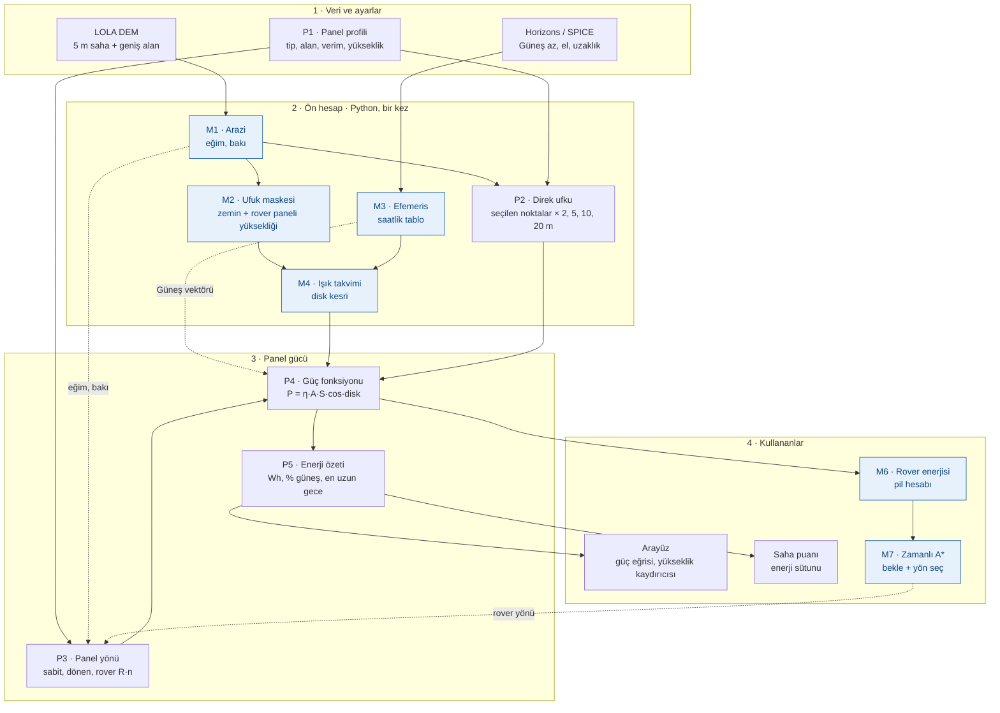

# Güneş Paneli Modeli: Hareket, Güneş Konumu ve Yükseklik

"Güneş panelleri için sadece açısal sabit değişken değil, hareket eden ve güneşte ve bulunduğu konum (yükseklik, eğim vb.) üzerinden hesap" araştırma başlığı (madde 13) kapsamında hazırlanan model ve mimari önerisi. Bir panelin Ay'ın güney kutbunda saat saat ne kadar güç üreteceğini; panelin tipine (yatık, sabit, dönen), yüksekliğine, bulunduğu yerin eğimine ve rover'ın baktığı yöne göre hesaplar. Hangi parçanın ne aldığını, ne verdiğini ve ürünün geri kalanına nasıl bağlandığını anlatır.

- **Tarih:** 14 Kasım 2026
- **Durum:** Öneri. Ürüne kod eklenmedi. 8. bölümdeki sayılar, araştırma sırasında yazılan küçük bir Python betiğiyle ve gerçek Horizons verisiyle hesaplandı.
- **Kapsadığı madde:** 13 (12 ve 8 ile bağlantılı)
- **Test sahası:** Mons Mouton (−84,78°, 29,13° D), [ephemeris-rotation-ground-stations](../ephemeris-rotation-ground-stations/README.md) ile aynı
- **Üst mimari:** [light-heat-layer](../light-heat-layer/README.md). Bu not oradaki M2 (ufuk maskesi), M4 (ışık takvimi) ve M6 (rover enerjisi) modüllerinin panel kısmını ayrıntılandırır.

## İçindekiler

1. [Kısa özet](#1-kısa-özet)
2. [Neden önemli](#2-neden-önemli)
3. [Hesabın mantığı](#3-hesabın-mantığı)
4. [Panel tipleri](#4-panel-tipleri)
5. [Yükseklik ve ufuk](#5-yükseklik-ve-ufuk)
6. [Rover: eğim ve yön](#6-rover-eğim-ve-yön)
7. [Sıcaklık ve verim](#7-sıcaklık-ve-verim)
8. [Mons Mouton ön hesabı](#8-mons-mouton-ön-hesabı)
9. [Mimari](#9-mimari)
10. [Modüller: girdi ve çıktı](#10-modüller-girdi-ve-çıktı)
11. [Dosyalar ve veri biçimi](#11-dosyalar-ve-veri-biçimi)
12. [Nasıl kullanacağız](#12-nasıl-kullanacağız)
13. [Açık kaynak araçlar ve veri](#13-açık-kaynak-araçlar-ve-veri)
14. [Teslime kadar plan](#14-teslime-kadar-plan)
15. [Riskler ve açık sorular](#15-riskler-ve-açık-sorular)
16. [Kaynaklar](#16-kaynaklar)

---

## 1. Kısa özet

1. **Kutupta Güneş hep ufkun dibinde.** Mons Mouton'da Aralık 2026 boyunca Güneş en fazla 6,47° yükseliyor ve ufku çember çizerek dolaşıyor. Bu yüzden panelin hangi yöne baktığı ve önünde tepe olup olmadığı, panelin kendisinden daha belirleyici.
2. **Dik ve Güneş'le birlikte dönen panel en iyisi.** Tek eksende (dikey eksen etrafında) dönen dik panel, iki eksende dönen pahalı panelle neredeyse aynı enerjiyi topluyor (fark yüzde 0,3). Sabit dik panel bunun yarısını, yere yatık panel ise yaklaşık yüzde 6'sını topluyor.
3. **Yükseklik ve arazi, panel tipinden sonraki en büyük etken.** Ufku yalnızca 1° yukarı ya da aşağı almak, dönen panelin aylık enerjisini 686 ile 890 W/m² arasında oynatıyor. Paneli direğe çıkarmak, yakındaki tepelerin üstünden bakmak demek.
4. **Rover yönünü değiştirerek yüzde 18 daha fazla enerji topluyor.** VIPER benzeri üç panelli bir rover'da Güneş arka köşeye gelince iki panel birden ışık alıyor.
5. **Ürüne katkısı:** kullanıcı bir yer, panel tipi ve yüksekliği seçer; program saat saat güç eğrisini, aylık enerjiyi ve en uzun karanlık süreyi gösterir. Aynı fonksiyon, zamanlı A* rota bulucunun pil hesabına girer.

---

## 2. Neden önemli

Yakın zamandaki iki iniş, panelin yönünün görevi nasıl belirlediğini gösteriyor:

| Görev | Ne oldu | Bizim için dersi |
|---|---|---|
| SLIM (JAXA, 2024) | Burnunun üstüne devrildi, paneller batıya baktı. Sabah güç yoktu, Güneş batıya geçince uyandı. | Panel yönü girdi olmalı, sabit kabul edilmemeli ([CSA notu](../csa-moon-exploration.md)). |
| Athena (IM-2, 2025) | Güney kutbunda bir kraterin içine yan yattı, paneller Güneş'i göremedi. Görev 13 saatten kısa sürdü. | Arazinin eğimi ve yakındaki gölge, panel gücünü sıfıra indirebilir. |
| VIPER (NASA, iptal edildi) | Üç dik paneli (sol, sağ, arka) vardı. Ekip, Güneş'i arka köşeye alacak şekilde sürüş planlıyordu. | Rover'ın yönü de bir karar değişkeni. |

Ayrıca NASA, kutupta güç için 10–20 m'lik dikey güneş paneli direkleri geliştiriyor (VSAT: Astrobotic, Honeybee Robotics, Lockheed Martin; prototipler 2024'te JSC'deki vakum odasında test edildi). Yani "dik, dönen ve yüksek panel" fikri NASA'nın kendi tercihiyle aynı.

---

## 3. Hesabın mantığı

Bir panelin o anki gücü üç sorunun cevabının çarpımı:

1. **Güneş ne kadar güçlü?** Ay'da hava olmadığı için 1 AU uzaklıkta 1361 W/m². Uzaklık değiştikçe `1361 / r_au²`.
2. **Panel Güneş'e ne kadar dönük?** Güneşe tam bakıyorsa 1, yandan görüyorsa 0. Matematikte bu, Güneş yönü ile panel normalinin (yüzeye dik ok) iç çarpımı: `max(0, ŝ · n̂)`.
3. **Güneş'in ne kadarı görünüyor?** Güneş bir nokta değil, yarıçapı yaklaşık 0,27° olan bir disk. Ufuktaki arazi diskin bir kısmını kapatabilir. 0 = tamamen gölge, 1 = tam güneş.

```text
P = verim × alan × 1361 / r_au² × max(0, ŝ · n̂) × disk_kesri
disk_kesri = clip((güneş_yüksekliği − ufuk[güneş_azimutu]) / (2 × 0,267°) + 0,5, 0, 1)
```

Buradaki `ufuk[az]`, panelin bulunduğu noktadan ve **panelin yüksekliğinden** bakınca o yöndeki arazinin kaç derece yukarıda olduğu (M2 ufuk maskesi).

Çekirdek kod (NumPy, açılar derece; ENU = doğu, kuzey, yukarı):

```python
import numpy as np

R_GUNES = 0.267  # derece, Güneş diskinin açısal yarıçapı

def gunes_vektoru(az, el):
    az, el = np.radians(az), np.radians(el)
    return np.stack([np.cos(el) * np.sin(az), np.cos(el) * np.cos(az), np.sin(el)], axis=-1)

def disk_kesri(el, ufuk):
    return np.clip((el - ufuk) / (2 * R_GUNES) + 0.5, 0.0, 1.0)

def panel_gucu(az, el, r_au, ufuk, normal_enu, alan_m2, verim):
    cos_i = np.maximum(0.0, gunes_vektoru(az, el) @ normal_enu)
    return verim * alan_m2 * 1361.0 / r_au**2 * cos_i * disk_kesri(el, ufuk)
```

---

## 4. Panel tipleri

Panelin normali (`n̂`) nasıl seçilirse panel tipi o olur. Güneş yüksekliği `el`, azimutu `az`.

| Tip | Ne demek | `ŝ · n̂` | Nerede kullanılır |
|---|---|---|---|
| Yere yatık | Panel yere paralel, yukarı bakar | `sin(el)` | Kutupta işe yaramaz; karşılaştırma için |
| Dik, sabit | Dik durur, tek yöne (`az0`) bakar | `cos(el) × cos(az − az0)` | Basit iniş aracı; SLIM ve Athena tipi durumlar |
| Dik, dönen | Dik durur, dikey eksen etrafında Güneş'e döner | `cos(el)` | Önerilen iniş aracı / üs paneli; NASA VSAT |
| İki eksenli | Hem döner hem eğilir, Güneş'e tam bakar | `1` | Referans (üst sınır) |
| Rover kutusu | Gövdeye bağlı birkaç dik panel; yönü rover belirler | her panel için ayrı, toplanır | VIPER benzeri rover (6. bölüm) |

Neden dönen dik panel iki eksenliye bu kadar yakın: Güneş en fazla 6,47° yükseliyor ve `cos(6,47°) = 0,994`. Yani panelin eğilmesine gerek kalmıyor, dönmesi yetiyor. EPJ Photovoltaics 2024 çalışması da kutup bölgesi için aynı sonuca varıyor: dikey eksenli izleyici iki eksenliye neredeyse eşit, sabit paneller ise yüzde 37–64 kaybediyor.

---

## 5. Yükseklik ve ufuk

Panel ne kadar yüksekteyse ufuk o kadar aşağı iner ve Güneş daha uzun süre görünür. Bunun iki nedeni var:

1. **Ay'ın eğriliği (küçük etki).** Yüksekten bakınca ufuk geometrik olarak `√(2h / R_ay)` kadar alçalır: 2 m'de 0,087°, 10 m'de 0,194°, 20 m'de 0,275°.
2. **Yakındaki arazi (büyük etki).** Güneş bu kadar alçakta olduğu için, birkaç yüz metre ötedeki küçük bir tepe bile diski kapatabilir. Paneli yükseltmek o tepenin üstünden bakmayı sağlar. Bu etki yere göre değişir ve yalnızca gerçek ufuk maskesiyle hesaplanabilir.

Literatürdeki sayılar bunu doğruluyor:

| Kaynak | Bulgu |
|---|---|
| Gläser vd. 2014 (LOLA arazi modeli) | En iyi güney kutup noktaları 2 m yükseklikte zamanın yüzde 77–88'inde aydınlık |
| Connecting Ridge çalışması (20 m arazi modeli, 19 yıllık döngü) | 2 m'de yüzde 92,27, 10 m'de yüzde 95,65 aydınlık (yazarı bu araştırmada doğrulanmadı) |
| Barker vd. (geliştirilmiş LOLA modeli) | 5 m ve üzerindeki yüksekliklerde arazi modeli hatalarının etkisi azalıyor |
| NASA VSAT / BEACON | Hedef: kutup kışında 100 saatten kısa gölge; 10–20 m direkler |

**Bizim için anlamı:** M2 ufuk maskesi, gözlemci yüksekliği parametre olacak şekilde yazılmalı (`h_gozlemci`). Zemin sıcaklığı için 0 m, rover paneli için yaklaşık 1 m, iniş aracı / üs direği için kullanıcının seçtiği değer (2, 5, 10, 20 m). Bütün ızgara için her yükseklik ayrı hesaplanırsa süre katlanır; bu yüzden direk yükseklikleri yalnızca **seçilen birkaç saha noktası** için hesaplanır (bkz. 10. bölüm, P2).

---

## 6. Rover: eğim ve yön

Rover'ın panelleri gövdeye bağlı. Panelin dünyada hangi yöne baktığı üç şeye bağlı:

- **Eğim (`s`):** rover'ın durduğu zeminin eğimi (M1)
- **Bakı (`A`):** zeminin yokuş aşağı baktığı yön (M1)
- **Yön (`psi`):** rover'ın burnunun baktığı yön (kuzeyden saat yönünde)

Ekibin [ephemeris çalışmasındaki](../ephemeris-rotation-ground-stations/README.md) `scripts/f1_check.py` bu üçünden gövde → ENU dönüş matrisini kuruyor ve 2000 rastgele durumla doğruluyor. Gövde eksenleri: x ileri, y sol, z yukarı.

```python
def R_enu_body(s, A, psi):            # f1_check.py ile aynı
    s, A, psi = np.radians([s, A, psi])
    z = np.array([np.sin(s) * np.sin(A), np.sin(s) * np.cos(A), np.cos(s)])
    x = np.array([np.sin(psi), np.cos(psi), -np.tan(s) * np.cos(psi - A)])
    x /= np.linalg.norm(x)
    y = np.cross(z, x)
    return np.column_stack([x, y, z])

# VIPER benzeri: sol (+y), sağ (−y), arka (−x) dik paneller
PANELLER = {"sol": [0, 1, 0], "sag": [0, -1, 0], "arka": [-1, 0, 0]}

def rover_gucu(az, el, r_au, ufuk, s, A, psi, alan_m2, verim):
    R = R_enu_body(s, A, psi)
    return sum(panel_gucu(az, el, r_au, ufuk, R @ np.array(n), alan_m2, verim)
               for n in PANELLER.values())
```

**En iyi yön:** düz zeminde Güneş arka köşeye (rover'a göre 135° veya 225°) geldiğinde iki panel birden `cos 45° = 0,707` ile ışık alır. Toplam `1,414`, tek panelin en iyi durumundan (`1`) yüzde 41 fazla. Eğimli zeminde en iyi yön değişir; bu yüzden kod, yönü 5°'lik adımlarla tarayıp en iyisini seçebilir (36 veya 72 deneme, çok ucuz).

**Sürerken yön:** normal bir rover hareket yönüne bakar, yani yön `psi` hamlenin yönüdür. VIPER her yöne sürülebiliyordu (yengeç yürüyüşü); böyle bir rover'da yön, hareket yönünden bağımsız seçilebilir. Bu, rover profilinde `her_yone_surus: true/false` ayarı olarak tutulur.

---

## 7. Sıcaklık ve verim

- **Verim (`verim`):** uzay tipi üç eklemli GaAs hücreler için yaklaşık 0,28–0,30 alınabilir. Rover profilinde bir sayı olarak tutulur.
- **Sıcaklık:** hücre ısındıkça verim düşer. Normal sıcaklıklar için ölçülmüş katsayı, her derece için yaklaşık yüzde 0,2 düşüş (`k ≈ −0,002 / K`). Bu değer bu araştırmada Ay kutbunun soğuk koşulları için doğrulanmadı.
- **Hücre sıcaklığı:** arXiv 2509.13110 (Ay'da PV sıcaklığı için gri bant modeli) panelin hem Güneş'ten hem sıcak zeminden ısındığını gösteriyor (örneğinde 390 K zeminin yanında, Güneş'e dik panel için 329 K).

İlk sürüm için öneri: sıcaklık düzeltmesini kapalı başlatmak (`k = 0`), sonra sabit bir hücre sıcaklığıyla açmak. Bu, enerji sonucunu birkaç yüzde değiştirir, ufkun 1° değişmesi ise yüzde 11–16. Önce ufuk doğru olmalı.

```text
P_sicaklikli = P × (1 + k × (T_hucre − T_ref))      # T_ref ≈ 301 K (28 °C)
```

---

## 8. Mons Mouton ön hesabı

**Yöntem:** JPL Horizons'tan Mons Mouton (−84,78°, 29,13° D, 0 m) için 1–31 Aralık 2026 saatlik Güneş azimutu, yüksekliği ve uzaklığı çekildi (744 satır). İlk satır ekibin `data/hz_sun_site.txt` verisiyle aynı çıktı (az 250,880680°, el −0,238375°). Arazi henüz hesapta yok: ufuk her yönde sabit −1°, 0° ve +1° kabul edildi. Değerler, verim uygulanmadan panelin metrekaresine düşen ortalama güç (W/m²).

### Aylık ortalama (W/m²)

| Panel | Ufuk −1° | Ufuk 0° | Ufuk +1° |
|---|---:|---:|---:|
| İki eksenli (üst sınır) | 892,7 | 771,2 | 688,3 |
| **Dik, dönen** | **890,3** | **768,8** | **685,9** |
| Dik, sabit (en iyi yönde) | 426,2 | 423,4 | 423,3 |
| Rover, Güneş'i arka köşeye alarak | 419,7 | 362,4 | 323,3 |
| Rover, park halinde (en iyi sabit yönde) | 354,4 | 316,6 | 289,3 |
| Yere yatık | 54,3 | 54,3 | 53,6 |

Rover değerleri üç panelin **toplam** alanına bölündü (bir anda en fazla iki panel ışık alır), bu yüzden sabit tek panelle doğrudan kıyaslanmamalı.

### Güneş ve karanlık

| | Ufuk −1° | Ufuk 0° | Ufuk +1° |
|---|---:|---:|---:|
| Güneş'in bir kısmı görünüyor | %66,2 | %56,6 | %50,6 |
| Güneş tam görünüyor | %61,1 | %53,3 | %47,5 |
| En uzun kesintisiz karanlık | 232 saat | 280 saat | — |
| En yüksek Güneş yüksekliği | 6,47° | 6,47° | 6,47° |

### Günlük görünüm (ufuk −1°, W/m²)

| Gün (Aralık) | Güneş en yüksek | Dönen dik | Sabit dik | Rover dönerek | Yere yatık |
|---|---:|---:|---:|---:|---:|
| 1 | −0,24° | 1076 | 210 | 507 | 0 |
| 2–10 | ufkun altında | 0–3 | 0 | 0–1 | 0 |
| 12 | 0,02° | 1331 | 0 | 627 | 0 |
| 16 | 4,21° | 1403 | 0 | 662 | 92 |
| 21 | 6,47° | 1392 | 1114 | 656 | 158 |
| 24 | 5,76° | 1394 | 1391 | 657 | 133 |
| 28 | 2,22° | 1403 | 931 | 662 | 41 |
| 31 | −1,08° | 55 | 10 | 26 | 0 |

### Ne öğrendik

1. Dönen dik panel ≈ iki eksenli. Eğme mekanizmasına gerek yok.
2. Sabit dik panel, Güneş arkasına geçtiği günlerde (yaklaşık 2–16 Aralık) hiç üretmiyor.
3. Ufku 1° aşağı almak dönen panelin enerjisini yüzde 16 artırıyor (769 → 890), 1° yukarı almak yüzde 11 azaltıyor (769 → 686). Gerçek arazi maskesi en önemli eksik parça.
4. 2–10 Aralık arasında Güneş ufkun altında. Yaklaşık 232 saatlik bu karanlık, VIPER'ın 50 saatlik güvenli sınırının çok üstünde. Rover bu günleri daha yüksek, güneş gören bir noktada geçirmeli. Bu, zamanlı A*'ın bulması gereken şey.
5. Rover'ın yönünü Güneş'e göre ayarlaması, park haline göre yüzde 18 daha fazla enerji veriyor.

> **Sınırlar:** arazi yok (sabit ufuk); verim ve sıcaklık uygulanmadı; yalnızca bir ay. Mons Mouton için literatürde hazır bir aydınlanma yüzdesi bulunamadı; doğrulama için PGDA kutup aydınlanma haritası kullanılmalı.

---

## 9. Mimari

Panel modeli, [light-heat-layer](../light-heat-layer/README.md) mimarisinin içine oturuyor; yeni bir veri kaynağı istemiyor. Yeni olan, panel profili ve P1–P5 parçaları. Mavi kutular üst mimarideki mevcut modüller.



Akış kısaca:

1. **P1** kullanıcının ya da rover profilinin panel ayarlarını tutar.
2. Ufuk iki yerden gelir: bütün ızgara için rover paneli yüksekliğinde **M2**, seçilen saha noktaları için farklı direk yüksekliklerinde **P2**.
3. **P3** panelin dünyadaki normalini bulur: sabit panelde sabit, dönen panelde Güneş azimutuna dönük, rover'da `R_enu_body(eğim, bakı, yön) × gövde normali`.
4. **P4** saat saat gücü hesaplar (3. bölümdeki formül).
5. **P5** bunu kullanıcının anlayacağı sayılara özetler.
6. Rover tarafında **M7** her hamlede rover yönünü seçer, **P4** o yöndeki gücü verir, **M6** pili günceller (kesikli geri ok).

---

## 10. Modüller: girdi ve çıktı

### P1 · Panel profili

Panelin bütün ayarlarını tek yerde tutan küçük bir JSON. Arayüzdeki kaydırıcılar bu dosyanın alanlarını değiştirir.

| Girdi | Çıktı | Açık kaynak |
|---|---|---|
| Kullanıcı seçimi veya hazır profil (VIPER benzeri, VSAT benzeri, sabit iniş aracı) | `panel_profile.json` (11. bölüm) | Yok; düz JSON |

### P2 · Direk yüksekliğinde ufuk

M2 ile aynı algoritma, yalnızca gözlemci yüksekliği farklı ve yalnızca birkaç nokta için. Bir nokta için 360 yönlük ufuk birkaç saniye sürer, bu yüzden arayüzde yükseklik değiştirildiğinde önceden hesaplanmış 4 yükseklikten biri gösterilir.

| Girdi | Çıktı | Açık kaynak |
|---|---|---|
| M1 DEM'leri (yakın 5 m + uzak kaba)<br/>Saha noktaları listesi<br/>Yükseklikler: 2, 5, 10, 20 m | `mast_horizon.npz`: `horizon[n_nokta, n_yukseklik, 360]` derece<br/>10 nokta × 4 yükseklik ≈ 60 KB | M2 ile aynı kod (kendi NumPy döngümüz ya da HORAYZON) |

### P3 · Panel yönü

| Girdi | Çıktı | Açık kaynak |
|---|---|---|
| P1 panel tipi ve gövde normalleri<br/>M1 eğim ve bakı (rover için)<br/>Rover yönü `psi` (M7'den ya da "en iyi yönü tara")<br/>M3 Güneş azimutu (dönen panel için) | Her panel yüzü için ENU normali `n̂[t, yüz, 3]` | NumPy; `R_enu_body` ekibin `f1_check.py` dosyasından |

### P4 · Güç fonksiyonu

| Girdi | Çıktı | Açık kaynak |
|---|---|---|
| M3 tablosu: `sun_az, sun_el, sun_r_au`<br/>Ufuk: M4 disk kesri (ızgara) veya P2 (direk)<br/>P3 normaller, P1 alan ve verim | `P(t)` W, her saat için (ve isterseniz yüz bazında)<br/>Fonksiyon olarak: `guc(t, kare, psi)` | NumPy (3. ve 6. bölümdeki kod) |

### P5 · Enerji özeti

| Girdi | Çıktı | Açık kaynak |
|---|---|---|
| P4 güç serisi<br/>İsteğe bağlı: pil kapasitesi ve sabit tüketim | `panel_power.csv` (saat saat)<br/>`panel_summary.json`: ortalama W, toplam Wh, Güneş % , en uzun karanlık (saat), "pil bu karanlığa yeter mi?" | NumPy / pandas |

### M6 ve M7'ye etkisi

| Modül | Panel modeli ne ekliyor |
|---|---|
| M6 · Rover enerjisi | `P_panel` artık sabit değil: `guc(t, kare, psi)` fonksiyonundan geliyor. Eğimli karede panel daha kötü ya da daha iyi bakabiliyor. |
| M7 · Zamanlı A* | "Bekle" hamlesinde rover yerinde dönüp en iyi yönü seçer (`psi` taranır). Sürüş hamlesinde `psi` hareket yönüdür; her yöne sürülebilen rover'da en iyi yön seçilir. Durum sayısı artmaz, çünkü yön her adımda yerel olarak seçilir ve durumun parçası olmaz. |

---

## 11. Dosyalar ve veri biçimi

### Girdi: `panel_profile.json`

```json
{
  "ad": "viper-benzeri",
  "tip": "rover_kutusu",
  "yuzler": [
    { "ad": "sol",  "normal_govde": [0, 1, 0],  "alan_m2": 1.0 },
    { "ad": "sag",  "normal_govde": [0, -1, 0], "alan_m2": 1.0 },
    { "ad": "arka", "normal_govde": [-1, 0, 0], "alan_m2": 1.0 }
  ],
  "verim": 0.29,
  "panel_yuksekligi_m": 1.0,
  "her_yone_surus": true,
  "sicaklik_katsayisi_K": 0.0,
  "T_ref_K": 301
}
```

Diğer tipler için `tip` alanı `yatik`, `dik_sabit` (+ `az0_derece`), `dik_donen` veya `iki_eksenli` olur ve `yuzler` tek elemanlıdır. Panel alanı ve verimi VIPER için yaklaşık değerler; arayüzde varsayım olduğu yazılmalı.

### Çıktılar

| Dosya | İçerik | Boyut | Kim üretir → kim okur |
|---|---|---|---|
| `mast_horizon.npz` | Seçilen noktalarda 4 yükseklik için 360° ufuk | ≈ 60 KB | P2 → P4 |
| `panel_power.csv` | `t, sun_az, sun_el, disk_kesri, P_W` (+ yüz bazında sütunlar) | < 1 MB | P4 → arayüz grafiği |
| `panel_summary.json` | Ortalama W, Wh, Güneş %, en uzun karanlık, pil yeterliliği | < 5 KB | P5 → arayüz kartı, saha puanı |
| `route.json` (mevcut) | Her adıma `psi` ve `P_panel` alanları eklenir | < 100 KB | M7 → rota grafiği, Unreal |

Örnek `panel_summary.json`:

```json
{
  "nokta": "mons-mouton",
  "tarih": ["2026-12-01", "2026-12-31"],
  "panel": "dik_donen",
  "yukseklik_m": 10,
  "ortalama_W": 258.2,
  "toplam_kWh": 192.1,
  "gunes_yuzde": 66.2,
  "en_uzun_karanlik_saat": 232,
  "pil_yeterli": false
}
```

(Sayılar örnek: 1 m², verim 0,29 ve ufuk −1° ile 8. bölümdeki 890 W/m²'den türetildi; gerçek 10 m ufku henüz hesaplanmadı.)

Büyük veri dosyaları repoya konmaz (bkz. [AGENTS.md](../../../AGENTS.md)); üretim betiğiyle oluşturulur.

---

## 12. Nasıl kullanacağız

### Kullanım 1 · Saha seçimi: "Bu noktaya panel koysam ne kadar enerji alırım?"

1. Kullanıcı haritada bir aday saha ve tarih aralığı seçer.
2. Panel tipini (dönen dik önerili) ve direk yüksekliğini (2 / 5 / 10 / 20 m) seçer.
3. Program P2'den o yükseklikteki ufku, M3'ten Güneş tablosunu alır, P4 ile saat saat gücü hesaplar.
4. Ekranda: güç eğrisi, ortalama güç, toplam enerji, Güneş görünür yüzdesi, en uzun karanlık.
5. Aynı noktada yükseklik kaydırıcısı oynatılınca "10 m'de karanlık 232 saatten X saate iniyor" gibi fark görünür.

Bu, [CSA notundaki](../csa-moon-exploration.md) "panel yönüne göre güç eğrisi" (MVP) ve "panel/direk yüksekliği kaydırıcısı" özelliklerinin uygulaması.

### Kullanım 2 · Saha puanı

Çok kriterli saha puanına bir **enerji** sütunu eklenir: seçilen panel ve yükseklikte aylık ortalama güç ve en uzun karanlık. Eğim ve Dünya görünürlüğü ile birlikte sahaları sıralar.

### Kullanım 3 · Rover rotası

1. M7 bir hamleyi değerlendirirken o karenin eğimini ve bakısını, hamlenin yönünü ve saati bilir.
2. P3 + P4 o andaki panel gücünü verir. "Bekle" hamlesinde rover en iyi yöne döner.
3. M6 pili günceller. Pil güvenli seviyenin altına düşecekse o yol elenir.
4. Sonuç: rota kendiliğinden "Güneş'i arka köşeye alarak sür", "karanlık başlamadan yüksek noktaya çık" gibi davranışlar öğrenir ve `route.json` her adımda `psi` ve `P_panel` gösterir.

### Kullanım 4 · Eğitim ve açıklama

Üç kullanıcı türünden "eğitimci" ve "halk" için: yere yatık / sabit / dönen panel karşılaştırması animasyonu ve "bu rover burada şarj olur mu?" kartı. 8. bölümdeki tablo bunun hazır içeriği.

---

## 13. Açık kaynak araçlar ve veri

| Araç / veri | Ne için | Lisans | Durum |
|---|---|---|---|
| NumPy | P3, P4, P5 bütün hesaplar | BSD-3 | Standart |
| Ekibin `f1_check.py` dönüş matrisi | P3 rover panel normalleri | Proje içi | Doğrulanmış (2000 rastgele test) |
| Ekibin efemeris kodu, astroquery.jplhorizons | M3 Güneş tablosu | Proje içi, BSD-3 | 8. bölümde Horizons API ile denendi |
| HORAYZON veya kendi ufuk döngümüz | M2 ve P2 | HORAYZON: kontrol edilmeli | Denenmedi |
| heat1d | İsteğe bağlı: zemin sıcaklığı, panel sıcaklığı için girdi | MIT | Kaynak kod okundu |
| pvlib-python | Yalnızca referans: izleyici geometrisi ve sıcaklık katsayısı formülleri Dünya için yazılmış; Ay için doğrudan kullanılmaz | BSD-3 | Kullanılması önerilmiyor (atmosfer varsayıyor) |
| PGDA 5 m LOLA saha DEM'leri | M1, M2, P2 | NASA verisi | Sayfa okundu |
| PGDA kutup aydınlanma haritaları | Sonuçları doğrulama (Güneş %) | NASA verisi | Sayfa okundu |

Yeni bir bağımlılık eklemeden önce ekip onayı gerekir (bkz. [docs/adr/](../../adr/README.md)). Bu modelin hiçbir parçası NumPy dışında zorunlu kütüphane istemiyor.

---

## 14. Teslime kadar plan

Teslim: **15 Kasım 2026, 23:59.** Panel modelinin büyük kısmı küçük fonksiyonlar; asıl bağımlılık M2 ufuk maskesi.

| Aşama | İş | Bağımlılık | Şart mı? |
|---|---|---|---|
| 1 | P1 profil + P4 güç fonksiyonu + P5 özet, sabit ufukla (8. bölümün betiği) | M3 tablosu (hazır) | Şart |
| 2 | Arayüzde panel tipi seçimi ve güç eğrisi | 1 | Şart |
| 3 | M4 disk kesrini P4'e bağla (gerçek arazi gölgesi) | M2, M4 | Şart |
| 4 | P3 rover yönü + M6/M7 entegrasyonu | M7 | Şart (rover demosu için) |
| 5 | P2 direk yükseklikleri + yükseklik kaydırıcısı | M2 kodu | Ekstra |
| 6 | Sıcaklık düzeltmesi | heat1d veya sabit T | Ekstra |

---

## 15. Riskler ve açık sorular

- **Ufuk maskesi kalitesi her şeyi belirliyor.** 1° hata, enerjide yüzde 11–16 hata demek. Uzak arazi için geniş DEM şart; sonuçlar PGDA aydınlanma haritasıyla karşılaştırılmalı.
- **Yansıyan ışık yok.** Komşu aydınlık yamaçlardan panele gelen ışık hesaba katılmıyor; güç biraz düşük tahmin edilir (güvenli yönde hata).
- **Panelin kendi gölgesi yok.** Rover gövdesinin ya da direğin panele düşen gölgesi hesaplanmıyor.
- **Hücre sıcaklığı ve verim** soğuk kutup koşulları için doğrulanmadı (7. bölüm).
- **Rover parametreleri varsayım.** VIPER panel alanı ve verimi kesin bilinmiyor; arayüzde varsayım olarak gösterilmeli.
- **Sürüş yönü kuralı:** Seçilecek rover her yöne sürülebiliyor mu? Bu, M7'de yönün serbest olup olmadığını belirler.
- **Tek ay hesaplandı.** Aralık 2026 dışında, özellikle kutup kışında sonuçlar farklı olacak; arayüz tarih aralığını parametre olarak almalı.

---

## 16. Kaynaklar

- EPJ Photovoltaics 2024, Ay kutbunda izleyici karşılaştırması: <https://www.epj-pv.org/articles/epjpv/abs/2024/01/pv20240003/pv20240003.html>
- Gläser vd. 2014, Icarus, LOLA ile güney kutbu aydınlanma koşulları: <https://doi.org/10.1016/j.icarus.2014.08.013>
- Barker vd., geliştirilmiş LOLA arazi modelleri: <https://ntrs.nasa.gov/citations/20205009660>
- NASA VSAT yıllık değerlendirme 2023: <https://ntrs.nasa.gov/api/citations/20230012849/downloads/GCD%20Annual%20Review%20VSAT%20September%202023%20Final.pdf>
- BEACON yönetici özeti: <https://ntrs.nasa.gov/api/citations/20240015887/downloads/BEACON%20Exec%20Summary.pdf>
- Lockheed Martin, dikey güneş dizileri (2025): <https://www.lockheedmartin.com/en-us/news/features/2025/powering-the-moon--vertical-solar-arrays-charge-the-way-.html>
- Honeybee Robotics LAMPS testi: <https://www.blueorigin.com/news/honeybee-robotics-deploys-lamps-at-nasa-johnson-space-center>
- VIPER görev planlama, Shirley ve Balaban 2022: <https://www.nasa.gov/wp-content/uploads/2022/05/overview_of_mission_planning_for_the_viper_rover.pdf>
- VIPER, IAC 2024 makalesi: <https://ntrs.nasa.gov/api/citations/20240010794/downloads/20240818%20VIPER%20Manuscript%20IAC%202024.pdf>
- VIPER hareket donanımı, LSIC 2024: <https://ntrs.nasa.gov/api/citations/20240013903/downloads/LSIC_2024-Tech%20Infusion_Panel-VIPER_Mob-HW.pdf>
- Ay'da PV sıcaklığı, arXiv 2509.13110: <https://arxiv.org/abs/2509.13110>
- DSNE Ay yüzeyi ortamı (Güneş akısı 1315–1421 W/m²): <https://ntrs.nasa.gov/api/citations/20230015518/downloads/DSNE_LunarSurfaceEnvironment_Chambers_v2.pdf>
- Spectrolab üç eklemli hücre veri sayfası: <https://www.spectrolab.com/DataSheets/TNJCell/tnj.pdf>
- Athena'nın devrilmesi: <https://www.space.com/astronomy/moon/heres-why-the-private-athena-lunar-lander-toppled-over-on-the-moon>
- JPL Horizons API: <https://ssd.jpl.nasa.gov/api/horizons.api>
- PGDA kutup aydınlanma haritaları: <https://pgda.gsfc.nasa.gov/products/69>
- PGDA 5 m saha DEM'leri: <https://pgda.gsfc.nasa.gov/products/78>
- Proje içi: [light-heat-layer](../light-heat-layer/README.md), [ephemeris-rotation-ground-stations](../ephemeris-rotation-ground-stations/README.md), [csa-moon-exploration.md](../csa-moon-exploration.md)
