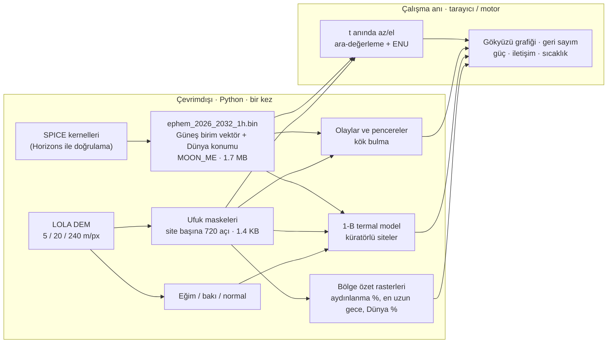

# Zamanda Değişen Verinin Hazırlanması: Efemeris, Gölge ve Termal

- **Kapsam:** Lunar Landing Site Navigator'da zamanla değişen katmanların nasıl üretileceği, saklanacağı ve doğrulanacağı. Katmanlar: Güneş ve Dünya konumu, aydınlanma/gölge, Dünya görünürlüğü, güç, sıcaklık, tutulma.
- **Hazırlanma tarihi:** 14 Kasım 2026
- **Durum:** Araştırma notu ve öneri. Veri formatı ve araç seçimi bir ADR ile kesinleşmeli (`docs/adr/`).
- **Doğrulama:** Bu belgedeki sayıların bir kısmı çalışma sırasında hesaplandı ve **(hesaplandı)** etiketiyle işaretlendi. Kullanılan girdiler:
  - JPL Horizons API (DE441) ve SPICE (DE440) ile çekilen 2027 yılı serileri,
  - Hayne et al. (2017) termal modelinin yeniden yazılmış hali,
  - sentetik bir DEM üzerinde ufuk algoritması testi.

  Literatür değerleri kaynaklarıyla birlikte verildi. Ek A'daki kodların hepsi çalıştırılarak test edildi.

---

## Kısa özet

1. **Ayrıştırma ilkesi.** Zamanla değişen her büyüklük iki parçaya ayrılır:
   - **Yere bağlı ama zamandan bağımsız kısım:** DEM, ufuk maskesi, eğim, albedo.
   - **Zamana bağlı ama yerden neredeyse bağımsız kısım:** Ay-sabit çerçevede Güneş ve Dünya vektörleri.

   Böylece depolama $O(N_{site}\cdot N_t)$ yerine $O(N_{site}+N_t)$ olur.
2. **Efemeris tablosu küçüktür.** 2026–2032 için saatlik Güneş birim vektörü ve Dünya konum vektörü toplam **≈1.7 MB** tutar. 6 saatlik düğümlerle doğrusal ara-değerleme yapılsa bile Güneş yönündeki hata **< 2″** kalır (hesaplandı).
3. **Gölge, ufuk maskesiyle hesaplanır.** Her site için 720 azimutta ufuk yükseklik açısı saklanır (1.4 KB). "Güneş görünüyor mu?" sorusu tek bir karşılaştırmaya iner: $E_\odot(t) > h(A_\odot(t))$. Python'da site başına süre ~0.03 s (hesaplandı).
4. **Kutupta belirleyici olan arazidir.** Arazisiz, pürüzsüz bir Ay'da 89.5°G'de Güneş −2.0° ile +2.0° arasında gezinir ve **144 gün** kesintisiz ufkun altında kalır (hesaplandı). Gerçek sırtlarda ise aydınlanma oranı **%92'ye** çıkar (Gläser et al. 2014).
5. **Kutupta zamanlama hassasiyeti saatlerle ölçülür.** Ufukta 0.057°'lik bir hata (1 km uzaklıkta 1 m yükseklik hatası) gün doğumunu ekvatorda ~7 dakika, kutupta ise **~2–10 saat** kaydırır.
6. **Termal model tarayıcıda çalışabilir.** Hayne et al. (2017) 1-B regolit modeli ~18 katman ve 900 s adımla ekvatorda **385 K / 92 K** verir; bu, Diviner ölçümleriyle uyumludur. Bir yıllık site simülasyonu saniyeler sürer (hesaplandı).
7. **Olaylar örneklemeyle değil, kök bulmayla hesaplanır.** Şubat 2027'de Apollo 11 sahasında Dünya, Güneş'in %34'ünü 2 sa 27 dk boyunca örtüyor. 2 saatlik örneklemede bu olay tek bir noktaya düştü (hesaplandı).

---

## İçindekiler

0. [Notasyon ve sabitler](#0-notasyon-ve-sabitler)
1. [Hangi veri zamanla değişir?](#1-hangi-veri-zamanla-değişir)
2. [Ayrıştırma ilkesi](#2-ayrıştırma-ilkesi)
3. [Zaman ve koordinat sistemleri](#3-zaman-ve-koordinat-sistemleri)
4. [Efemeris üretimi](#4-efemeris-üretimi)
5. [Gölge ve aydınlanma: ufuk maskesi](#5-gölge-ve-aydınlanma-ufuk-maskesi)
6. [Olaylar ve pencereler](#6-olaylar-ve-pencereler)
7. [Güç ve batarya](#7-güç-ve-batarya)
8. [Termal model](#8-termal-model)
9. [Dünya ile doğrudan iletişim (DTE)](#9-dünya-ile-doğrudan-iletişim-dte)
10. [Hata bütçesi ve hassasiyet](#10-hata-bütçesi-ve-hassasiyet)
11. [Önerilen veri hattı](#11-önerilen-veri-hattı)
12. [Hackathon için uygulama sırası](#12-hackathon-için-uygulama-sırası)
13. [Kaynaklar](#13-kaynaklar)
- [Ek A: Test edilmiş kodlar](#ek-a-test-edilmiş-kodlar)

---

## 0. Notasyon ve sabitler

| Sembol | Anlam | Değer |
| --- | --- | --- |
| $R$ | LOLA referans küresi yarıçapı | 1737.4 km |
| $S_0$ | Güneş sabiti (1 AU) | 1361 W m⁻² (Kopp & Lean 2011) |
| $r_\odot$ | Ay'dan görülen Güneş'in açısal yarıçapı | 0.2615°–0.2717° (2027, hesaplandı) |
| $r_\oplus$ | Ay'dan görülen Dünya'nın açısal yarıçapı | 0.899°–1.023° (2027, hesaplandı) |
| $d_\oplus$ | Ay–Dünya merkez uzaklığı | 357 172–406 732 km (2027, hesaplandı) |
| $P_{syn}$ | Sinodik ay (bir Ay günü) | 29.530589 gün |
| $P_{drac}$ | Drakonik ay (enlem librasyonu) | 27.212221 gün |
| $P_{anom}$ | Anomalistik ay (boylam librasyonu, mesafe) | 27.554550 gün |
| $Y_{ecl}$ | Tutulma yılı (kutuptaki "mevsim" periyodu) | 346.62 gün |
| $P_{node}$ | Düğüm presesyonu | 18.61 yıl |
| $\varepsilon_☾$ | Ay ekvatoru ile ekliptik arası açı | 1.543° |
| $\sigma$ | Stefan–Boltzmann sabiti | 5.670374×10⁻⁸ W m⁻² K⁻⁴ |
| $\hat s,\ \hat e$ | Güneş ve Dünya birim vektörleri (topo-merkezli) | |
| $A,\ E$ | Azimut (kuzeyden doğuya), yükseklik açısı | derece |
| $h(A)$ | Ufuk maskesi: $A$ azimutunda arazinin yükseklik açısı | derece |

---

## 1. Hangi veri zamanla değişir?

| Büyüklük | Sürücü | Baskın periyotlar | Gerekli girdi | Üründeki karşılığı |
| --- | --- | --- | --- | --- |
| Güneş az/el | Ay'ın dönüşü, mevsim | 29.53 g, 346.6 g | Efemeris | Gökyüzü grafiği, yerel saat |
| Dünya az/el | Librasyon | 27.21 g (enlem), 27.55 g (boylam) | Efemeris | DTE penceresi |
| Aydınlanma / gölge | Güneş konumu × arazi | 29.53 g, 346.6 g, 18.6 y | Efemeris + ufuk maskesi | Aydınlanma %, en uzun gece |
| Dünya görünürlüğü | Dünya konumu × arazi | 27.21 g, 18.6 y | Efemeris + ufuk maskesi | İletişim %, Earthset geri sayımı |
| Güç | Aydınlanma × panel geometrisi × mesafe | Yukarıdakiler | + panel modeli | W, Wh, batarya doluluk (SOC) |
| Yüzey sıcaklığı | Soğurulan güneş akısının **geçmişi** | 29.53 g, mevsim | + eğim, albedo, termofizik | $T(t)$, min/maks |
| Tutulma | Dünya'nın Güneş'i örtmesi | Yılda 0–3 olay, saatler | Efemeris | Güç düşüşü |
| Ay–Dünya mesafesi | Yörünge eksantrisitesi | 27.55 g | Efemeris | Link bütçesi (±1.13 dB), gecikme 1.19–1.36 s |
| Yer istasyonu (DSN) görünürlüğü | Dünya'nın dönüşü | 1 g | DSN koordinatları, Ay deklinasyonu | Kapsama |

**Uzun dönem istatistik notu:** Kutup aydınlanma istatistikleri (ortalama aydınlanma, kalıcı gölge) tam bir 18.6 yıllık döngü üzerinden hesaplanır. Mazarico et al. (2011) ve Gläser et al. (2014) bu yaklaşımı izler. Tek bir yılın istatistiği yanıltıcı olabilir.

---

## 2. Ayrıştırma ilkesi

Bir $x$ sahasında zamanla değişen herhangi bir büyüklük şöyle yazılabilir:

$$
q(x,t) = \mathcal{G}\big(\Sigma(x),\ \mathcal{E}(t)\big)
$$

- $\Sigma(x)$ **statik tanımlayıcıdır**: ufuk maskesi $h_x(A)$, yüzey normali $\hat n_x$, albedo $A_0(x)$, termofiziksel parametreler ($H$-parametresi vb.).
- $\mathcal{E}(t)$ **küresel efemeristir**: Ay-sabit çerçevede (MOON_ME) $\big(\hat s(t),\ \vec r_\oplus(t),\ r_{AU}(t)\big)$.

**Neden geçerli?** Güneş için paralaks, yani Ay yarıçapı boyunca yön değişimi:

$$
\frac{R}{1\,\text{AU}} = \frac{1737.4}{1.496\times10^8} = 1.16\times10^{-5}\ \text{rad} \approx 2.4''
$$

Bu ihmal edilebilir; $\hat s$ bütün sahalar için aynıdır. Dünya için paralaks $R/d_\oplus \approx 4.5\times10^{-3}$ rad $\approx 0.26°$'dir. Bu ihmal edilemez ama kesin olarak düzeltilebilir:

$$
\vec r_{\oplus,\text{topo}}(x,t) = \vec r_\oplus(t) - \vec r_x
$$

Bu yüzden Dünya'nın **birim vektörü değil, konum vektörü** saklanır. Saha vektörü istemcide çıkarılır.

**Depolama karmaşıklığı.** Örnek: 20 km × 20 km'lik bir bölge 20 m/px çözünürlükte $10^6$ piksel eder. Bir yıl saatlik çözünürlükte, piksel başına 1 bayt aydınlanma değeriyle naif saklama:

$$
10^6 \times 8760 \times 1\ \text{B} \approx 8.8\ \text{GB/yıl}
$$

Ayrıştırılmış saklama:

$$
\underbrace{10^6 \times 720 \times 2\ \text{B}}_{\text{ufuk maskeleri}} + \underbrace{8760 \times 28\ \text{B}}_{\text{efemeris}} \approx 1.44\ \text{GB} + 0.25\ \text{MB}
$$

Bu toplam yıldan bağımsızdır ve her tarih için geçerlidir. Küratörlü siteler için (birkaç düzine) ufuk maskeleri yalnızca kilobaytlar tutar.

**İstisna: sıcaklık.** Sıcaklık geçmişe bağlıdır: $t$ anındaki $T$, geçmiş akı $Q_x(\tau),\ \tau\le t$ tarafından belirlenir. Bu yüzden tablodan okunmaz, hesaplanır: $T_x(t) = \mathcal{T}[Q_x(\cdot)](t)$. Ancak girdisi olan $Q_x$ yine ayrıştırılmış parçalardan gelir (Bölüm 8).

---

## 3. Zaman ve koordinat sistemleri

### 3.1 Zaman ölçekleri

$$
\text{TT} = \text{TAI} + 32.184\ \text{s},\qquad \text{TAI} = \text{UTC} + \Delta AT,\qquad \Delta AT = 37\ \text{s}\ (\text{2017'den beri})
$$

$$
\text{TDB} - \text{TT} \approx 0.001657\sin g + 0.000014\sin 2g\ \ \text{s},\qquad g = 357.53° + 0.98560028°\,(JD_{TT}-2451545.0)
$$

Buna göre $\text{TDB}-\text{UTC} \approx 69.184$ s.

- **SPICE** zamanı ET (=TDB) cinsinden kullanır. `str2et("2027-01-01T00:00:00")` UTC girdisini, yüklenen leapseconds kernel'i (`naif0012.tls`) ile TDB'ye çevirir.
- **Horizons** gözlemci tablolarını varsayılan olarak UT (UTC) cinsinden verir. Belirtilirse TT de verebilir.
- **İhmalin etkisi:** UTC ile TDB karıştırılırsa sonuç 69 s kayar. Bu, Güneş azimutunda $69.184\ \text{s}\times 0.508°/\text{sa} = 0.0098°$ hataya karşılık gelir.
- **Ay saati notu:** Koordineli Ay Zamanı (LTC) üzerine çalışmalar sürüyor. Ay yüzeyindeki saatler Dünya'dakilere göre günde ~56 µs hızlı işler. Bu fark planlama aracı için önemsizdir; arayüzde UTC kullanılmalıdır.

### 3.2 Ay referans çerçeveleri

| Çerçeve | Tanım | Kim kullanır |
| --- | --- | --- |
| `MOON_PA` | Asal eksenler (principal axis), dinamik çerçeve | DE440 binary PCK |
| `MOON_ME` | Ortalama Dünya / kutup ekseni (mean Earth) | LOLA, LROC, haritacılık, **Horizons** |

- **Aradaki fark:** ~0.02886°, yüzeyde ~875 m (`moon_de440_250416.tf` yorumu). Test sahasında (89.5°G, 0°D) ME→PA kayması 663 m çıktı (hesaplandı).
- **Horizons çerçevesi:** Horizons Ay için mean-Earth (DE421) kullanır. Test isteğinin başlığında `Center pole/equ : MEAN_ME (high precision)` satırı görülüyor (hesaplandı).
- **Güncel kernel çifti:** `moon_pa_de440_200625.bpc` + `moon_de440_250416.tf`. Bu FK'deki `MOON_ME`, `MOON_ME_DE440_ME421` için bir takma addır ve DE421 ME çerçevesiyle hizalıdır. Bu yüzden LOLA ürünleriyle tutarlıdır. Daha eski `moon_de440_220930.tf` artık `a_old_versions/` klasöründe.
- **Kural:** DEM ve efemeris **aynı çerçevede** olmalı. Çerçeve olarak `MOON_ME` seçilmeli. Çerçeve karışırsa saha ~0.7–0.9 km kayar; kutupta bu, sırt ile krater içi arasındaki farktır.

### 3.3 Selenografik → kartezyen → yerel ufuk (ENU)

Enlem $\varphi$, doğu boylamı $\lambda$, küreye göre yükseklik $z$:

$$
\vec r_x = (R+z)\begin{bmatrix}\cos\varphi\cos\lambda\\ \cos\varphi\sin\lambda\\ \sin\varphi\end{bmatrix}
$$

$$
\hat e = \begin{bmatrix}-\sin\lambda\\ \cos\lambda\\ 0\end{bmatrix},\quad
\hat n = \begin{bmatrix}-\sin\varphi\cos\lambda\\ -\sin\varphi\sin\lambda\\ \cos\varphi\end{bmatrix},\quad
\hat u = \begin{bmatrix}\cos\varphi\cos\lambda\\ \cos\varphi\sin\lambda\\ \sin\varphi\end{bmatrix}
$$

Hedefe giden topo-merkezli birim vektör $\hat p = (\vec r_{hedef} - \vec r_x)/\lVert\cdot\rVert$ ise:

$$
A = \operatorname{atan2}(\hat p\cdot\hat e,\ \hat p\cdot\hat n) \bmod 360°,\qquad E = \arcsin(\hat p\cdot\hat u)
$$

> **Kutup tuzağı:** Tam $\varphi=-90°$ noktasında $\hat e$ ve $\hat n$ tanımsızdır, çünkü her yön "kuzey"dir. Ya grid-kuzeyi (stereografik $+y$) gibi bir azimut kuralı tanımlanmalı, ya da saha kutuptan birkaç metre kaydırılmalı. Arayüzde bu kural yazılı olmalı.

### 3.4 Güney kutup stereografik izdüşümü (LOLA kutup ürünleri)

$$
x = 2R\tan\!\Big(\frac{\pi}{4}+\frac{\varphi}{2}\Big)\sin\lambda,\qquad
y = 2R\tan\!\Big(\frac{\pi}{4}+\frac{\varphi}{2}\Big)\cos\lambda
$$

$$
\rho=\sqrt{x^2+y^2},\qquad \varphi = 2\arctan\frac{\rho}{2R}-\frac{\pi}{2},\qquad \lambda=\operatorname{atan2}(x,y)
$$

Ölçek faktörü $k = 2/(1-\sin\varphi)$'dır: kutupta $k=1$, 80°G'de $k=1.0076$ (%0.76). Mesafe ve eğim hesaplarında bu faktör düzeltilmelidir. Formüller her ürünün PDS etiketindeki tanımla karşılaştırılarak teyit edilmelidir.

Grid üzerinde yerel kuzey ve doğu yönleri:

$$
\hat n_{grid} = (\sin\lambda,\ \cos\lambda),\qquad \hat e_{grid} = (\cos\lambda,\ -\sin\lambda)
$$

---

## 4. Efemeris üretimi

### 4.1 Üç yol

| Yol | Artı | Eksi | Ne zaman |
| --- | --- | --- | --- |
| **SPICE** (`spiceypy`) | Çevrimdışı, hızlı, sınırsız saha, olay bulucular (`gfoclt` vb.) | Kernel yönetimi (~45 MB) | **Ana yol:** toplu ön hesaplama |
| **JPL Horizons API** | Kurulum yok, referans çıktı | İstek başına bir hedef ve bir saha, ağ bağımlılığı | Doğrulama, hızlı prototip |
| Skyfield / Astropy | Saf Python | Ay çerçevesi kurulumu ek iş | Alternatif |

### 4.2 SPICE tarifi (test edildi)

Yüklenecek kernel'ler:

| Kernel | Görev |
| --- | --- |
| `naif0012.tls` | Artık saniyeler (UTC↔TDB) |
| `pck00011.tpc` | Gezegen sabitleri |
| `de440s.bsp` | Gezegen efemerisi (1849–2150, 32 MB) |
| `moon_pa_de440_200625.bpc` | Ay yönelimi (PA) |
| `moon_de440_250416.tf` | `MOON_ME` / `MOON_PA` çerçeve tanımları |

Topo-merkezli vektör `spkcpo` ile alınır: sabit konumlu gözlemci, `LT+S` düzeltmesi. Kod Ek A.1'de.

**SPICE ile Horizons karşılaştırması (hesaplandı):**

| Hedef | Saha | Zaman (UTC) | SPICE az / el | Horizons az / el |
| --- | --- | --- | --- | --- |
| Güneş | 89.5°G, 0°D | 2027-01-01 00:00 | 263.107140 / 0.953942 | 263.107140 / 0.953942 |
| Dünya | 89.5°G, 0°D | 2027-06-15 12:00 | 5.703098 / −6.428524 | 5.703099 / −6.428524 |
| Güneş | Apollo 11 (0.67°K, 23.47°D) | 2027-06-15 12:00 | 88.513836 / 67.428442 | 88.513836 / 67.428442 |
| Dünya | Apollo 11 | 2027-01-01 00:00 | 288.494574 / 72.823768 | 288.494575 / 72.823768 |

Fark ≤ 10⁻⁶°. İki yol birbirini doğruluyor.

### 4.3 Horizons API (test edildi)

```text
https://ssd.jpl.nasa.gov/api/horizons.api?format=text
  &COMMAND='10'                 # 10 = Güneş, 399 = Dünya
  &CENTER='coord@301'           # 301 = Ay, kullanıcı tanımlı saha
  &COORD_TYPE='GEODETIC'
  &SITE_COORD='0,-89.5,0'       # Doğu boylamı (°), enlem (°), yükseklik (km)
  &EPHEM_TYPE='OBSERVER' &MAKE_EPHEM='YES' &OBJ_DATA='NO'
  &START_TIME='2027-01-01 00:00' &STOP_TIME='2027-12-31 00:00' &STEP_SIZE='2 h'
  &QUANTITIES='4,13,20'         # 4 = görünür Az/El, 13 = açısal çap, 20 = uzaklık
  &CSV_FORMAT='YES'
```

URL tek satırda yazılmalı; boşluklar `%20` olarak kodlanmalı.

- **Atmosfer:** Çıktı başlığında `Atmos refraction: NO (AIRLESS)` yazar. Kırılma uygulanmaz.
- **Arazi:** Yükseklik açısı **küresel ufka** göredir. Horizons arazi kullanmaz; bu yüzden ufuk maskesi bizim işimizdir.
- **Hacim:** Bir yıl 2 saatlik adımla 4369 satır eder ve tek istekle gelir (hesaplandı).

### 4.4 Ne sıklıkla örneklenmeli? (ara-değerleme hatası)

Güneş, Ay-sabit çerçevede $\omega = 2\pi/P_{syn} = 0.508°/\text{sa}$ hızla döner. Horizons verisinde medyan azimut hızı 0.5080°/sa çıktı (hesaplandı).

Birim vektör iki düğüm arasında doğrusal ara-değerlenir ve **yeniden normalize edilirse**, sabit hızlı dönmede yörünge-dışı hata sıfırlanır. Geriye yalnızca $O(\theta^3)$ mertebesinde bir yörünge-boyu hata kalır. Normalize edilmezse $\theta^2/8$ kadar bir sehim hatası oluşur. Burada $\theta=\omega\,\Delta t$'dir.

**Teorik hata (sabit dönme):**

| Düğüm aralığı | Normalize edilmiş | Normalize edilmemiş ($\theta^2/8$) |
| --- | --- | --- |
| 1 sa | 0.002″ | 2.0″ |
| 6 sa | 0.50″ | 73″ |
| 24 sa | 32″ | 1167″ |

**Gerçek veriyle test (hesaplandı).** 2 saatlik Horizons serisi seyreltildi, aradaki örnekler tahmin edildi ve gerçek değerle karşılaştırıldı:

| Hedef | 6 sa düğüm (maks / rms) | 12 sa | 24 sa |
| --- | --- | --- | --- |
| Güneş (kutup ve ekvator) | 1.83″ / 1.28″ | 7.9″ / 5.4″ | 41″ / 29″ |
| Dünya (89.5°G) | 15.3″ / 8.8″ | 69″ / 32″ | 275″ / 121″ |

**Sonuç:** Güneş'in yarıçapı ~960″ olduğundan **1 saatlik düğüm + normalizasyon** her iki cisim için de fazlasıyla yeterlidir. Dünya'da hatanın daha büyük olması, boylam librasyonunun düzgün olmayan hızından ve paralakstan kaynaklanır.

### 4.5 Küçük düzeltmelerin büyüklüğü

| Etki | Güneş | Dünya | Not |
| --- | --- | --- | --- |
| Paralaks (Ay yarıçapı) | 2.4″ | **0.26°** | Dünya için mutlaka topo-merkezli hesap |
| Yıldız aberasyonu ($v/c$, $v\approx30$ km/s) | ~20″ | ~1″ (ortak hareket) | `LT+S` ile bedava |
| Işık zamanı | 499 s | 1.19–1.36 s | `LT+S` içinde |

### 4.6 Depolama önerisi (ADR'ye aday)

```json
{
  "version": 1,
  "frame": "MOON_ME (moon_de440_250416.tf, DE421 ME uyumlu)",
  "time_scale": "UTC",
  "t0": "2026-01-01T00:00:00Z",
  "step_s": 3600,
  "count": 61368,
  "abcorr": "LT+S",
  "fields": [
    { "name": "sun_u",    "dtype": "float32", "shape": [3], "unit": "1",  "origin": "Moon center" },
    { "name": "sun_dist", "dtype": "float32", "shape": [1], "unit": "au" },
    { "name": "earth_r",  "dtype": "float32", "shape": [3], "unit": "km", "origin": "Moon center" }
  ],
  "kernels": ["naif0012.tls", "pck00011.tpc", "de440s.bsp", "moon_pa_de440_200625.bpc", "moon_de440_250416.tf"]
}
```

- **Boyut:** 2026–2032 arası (7 yıl, 61 368 saat) × 7 float32 = **1.72 MB**. gzip ile daha da küçülür.
- **Hassasiyet:** float32, 384 400 km için ~0.03 km çözünürlük verir. Yeterli.
- **Kullanım:** İstemci $t$'yi iki düğüm arasında ara-değerler, normalize eder, Dünya için saha vektörünü çıkarır, ENU'ya döndürür.

---

## 5. Gölge ve aydınlanma: ufuk maskesi

### 5.1 Geometri

Gözlemci $O$ (zemin + direk yüksekliği $h_{m}$) ile arazi noktası $P$ için yükseklik açısı:

$$
\theta_P = \arcsin\frac{(\vec r_P-\vec r_O)\cdot\hat u_O}{\lVert\vec r_P-\vec r_O\rVert}
$$

Küçük açı ve kısa mesafe yaklaşımı, yatay uzaklık $d$ ve yükseklik farkı $\Delta z$ ile:

$$
\theta_P \approx \arctan\frac{\Delta z - d^2/(2R)}{d}
$$

Ufuk maskesi, azimut $A$ boyunca bu açının maksimumudur:

$$
h(A) = \max_{P\,\in\,\text{ışın}(A),\ d\le D_{max}} \theta_P
$$

**Ay eğriliği** ufku Dünya'dakinden çok daha yakına getirir:

| Uzaklık | Eğrilik düşümü $d^2/2R$ |
| --- | --- |
| 10 km | 29 m |
| 50 km | 719 m |
| 100 km | 2 878 m |
| 150 km | 6 475 m |

2 m direk için geometrik ufuk uzaklığı $\sqrt{2Rh}$ = **2.64 km** (Dünya'da 5.05 km). Ufuk dip açısı $\sqrt{2h/R} = 0.087°$ (hesaplandı).

**$D_{max}$ seçimi:** Kutupta Güneş en fazla ~2° yükselir. 100–150 km uzaklıkta birkaç km yüksekliğindeki bir masif hâlâ ~1° ufuk oluşturabilir. Bu yüzden $D_{max}$ = **150–200 km** önerilir.

### 5.2 Algoritma: azimut başına ışın yürütme

1. Her azimut $A_j = j\cdot 0.5°$ ($j=0..719$) için gözlemciden dışa doğru bir ışın çizilir.
2. Adım boyu yakında küçük, uzakta büyük olacak şekilde geometrik büyür: $s_{k+1} = s_k + \max(\Delta_0,\ (\gamma-1)s_k)$, örneğin $\gamma = 1.01$.
3. Her örnekte DEM bilinear okunur, nokta 3-B'ye çevrilir, $\theta_P$ hesaplanır ve maksimum alınır.

**Çok çözünürlüklü DEM:**

| Bölge | Çözünürlük | Kaynak |
| --- | --- | --- |
| 0–5 km | 5 m/px | PGDA saha DEM'leri, Barker et al. 2021 |
| 5–40 km | 20 m/px | LOLA kutup mozaiği |
| 40–200 km | 240 m/px | LOLA kutup mozaiği |

Uzak bölgede seyrek örneklemenin dar zirveleri kaçırmaması için kaba DEM'in **maksimum-filtrelenmiş** (zarf) piramidi kullanılmalı. Bu muhafazakâr bir yaklaşımdır.

**Maliyet:** $N_{az}\times K$ örnek gerekir. $\Delta_0 = 50$ m, $\gamma=1.01$ ve 150 km için $K\approx 440$, yani site başına ~3.2×10⁵ okuma. Numpy ile **~0.03 s** sürer (hesaplandı, Ek A.2).

**Sentetik test (hesaplandı):** 40 km uzakta 3 km yüksekliğinde bir tepe kuruldu.

| Azimut | Algoritma | Beklenen |
| --- | --- | --- |
| Tepe yönü | 3.635° | 3.630° |
| Düz yön | −0.087° | −0.087° (dip açısı) |

Azimut çözünürlüğü 0.5°, Güneş diskinin çapıyla (0.53°) aynı mertebededir. Kutupta Güneş bir azimut kutusunu yaklaşık 1 saatte geçer.

### 5.3 Güneş bir nokta değil, bir disktir

Disk merkezi yüksekliği $E_\odot$, yerel ufuk $h$ ve normalize edilmiş fark $x = \operatorname{clip}\big((E_\odot-h)/r_\odot,\,-1,\,1\big)$ olsun. Ufuk disk genişliği boyunca düz kabul edilirse görünen alan oranı:

$$
F(x) = 1 - \frac{\arccos x - x\sqrt{1-x^2}}{\pi}
$$

**Türetme:** Birim daire, merkezden $x$ uzaklıktaki bir kirişle kesildiğinde kirişin altında kalan parçanın alanı $\arccos x - x\sqrt{1-x^2}$'dir. Görünen oran, toplam alandan bu parçanın çıkarılıp $\pi$'ye bölünmesiyle bulunur. Kontrol: $F(-1)=0$, $F(0)=1/2$, $F(1)=1$.

**Eğimli ufuk için genel hal.** Disk, $\xi\in[-r_\odot, r_\odot]$ dikey şeritlere bölünür. Şerit yarı yüksekliği $c(\xi)=\sqrt{r_\odot^2-\xi^2}$, şeritteki yerel ufuk ise disk merkezine göre $\eta_h(\xi) = h\big(A_\odot + \xi/\cos E_\odot\big) - E_\odot$ olur:

$$
F = \frac{1}{\pi r_\odot^2}\int_{-r_\odot}^{r_\odot}\operatorname{clip}\big(c(\xi)-\eta_h(\xi),\ 0,\ 2c(\xi)\big)\,d\xi
$$

16–32 şerit yeterlidir. Mazarico et al. (2011) de Güneş'i sonlu bir disk olarak modeller (PGDA ürün sayfası).

**Neden önemli?** Kutupta Güneş ufku sıyırarak dolaşır. Nokta kaynak varsayımı, aydınlanma süresinde saatlerce fark yaratır (Bölüm 10).

### 5.4 Dünya görünürlüğü

Aynı formüller topo-merkezli Dünya vektörüyle ve $r_\oplus\approx0.9°–1.02°$ yarıçapla uygulanır. İletişim için bir anten maskesi eklenir:

$$
\text{DTE}(t) = \big[E_\oplus(t) - h(A_\oplus(t)) \ge \epsilon_{min}\big]
$$

$\epsilon_{min}$ tipik olarak 0°–5° arasındadır ve anten tasarımına bağlıdır.

### 5.5 Direk yüksekliği ve sırtların ayrıcalığı

Uzaklık $d$'deki bir engelin açısı, gözlemci $\Delta h$ kadar yükseldiğinde yaklaşık $\Delta\theta\approx-\Delta h/d$ kadar düşer. Yüksek noktalarda ufuk 0°'nin altına iner; Güneş ±2° gezindiği için bu fark belirleyicidir.

Gläser et al. (2014), Shackleton ile de Gerlache arasındaki Connecting Ridge üzerinde şu oranları buldu: zeminden 2 m yükseklikte zamanın **%92.27'si**, 10 m yükseklikte **%95.65'i** güneşli. En uzun karanlık dönemler tipik olarak yalnızca **3–5 gün**.

### 5.6 Bölge haritaları: üç seçenek

| Yöntem | Nasıl | Artı | Eksi |
| --- | --- | --- | --- |
| **(a) Çevrimdışı özet rasterler** | Her piksel için ufuk maskesi ve 18.6 yıl üzerinden istatistik | PGDA 69 ile kıyaslanabilir | Zaman animasyonu yok |
| **(b) GPU ufuk haritalama** (Max 1988) | Ufuk maskeleri doku olarak yüklenir; shader'da `lit = E_sun > h(A_sun)` | Her tarih için anlık, uzak ufku içerir | Bellek: $10^6$ px × 720 × 2 B = 1.44 GB, sıkıştırma gerekir |
| **(c) Oyun motoru gölge haritası** (Cesium/Unreal) | Efemeristen gelen yönlü ışık | Görsel olarak zengin, kurulum kolay | Gölge mesafesi birkaç km; **uzak ufuk gölgesini kaçırır** |

**Öneri:** Yakın alan görseli için (c), "saha aydınlık mı?" sorusunun doğrusu için ufuk maskesi. Uzak alan görünürlüğü motor ışığına çarpan olarak verilebilir.

**Ufuk maskesinin Fourier sıkıştırması:**

$$
h(A) \approx a_0 + \sum_{k=1}^{K}\big(a_k\cos kA + b_k\sin kA\big)
$$

$K=32$ ile 65 katsayı yeter; bu 720 değere göre 11× küçültme demektir. Keskin sırtlarda Gibbs salınımı oluşur; bu durumda kodlama kalıntıyla birlikte yapılmalı ya da $K$ artırılmalı.

### 5.7 Doğrulama kaynakları

- **PGDA ürün 69 (Lunar Polar Illumination):** Ortalama aydınlanma ve Dünya görünürlüğü haritaları. 240 m/px ve 60 m/px; saatlik adım, 18.6 yıl.
- **Gläser et al. 2014:** 20 m/px DTM, 19 yıl, Connecting Ridge değerleri.
- **LROC WAC/NAC görüntüleri:** Belirli bir tarihteki gölge sınırlarıyla görsel karşılaştırma. Mazarico et al. 2011 de bu yolla doğrulama yapmıştır.

---

## 6. Olaylar ve pencereler

### 6.1 Olay fonksiyonları

| Olay | Fonksiyon $g(t)$ | Kök anlamı |
| --- | --- | --- |
| İlk ışık / son ışık | $E_\odot - h(A_\odot) + r_\odot$ | Diskin ilk / son parçası |
| Gün doğumu / batımı (merkez) | $E_\odot - h(A_\odot)$ | Disk merkezi ufukta |
| Tam disk | $E_\odot - h(A_\odot) - r_\odot$ | Diskin tamamı görünür |
| Earthrise / Earthset | $E_\oplus - h(A_\oplus) - \epsilon_{min}$ | DTE başlar / biter |
| Tutulma | $\gamma - (r_\odot + r_\oplus)$, $\gamma=\arccos(\hat s\cdot\hat e)$ | Örtülme başlar / biter |

### 6.2 Kök bulma

1. **Kaba tarama:** $\Delta t_c$ adımıyla işaret değişimi aranır. $\Delta t_c$, beklenen en kısa pencere ve en kısa boşluktan küçük olmalıdır. SPICE GF alt sistemi aynı kuralı kullanır.
2. **İnceltme:** Her işaret değişimi Brent yöntemiyle ~1 s toleransa kadar daraltılır.
3. **Sıyırma (grazing):** Kutupta $g$ sıfıra teğet geçebilir, işaret değiştirmeden. $\lvert g(t_k)\rvert < \max\lvert\dot g\rvert\cdot\Delta t_c$ olan yerel minimumlar altın-oran aramasıyla ayrıca incelenir.

$g$'nin değişim hızı:

$$
\dot g = \dot E_\odot - h'(A_\odot)\,\dot A_\odot
$$

Kutupta $\dot E_\odot$ çok küçüktür, en fazla 0.0055°/sa (89.5°G, hesaplandı). Buna karşılık $\dot A_\odot \approx 0.508°/\text{sa}$. Yani kutupta gün doğumu zamanını **ufuk profilinin eğimi $h'$** belirler. Ekvatorda ise $\dot E_\odot\approx0.51°/\text{sa}$'dir.

### 6.3 Pencere cebri ve metrikler

$$
W_\odot=\{t: g_\odot(t)>0\},\quad W_\oplus=\{t: g_\oplus(t)>0\},\quad W_{ops}=W_\odot\cap W_\oplus\cap W_T
$$

$W_T$, sıcaklığın limitler içinde olduğu aralıkları gösterir.

| Metrik | Tanım |
| --- | --- |
| Aydınlanma oranı | $\lvert W_\odot\cap[t_0,t_1]\rvert/(t_1-t_0)$ |
| En uzun gece | $\max$ boşluk uzunluğu ($[t_0,t_1]\setminus W_\odot$) |
| Gün batımına kalan süre | $\tau(t)=\min\{t_e>t: g_\odot(t_e)=0\}-t$ |
| Ortak pencere | $\lvert W_\odot\cap W_\oplus\rvert$ (hem güç hem iletişim) |

**2027 için arazisiz küre üzerinde örnek sonuçlar (hesaplandı, Horizons 2 sa adım):**

| Saha | Güneş merkezi üstte | Diskin bir kısmı üstte | En uzun Güneş-yok | Dünya üstte | En uzun Dünya-yok | İkisi birlikte |
| --- | --- | --- | --- | --- | --- | --- |
| 89.5°G, 0°D | %52.0 | %57.1 | **143.8 gün** | %49.4 | 13.9 gün | %25.5 |
| Apollo 11 | %48.7 | %48.9 | 14.8 gün | %100 (el 58°–73°) | 0 | %48.7 |

**Okuma:** Arazi olmasaydı kutup ~5 ay karanlık kalırdı. Gerçekte aydınlanma tamamen ufuk maskesine bağlıdır: sırtlar %90'ın üzerinde, krater tabanları %0. Dünya, kutupta drakonik ay boyunca ±6.8° salınır ve ayın yaklaşık yarısında ufkun altındadır.

### 6.4 Tutulmalar (Dünya'nın Güneş'i örtmesi)

İki diskin açısal merkez uzaklığı $\gamma$, yarıçapları $r_1=r_\odot$ ve $r_2=r_\oplus$ ise kesişim (lens) alanı:

$$
\mathcal{A} = r_1^2\arccos\frac{\gamma^2+r_1^2-r_2^2}{2\gamma r_1} + r_2^2\arccos\frac{\gamma^2+r_2^2-r_1^2}{2\gamma r_2} - \frac12\sqrt{(-\gamma+r_1+r_2)(\gamma+r_1-r_2)(\gamma-r_1+r_2)(\gamma+r_1+r_2)}
$$

Örtülme oranı $f_{occ}=\mathcal{A}/(\pi r_\odot^2)$'dir. $\gamma \le r_\oplus - r_\odot$ olduğunda örtülme tamdır; Ay'dan bakınca Dünya, Güneş'ten büyük görünür.

**2027, Apollo 11 sahası (SPICE, 1 dk adım, hesaplandı):**

| Olay | Sonuç |
| --- | --- |
| 20–21 Şubat 2027 | 22:09 – 00:36 UTC (2 sa 27 dk), en fazla **%34.3** örtülme. 2 saatlik Horizons serisi bu olayı yalnızca 00:00 örneğinde yakaladı. |
| 18 Temmuz 2027 | Bu sahada örtülme yok. En küçük ayrım 1.408°. |
| 17 Ağustos 2027 | Bu sahada örtülme yok. En küçük ayrım 1.1730°, eşik ~1.168°; olay **0.005° farkla** kaçıyor. |

**Ders:** Tutulma gibi kısa olaylar seyrek örneklemede ya kaçar ya tek noktaya düşer. Olay listesi `gfoclt` ya da yukarıdaki ince arama ile ayrıca üretilmelidir.

---

## 7. Güç ve batarya

### 7.1 Anlık güç

$$
P(t) = \eta(T_c)\,A_p\,\frac{S_0}{r_{AU}(t)^2}\,F_\odot(t)\,\big[1-f_{occ}(t)\big]\,\max\big(0,\ \hat n_p\cdot\hat s(t)\big)\,(1-L)
$$

- **Uzaklık:** $r_{AU}$ 2027'de 0.9807–1.0190 aralığında (hesaplandı). Akı ±%3.4 oynar.
- **Sıcaklık katsayısı:** $\eta(T_c)=\eta_{ref}\,[1+\beta(T_c-T_{ref})]$. Tipik $\beta$: Si için ≈ −0.4…−0.5 %/K, üç eklemli GaAs için ≈ −0.2…−0.3 %/K. Hücre sıcaklığı Bölüm 8'deki modelle ya da basit bir denge modeliyle tahmin edilebilir.
- **Kayıplar:** $L$ toz, kablo ve MPPT kayıplarını toplar.

### 7.2 Panel yönü, kutupta her şeyi değiştirir

| Panel | $\cos i$ | $E_\odot=1.5°$'de |
| --- | --- | --- |
| Yatay | $\sin E_\odot$ | 0.026 |
| Dikey, sabit, $\alpha$ azimutuna bakan | $\cos E_\odot\,\max(0,\cos(A_\odot-\alpha))$ | 0–1 (gün içinde döner) |
| Dikey, azimutta Güneş takipli | $\cos E_\odot$ | 0.9997 |
| İki eksen takipli | 1 | 1 |

Kutupta dikey takipli panel, yatay panele göre **38 kat** fazla güç üretir (hesaplandı). Kutup inicilerinin dikey panel kullanmasının nedeni budur.

### 7.3 Enerji ve batarya

$$
E_{[t_0,t_1]}=\int_{t_0}^{t_1}P\,dt \approx \sum_k \tfrac12(P_k+P_{k+1})\Delta t
$$

$$
\text{SOC}_{k+1}=\operatorname{clip}\Big(\text{SOC}_k+\frac{\Delta t}{C}\big(\eta_c P_{in,k}-P_{load,k}/\eta_d\big),\ 0,\ 1\Big)
$$

**Gece boyutlandırması:** $C \ge P_{surv}\,T_{dark,max}/(\eta_d\cdot DoD_{max})$.

| Saha | Hesap | Gerekli kapasite |
| --- | --- | --- |
| Kutup sırtı ($T_{dark}$ = 5 gün) | 100 W × 120 sa / (0.95 × 0.8) | **15.8 kWh** |
| Ekvator ($T_{dark}$ = 14.8 gün) | 100 W × 355 sa / (0.95 × 0.8) | **46.7 kWh** |

Örneklerde hayatta kalma yükü $P_{surv}$ = 100 W alınmıştır. Değerler örnek amaçlıdır.

---

## 8. Termal model

### 8.1 Neden 1-B yeterli?

Günlük ısı dalgasının nüfuz derinliği (skin depth):

$$
z_s=\sqrt{\frac{\kappa P_{syn}}{\pi}},\qquad \kappa=\frac{K}{\rho c_p}
$$

Bu derinlik ~4–10 cm'dir (Hayne et al. 2017); bizim ızgarada 2.85 cm çıktı (hesaplandı). Yanal ısı iletimi, piksel boyutu (≥5 m) yanında ihmal edilir. Bu yüzden her piksel ya da site, bağımsız bir 1-B sütun olarak çözülür.

### 8.2 Denklemler (Hayne et al. 2017, Ek A)

$$
\rho c_p\frac{\partial T}{\partial t}=\frac{\partial}{\partial z}\Big(K\frac{\partial T}{\partial z}\Big)
$$

$$
\rho(z)=\rho_d-(\rho_d-\rho_s)\,e^{-z/H},\qquad
K_c=K_d-(K_d-K_s)\frac{\rho_d-\rho}{\rho_d-\rho_s},\qquad
K=K_c\Big[1+\chi\Big(\frac{T}{350}\Big)^3\Big]
$$

$$
c_p(T)=c_0+c_1T+c_2T^2+c_3T^3+c_4T^4
$$

**Üst sınır:** Soğurulan akı ve iletim, kızılötesi yayılımla dengelenir:

$$
K\frac{\partial T}{\partial z}\Big|_{0}+Q_s=\varepsilon\sigma T_s^4,\qquad Q_s=(1-A(\theta))\,F_\odot
$$

**Açıya bağlı albedo:**

$$
A(\theta)=A_0+a\Big(\frac{\theta}{\pi/4}\Big)^3+b\Big(\frac{\theta}{\pi/2}\Big)^8
$$

**Alt sınır:** İç ısı akısı belirler: $\partial T/\partial z\,|_{z^*}=Q/K$.

| Parametre | Değer | Parametre | Değer |
| --- | --- | --- | --- |
| $\rho_s$ | 1100 kg m⁻³ | $K_s$ | 7.4×10⁻⁴ W m⁻¹ K⁻¹ |
| $\rho_d$ | 1800 kg m⁻³ | $K_d$ | 3.4×10⁻³ W m⁻¹ K⁻¹ |
| $H$ | 0.06 m (küresel ort. 0.068 m) | $\chi$ | 2.7 |
| $\varepsilon$ | 0.95 | $A_0,\ a,\ b$ | 0.12, 0.06, 0.25 |
| $c_0..c_4$ | −3.6125, 2.7431, 2.3616×10⁻³, −1.2340×10⁻⁵, 8.9093×10⁻⁹ | $Q$ | 0.018 W m⁻² |

Küresel ortalama termal eylemsizlik 273 K'de ~55 J m⁻² K⁻¹ s⁻½'dir.

### 8.3 Sayısal çözüm

- **Izgara:** $\Delta z_0=z_s/m$, $\Delta z_i=\Delta z_{i-1}(1+1/n)$, $m=10$, $n=5$. Alt sınır ~10 $z_s$ derinlikte; burada günlük dalga $e^{-10}$ ile söner. Toplam 15–20 katman olur; bizim ızgarada 18 katman çıktı.
- **Zaman adımı:** Açık (explicit) fark şeması, Fourier sayısı $<0.5$ kararlılık koşuluyla: $\Delta t_{max}=\min_i\big[\rho c_p/(2(\alpha_i+\beta_i))\big]\sim\Delta z^2$. Bizim ızgarada $\Delta t$ = 900 s.
- **Yüzey sıcaklığı:** Üst sınır denklemi her adımda Newton yöntemiyle çözülür, 3 noktalı gradyanla: $\partial T/\partial z\approx(-3T_0+4T_1-T_2)/(2\Delta z_0)$.
- **Isınma (spin-up):** Yıldan yıla fark $\ll$1 K olana dek döngü sürdürülür. Hayne bu koşul için 5 yıl kullanır. Biz ekvatorda 8 Ay günü, kutupta 2 yıl kullandık.

### 8.4 Girdi akısı: ayrıştırma burada birleşir

Eğimli bir yüzey (normal $\hat n_x$) için:

$$
F_\odot(x,t)=\frac{S_0}{r_{AU}^2}\,F(x,t)\,\big[1-f_{occ}(t)\big]\,\max\big(0,\ \hat n_x\cdot\hat s(t)\big),\qquad \cos\theta=\hat n_x\cdot\hat s
$$

Bu ifadedeki parçaların kaynakları:

- $F(x,t)$, ufuk maskesi ile efemeristen gelir (Bölüm 5.3).
- $\hat n_x$, DEM gradyanından gelir: $\hat n\propto(-\partial_x z,\,-\partial_y z,\,1)$.
- $\hat s(t)$, efemeris tablosundan gelir.

### 8.5 Çalıştırılan senaryolar (hesaplandı)

| Senaryo | $T_{maks}$ | $T_{min}$ | $T_{ort}$ |
| --- | --- | --- | --- |
| Ekvator, düz, analitik akı ($\delta=0$) | **385.2 K** | **92.2 K** | – |
| 89.5°G, düz, arazi yok (Horizons 2027 Güneş serisi) | 117.1 K | 45.4 K | 71.5 K |
| 89.5°G, 20° eğim, kuzeye bakan | 278.5 K | 54.5 K | 117.4 K |
| 89.5°G, 20° eğim, güneye bakan | 274.0 K | 47.0 K | 103.8 K |

**Ekvator doğrulaması:** Diviner gözlemlerinde öğle ~390 K, şafak öncesi ~95 K'dir. Model tutarlı. Dört senaryonun tamamı saf numpy ile ~3 s sürdü.

**Kutup senaryolarının eksikleri:** Bu koşularda arazi gölgesi ve çevreden gelen saçılmış ışık ile kızılötesi ısıtma **yok**. Bu yüzden kutup değerleri yalnızca eğimin etkisini göstermek içindir. Asıl sonuç şudur: aynı noktada 20° eğim, maksimum sıcaklığı ~160 K artırır.

Eşdeğer düz-yüzey denge sıcaklığı bu farkı açıklar:

$$
T_{eq}=\Big[\frac{(1-A)S_0\cos i}{\varepsilon\sigma}\Big]^{1/4}
$$

Bu formülle Güneş tepedeyken 386 K, $\cos i=\sin1.5°$ iken 155 K bulunur.

### 8.6 Kutup için eklenmesi gerekenler

- **Arazi kaynaklı ısıtma.** Kalıcı gölge bölgelerinde (PSR) tek ısı kaynağı çevre arazidir. Görüş faktörü $V_{ij}$ ile:

  $$
  Q_{s,i}=(1-A)\Big[F_{\odot,i}+\sum_j V_{ij}\,A\,F_{\odot,j}\Big]+\varepsilon\sum_j V_{ij}\,\varepsilon\sigma T_j^4
  $$

- **Jeotermal taban.** Hiç ısıtma almayan bir yüzeyin alt sınırı $T=(Q/\varepsilon\sigma)^{1/4}\approx24$ K'dir. Diviner, güney kutbu PSR'lerinde ~35 K (−238 °C) mertebesinde sıcaklıklar ölçmüştür (ikincil kaynak; Paige et al. 2010'dan teyit edilmeli).
- **Mevsimsellik.** Williams et al. (2019): kışın, su buzunu 1 milyar yıl tutabilecek (<110 K) yüzey alanı güneyde 2.8 kat, kuzeyde 4.3 kat artar. Kutupta termal tahmin **mevsim** girdisi olmadan eksik kalır.
- **Doğrulama verisi:** Diviner kutup sıcaklık haritaları (Williams et al. 2019) ve Diviner $H$-parametresi haritası. $H$ haritası ±70° enlem arasını kapsar; kutuplar için sabit $H$=0.06 m kullanılabilir.

---

## 9. Dünya ile doğrudan iletişim (DTE)

$$
\text{DTE}(t)=\underbrace{\big[E_\oplus-h(A_\oplus)\ge\epsilon_{min}\big]}_{\text{Ay tarafı}}\ \wedge\ \underbrace{\bigvee_{g\in\{\text{Goldstone, Madrid, Canberra}\}}\big[E_{☾,g}(t)\ge10°\big]}_{\text{Dünya tarafı}}
$$

Yer istasyonundan görülen Ay yüksekliği, enlem $\varphi_g$, Ay deklinasyonu $\delta_☾$ ve saat açısı $H_☾$ ile:

$$
\sin E_{☾,g}=\sin\varphi_g\sin\delta_☾+\cos\varphi_g\cos\delta_☾\cos H_☾
$$

DSN istasyonları boylamda ~120° aralıklıdır; Ay çoğu zaman en az birinden görünür. $\delta_☾$ 18.6 yıllık döngüde ±18.3° ile ±28.6° arasında salınır, bu da istasyonlar arası kapsamayı değiştirir.

**Mesafenin etkisi.** Serbest uzay kaybı $L_{fs}=20\log_{10}(4\pi d/\lambda)$'dır. 2027'deki mesafe aralığı $20\log_{10}(406\,732/357\,172)$ = **1.13 dB** fark yaratır. Işık gecikmesi 1.19–1.36 s arasındadır (hesaplandı).

---

## 10. Hata bütçesi ve hassasiyet

### 10.1 Açısal hata → zaman hatası

Zaman hatası $\Delta t=\Delta\theta/\lvert\dot g\rvert$ ile bulunur.

- **Ekvator:** $\dot g\approx0.51°/\text{sa}$.
- **Kutup (89.5°G):** $h'=0.05$ (ufuk her 1° azimutta 0.05° yükseliyor) varsayımıyla $\dot g\approx0.03°/\text{sa}$. Düz ufukta ($h'=0$) bu değer ≤0.0055°/sa'e iner ve hatalar ~5 kat büyür.

| Hata kaynağı | Açısal etki | Ekvatorda kayma | Kutupta kayma |
| --- | --- | --- | --- |
| UTC ↔ TDB karıştırma | 0.0098° (azimut) | 69 s (doğrudan) | 69 s (doğrudan) |
| Aberasyon ihmali | ~20″ = 0.0057° | 40 s | ~11 dk |
| DEM yükseklik hatası, 1 m @ 1 km | 0.057° | 6.7 dk | **1.9 sa** (düz ufukta ~10 sa) |
| Güneşi nokta kaynak varsaymak | 0.267° | ±31 dk | **±9 sa** |
| Ara-değerleme (1 sa düğüm, normalize) | <0.01″ | ihmal | ihmal |
| ME / PA çerçeve karışıklığı | 663–875 m konum hatası | Sahaya bağlı | Sahaya bağlı, büyük olabilir (10.2) |

### 10.2 Konum hassasiyeti: "100 metre neden önemli?"

Uzaklık $d$'de, göreli yüksekliği $H_{rel}$ olan bir engel için $\theta\approx H_{rel}/d$ olduğundan:

$$
\Delta\theta\approx\frac{H_{rel}}{d^2}\,\Delta d
$$

**Örnek:** 2 km uzaktaki 500 m'lik bir sırt düşünelim. Saha 100 m kaydırılırsa:

$$
\Delta\theta = \frac{500\times100}{2000^2} = 0.0125\ \text{rad} = 0.72°
$$

Bu değer, 89.5°G'deki günlük Güneş salınımından (±0.5°) büyüktür. Yani sahayı 100 m kaydırmak, bir yönü "hep güneşli"den "hep gölge"ye çevirebilir. Mücadele metnindeki "küçük konum değişiklikleri büyük fark yaratır" vurgusunun matematiksel karşılığı budur.

---

## 11. Önerilen veri hattı



### 11.1 Dosya düzeni ve boyutları (öneri)

| Dosya | İçerik | Boyut |
| --- | --- | --- |
| `data/ephem/manifest.json` + `ephem_2026_2032_1h.bin` | Bölüm 4.6 | 1.7 MB |
| `data/sites/<site_id>/horizon.i16` | 720 × int16, 0.01° birim | 1.4 KB |
| `data/sites/<site_id>/meta.json` | lat, lon, z, normal, albedo, direk yüksekliği, DEM kaynağı | <1 KB |
| `data/sites/<site_id>/events_2026_2032.json` | Gün doğumu/batımı, Earthrise/Earthset, tutulmalar | ~50–200 KB |
| `data/sites/<site_id>/thermal_2027_2h.f32` | Yüzey sıcaklığı serisi | 17.5 KB/yıl |
| `data/regions/<region>/illum_pct.tif` | Bulut-optimize GeoTIFF özet rasterleri | Bölgeye bağlı |

### 11.2 Ekip sözleşmesi

Bu formatlar ön uç, arka uç ve AI rolleri arasında paylaşılan bir sözleşme olacak. Bu yüzden `docs/adr/` altında bir ADR ile kabul edilmeli. Sabitlenmesi gerekenler:

- çerçeve (`MOON_ME`),
- zaman ölçeği (UTC etiket, TDB hesap),
- azimut kuralı (kuzeyden doğuya; kutupta grid-kuzey),
- ufuk maskesi çözünürlüğü (0.5°).

---

## 12. Hackathon için uygulama sırası

| Aşama | İş | Çıktı | Bağımlılık |
| --- | --- | --- | --- |
| 1 | Efemeris tablosu (SPICE) + istemci ara-değerleme | Her saha ve tarih için az/el | – |
| 2 | Küresel ufukla gökyüzü grafiği ve "gün batımına kalan süre" | MVP ekranı | 1 |
| 3 | Küratörlü siteler için ufuk maskesi (5/20/240 m DEM) | Gerçekçi aydınlanma | DEM indirme |
| 4 | Olay bulucu ve pencere metrikleri | Karşılaştırma tablosu | 1, 3 |
| 5 | Güç modeli ve batarya SOC | Enerji grafiği | 4 |
| 6 | 1-B termal model (Web Worker ya da sunucu) | Sıcaklık eğrisi | 3 |
| 7 | Bölge özet rasterleri ve GPU ufuk haritalama | 2-B/3-B harita animasyonu | 3 |

**Kritik yol:** 1 → 3 → 4. Termal (6) ve bölge haritaları (7) sunum için "vay" etkisi yaratır ama MVP'yi bloke etmez.

---

## 13. Kaynaklar

**Aydınlanma ve topografya**
- Mazarico, E., Neumann, G. A., Smith, D. E., Zuber, M. T., Torrence, M. H. (2011). Illumination conditions of the lunar polar regions using LOLA topography. *Icarus* 211, 1066–1081. doi:10.1016/j.icarus.2010.10.030
- Gläser, P. et al. (2014). Illumination conditions at the lunar south pole using high resolution Digital Terrain Models from LOLA. *Icarus* 243, 78–90. [ADS](https://ui.adsabs.harvard.edu/abs/2014Icar..243...78G)
- Barker, M. K. et al. (2021). Improved LOLA elevation maps for south pole landing sites. *Planetary and Space Science* 203, 105119. doi:10.1016/j.pss.2020.105119
- [PGDA ürün 69: Lunar Polar Illumination](https://pgda.gsfc.nasa.gov/products/69) · [PGDA ürün 78: High-Resolution LOLA Topography for Lunar South Pole Sites](https://pgda.gsfc.nasa.gov/products/78) · [PGDA ürün 104: Shape-from-Shading south pole DEMs](https://pgda.gsfc.nasa.gov/products/104)

**Termal**
- Hayne, P. O. et al. (2017). Global regolith thermophysical properties of the Moon from the Diviner Lunar Radiometer Experiment. *JGR Planets* 122, 2371–2400. doi:10.1002/2017JE005387 · [arXiv:1711.00977](https://arxiv.org/abs/1711.00977)
- Williams, J.-P. et al. (2019). Seasonal polar temperatures on the Moon. *JGR Planets* 124, 2505–2521. doi:10.1029/2019JE006028
- Paige, D. A. et al. (2010). Diviner Lunar Radiometer observations of cold traps in the Moon's south polar region. *Science* 330, 479–482.

**Efemeris ve çerçeveler**
- [NAIF generic kernels](https://naif.jpl.nasa.gov/pub/naif/generic_kernels/): `moon_de440_250416.tf` yorum bölümü (ME/PA farkı, takma adlar), `moon_pa_de440_200625.cmt`
- [JPL Horizons manual](https://ssd.jpl.nasa.gov/horizons/manual.html) · [Horizons API](https://ssd-api.jpl.nasa.gov/doc/horizons.html)

**Grafik**
- Max, N. L. (1988). Horizon mapping: shadows for bump-mapped surfaces. *The Visual Computer* 4, 109–117.
- Kopp, G., Lean, J. L. (2011). A new, lower value of total solar irradiance. *GRL* 38, L01706.

> Gläser ve Williams'a ait sayılar yayın özetlerinden ve ikincil kaynaklardan alındı. Sunumda kullanmadan önce makalenin kendisinden teyit edin.

---

## Ek A: Test edilmiş kodlar

Gereken paketler: `pip install spiceypy numpy`. Kernel'ler [NAIF generic_kernels](https://naif.jpl.nasa.gov/pub/naif/generic_kernels/) altından indirilir: `lsk/`, `pck/`, `spk/planets/`, `fk/satellites/`.

### A.1 SPICE ile topo-merkezli Az/El

Horizons ile 10⁻⁶° uyumlu (Bölüm 4.2).

```python
import numpy as np
import spiceypy as sp

for k in ["naif0012.tls", "pck00011.tpc", "de440s.bsp",
          "moon_pa_de440_200625.bpc", "moon_de440_250416.tf"]:
    sp.furnsh(k)

R_MOON = 1737.4  # km, LOLA referans küresi

def site_vector(lat_deg, lon_deg, h_km=0.0):
    lat, lon = np.radians([lat_deg, lon_deg])
    return (R_MOON + h_km) * np.array([np.cos(lat) * np.cos(lon),
                                       np.cos(lat) * np.sin(lon),
                                       np.sin(lat)])

def enu_basis(lat_deg, lon_deg):
    lat, lon = np.radians([lat_deg, lon_deg])
    e = np.array([-np.sin(lon), np.cos(lon), 0.0])
    n = np.array([-np.sin(lat) * np.cos(lon), -np.sin(lat) * np.sin(lon), np.cos(lat)])
    u = np.array([np.cos(lat) * np.cos(lon), np.cos(lat) * np.sin(lon), np.sin(lat)])
    return e, n, u

def az_el(target, utc, lat, lon, h_km=0.0, frame="MOON_ME"):
    r_site = site_vector(lat, lon, h_km)
    e, n, u = enu_basis(lat, lon)
    et = sp.str2et(utc)                       # UTC -> TDB
    state, lt = sp.spkcpo(target, et, frame, "OBSERVER", "LT+S",
                          r_site, "MOON", frame)
    p = state[:3] / np.linalg.norm(state[:3])
    return np.degrees(np.arctan2(p @ e, p @ n)) % 360, np.degrees(np.arcsin(p @ u))

print(az_el("SUN", "2027-01-01T00:00:00", -89.5, 0.0))   # (263.107140, 0.953942)
```

### A.2 Ufuk maskesi

Güney kutup stereografik DEM; sentetik testte 3.635° hesaplandı, 3.630° bekleniyordu.

```python
import numpy as np
R = 1737.4e3  # m

def stereo_to_latlon(x, y):
    rho = np.hypot(x, y)
    return 2 * np.arctan(rho / (2 * R)) - np.pi / 2, np.arctan2(x, y)

def body_fixed(lat, lon, h):
    r = R + h
    return np.stack([r * np.cos(lat) * np.cos(lon),
                     r * np.cos(lat) * np.sin(lon),
                     r * np.sin(lat)], axis=-1)

def bilinear(dem, x0, y0, res, x, y):
    """dem[i, j]: satır i -> y = y0 - i*res, sütun j -> x = x0 + j*res (piksel merkezleri)."""
    fj = (x - x0) / res; fi = (y0 - y) / res
    j = np.clip(np.floor(fj).astype(int), 0, dem.shape[1] - 2)
    i = np.clip(np.floor(fi).astype(int), 0, dem.shape[0] - 2)
    tj = fj - j; ti = fi - i
    return ((1 - ti) * (1 - tj) * dem[i, j] + (1 - ti) * tj * dem[i, j + 1]
            + ti * (1 - tj) * dem[i + 1, j] + ti * tj * dem[i + 1, j + 1])

def horizon_mask(dem, x0, y0, res, xo, yo, h_obs=2.0, n_az=720, d_max=150e3, growth=1.01):
    """Ufuk yükseklik açısı (derece), azimut yerel kuzeyden doğuya."""
    lat_o, lon_o = stereo_to_latlon(xo, yo)
    z_o = bilinear(dem, x0, y0, res, np.array([xo]), np.array([yo]))[0] + h_obs
    r_o = body_fixed(lat_o, lon_o, z_o)
    u = r_o / np.linalg.norm(r_o)
    n_g = np.array([np.sin(lon_o), np.cos(lon_o)])     # yerel kuzey, grid'de
    e_g = np.array([np.cos(lon_o), -np.sin(lon_o)])    # yerel doğu, grid'de
    s = [res / 2]
    while s[-1] < d_max:
        s.append(s[-1] + max(res / 2, s[-1] * (growth - 1)))
    s = np.array(s)
    az = np.arange(n_az) * 2 * np.pi / n_az
    dirs = np.cos(az)[:, None, None] * n_g + np.sin(az)[:, None, None] * e_g
    pts = np.array([xo, yo]) + dirs * s[None, :, None]
    xs, ys = pts[..., 0], pts[..., 1]
    inside = ((xs >= x0) & (xs <= x0 + (dem.shape[1] - 1) * res)
              & (ys <= y0) & (ys >= y0 - (dem.shape[0] - 1) * res))
    z = bilinear(dem, x0, y0, res, xs, ys)
    lat, lon = stereo_to_latlon(xs, ys)
    v = body_fixed(lat, lon, z) - r_o
    el = np.arcsin(np.clip((v @ u) / np.linalg.norm(v, axis=-1), -1, 1))
    return np.degrees(az), np.degrees(np.where(inside, el, -np.pi / 2).max(axis=1))
```

### A.3 Görünen disk oranı

```python
import numpy as np

def disk_fraction(elev_deg, horizon_deg, radius_deg):
    """Düz ufuk varsayımıyla diskin görünen alan oranı (0..1)."""
    x = np.clip((elev_deg - horizon_deg) / radius_deg, -1.0, 1.0)
    return 1.0 - (np.arccos(x) - x * np.sqrt(1.0 - x * x)) / np.pi
```

### A.4 1-B regolit termal modeli

Hayne et al. 2017 Ek A; ekvatorda 385.2 K / 92.2 K verir.

```python
import numpy as np
sig, S0 = 5.670374e-8, 1361.0
eps, A0, a, b = 0.95, 0.12, 0.06, 0.25
rho_s, rho_d, H = 1100.0, 1800.0, 0.06
Ks, Kd, chi, Q = 7.4e-4, 3.4e-3, 2.7, 0.018
C = [-3.6125, 2.7431, 2.3616e-3, -1.2340e-5, 8.9093e-9]
P = 29.53059 * 86400

cp = lambda T: C[0] + C[1]*T + C[2]*T**2 + C[3]*T**3 + C[4]*T**4
albedo = lambda inc: A0 + a*(inc/(np.pi/4))**3 + b*(inc/(np.pi/2))**8

# ızgara: dz0 = zs/m, geometrik büyüme (1 + 1/n), alt sınır 10 zs
zs = np.sqrt(Ks / (rho_s * cp(250.0)) * P / np.pi)
z, dz = [0.0], zs / 10
while z[-1] < 10 * zs:
    z.append(z[-1] + dz); dz *= 1 + 1 / 5
z = np.array(z); dz = np.diff(z)
rho = rho_d - (rho_d - rho_s) * np.exp(-z / H)
Kc = Kd - (Kd - Ks) * (rho_d - rho) / (rho_d - rho_s)
B = Kc * chi / 350.0**3
d3 = dz[1:] * dz[:-1] * (dz[1:] + dz[:-1])
p, q = 2 * dz[1:] / d3, 2 * dz[:-1] / d3

def absorbed_flux(t):            # ekvator, düz yüzey, deklinasyon 0
    cosi = np.cos(2 * np.pi * t / P)
    return 0.0 if cosi <= 0 else (1 - albedo(np.arccos(cosi))) * S0 * cosi

def simulate(flux, t_end, dt_out=1800.0, T0=250.0):
    T = T0 + (T0 / np.sqrt(2) - T0) * (1 - np.exp(-z / H))
    K = Kc + B * T**3
    dt = min(0.9 * np.min(rho[1:-1] * cp(T[1:-1]) / (2 * (p * K[:-2] + q * K[1:-1]))), dt_out)
    nsub = int(np.ceil(dt_out / dt)); dt = dt_out / nsub
    t, out = 0.0, []
    while t < t_end:
        for _ in range(nsub):
            Qs, K = flux(t), Kc + B * T**3
            Ts = T[0]
            for _ in range(20):          # yüzey sınır koşulu, Newton
                g = (-3 * Ts + 4 * T[1] - T[2]) / (2 * dz[0])
                f = eps * sig * Ts**4 - Qs - (Kc[0] + B[0] * Ts**3) * g
                fp = 4 * eps * sig * Ts**3 - 3 * B[0] * Ts**2 * g + 3 / (2 * dz[0]) * (Kc[0] + B[0] * Ts**3)
                step = -f / fp; Ts += step
                if abs(step) < 1e-4:
                    break
            Tn = T.copy(); Tn[0] = Ts
            al, be = p * K[:-2], q * K[1:-1]
            Tn[1:-1] = T[1:-1] + dt / (rho[1:-1] * cp(T[1:-1])) * (al * T[:-2] - (al + be) * T[1:-1] + be * T[2:])
            Tn[-1] = Tn[-2] + Q / K[-2] * dz[-1]   # jeotermal alt sınır
            T, t = Tn, t + dt
        out.append((t, T[0]))
    return np.array(out)

res = simulate(absorbed_flux, 8 * P)
last = res[res[:, 0] > 7 * P, 1]
print(f"Tmax={last.max():.1f} K, Tmin={last.min():.1f} K")   # ~385 K, ~92 K
```

Kutup ya da eğimli yüzey için `absorbed_flux(t)` yerine Bölüm 8.4'teki akı kullanılır: efemeris tablosundan $\hat s(t)$, ufuk maskesinden $F$, yüzey normali ile $\cos\theta$ alınarak.
